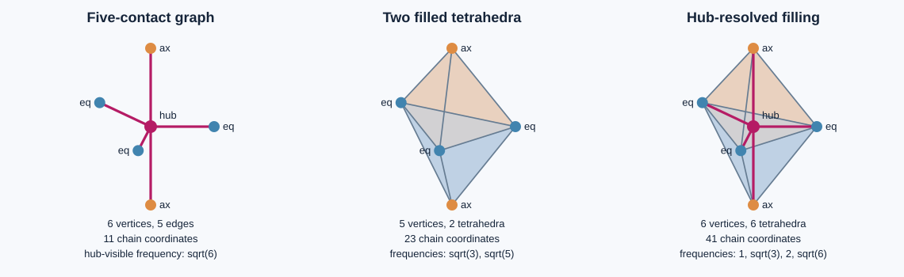

# UD bipyramid bridge exploration v0.1

15 October 2026 UTC. Development — no registry entry. Constructor verification; independent review pending. Physical promotion 0.

**Assessment.** The pictured trigonal bipyramid is a strong candidate for a minimal bridge programme: it gives two geometrically distinct contact classes, a shared tetrahedral interface, identifiable hidden modes, and a small exact test of coarse-graining. Its strongest contribution is to make the required metric and observable explicit. Shape alone does not select the physical interaction law.

The new exact results are (1) a two-coefficient five-contact spectrum, (2) identical hub response for two different carrier complexes, (3) a face port that misses an entire two-cell exchange channel, and (4) a positive, symmetry-compatible metric that preserves the original two-tetrahedron clocks after adding the hub by subdivision.

## 1. What the image shows

The supplied `image(3).png` became locally accessible and was inspected. It depicts one central hub, two axial contacts and three equatorial contacts. No atom identity, bond stiffness, mass, carrier equation or numerical length is specified. The archived `Gap2_FINAL_Finite_Genesis.png` remains unavailable and was not used.

Ideal coordinates for this geometry are

\[
e_j=(R\cos(2\pi j/3),R\sin(2\pi j/3),0),
\quad a_\pm=(0,0,\pm h),\quad o=(0,0,0).
\]

They give equatorial angles 120 degrees, axial separation 180 degrees and axial/equatorial angles 90 degrees. The ratio h/R remains free. The geometric symmetry is D3h, of order 12, with contact orbits 3+2. The abstract unweighted five-spoke graph has the larger accidental leaf-permutation symmetry S5; this does not make all five geometric positions equivalent.

If the envelope is specifically made from two **regular** tetrahedra sharing the equatorial triangle, their common side a satisfies R=a/sqrt(3) and h=a sqrt(2/3). Thus

\[
\boxed{h/R=\sqrt2.}
\]

This is a derived ratio for that additional regular-tetrahedron assumption. A general trigonal-bipyramidal coordination does not impose it. Equal central bond lengths would instead have h/R=1 and nonregular envelope tetrahedra. The drawing therefore does not by itself select sqrt(2), sqrt(10), a mass ratio or a coupling constant.

## 2. Three related carriers, with different dynamics

Label the equatorial vertices 0,1,2, the axial vertices 3,4 and the optional hub 5. For each declared simplicial complex use all simplex chains and the unit-metric skew Hodge–Dirac A=boundary transpose minus boundary.

| Carrier | Definition | f-vector | Chain dimension |
|---|---|---|---:|
| G | The five radial edges (5,i), i=0,...,4 | (6,5,0,0) | 11 |
| K-minus | Filled tetrahedra 0123 and 0124 | (5,9,7,2) | 23 |
| K-hub | Insert 5 in shared face 012, split each original tetrahedron into three | (6,14,15,6) | 41 |

K-hub has six tetrahedra (5,i,j,a) for equatorial edges ij and a=3,4. It fills the same bipyramid and retains the same six outer boundary triangles. The graph drawn in the image is a subcomplex of K-hub; it is not its full chain carrier. Its 11-coordinate subspace leaks out under the full 41-coordinate unit generator: the exact off-subspace coupling rank is 8.

The exact characteristic polynomials are

\[
\begin{aligned}
\chi_G(\lambda)&=\lambda(\lambda^2+1)^4(\lambda^2+6),\\
\chi_{K_-}(\lambda)&=\lambda(\lambda^2+3)^4(\lambda^2+5)^7,\\
\chi_{K_{\rm hub}}(\lambda)&=\lambda(\lambda^2+1)
(\lambda^2+3)^2(\lambda^2+4)^6(\lambda^2+6)^{11}.
\end{aligned}
\]

The K-minus result agrees with attached ledger Q174. K-hub is a subdivision of the same solid but has different unit-weight clocks. Consequently a bridge must state its metric and coarse-graining. Triangulation invariance does not follow from the picture or from boundary nilpotence.

## 3. Two geometric contact classes give a symbolic spectrum

For G alone, give the three equatorial radial incidences rate e and the two axial incidences rate a. The variables are six vertex amplitudes and five edge amplitudes, not nuclear Cartesian displacements. Let D be oriented graph incidence and W=diag(e,e,e,a,a). Then

\[
A(e,a)=\begin{pmatrix}0&-DW\\WD^T&0\end{pmatrix}.
\]

Equatorial differences give two oscillator pairs of frequency |e|. The axial difference gives one pair of frequency |a|. The remaining five-dimensional collective block has one zero mode and two oscillator pairs. Its squared frequencies are

\[
\boxed{\omega_\pm^2=
\frac{4e^2+3a^2\pm\sqrt{16e^4+9a^4}}2.}
\]

Derivation: normalized equal-on-equator and equal-on-axis edge vectors reduce WD^TDW to

\[
\begin{pmatrix}4e^2&\sqrt6ea\\\sqrt6ea&3a^2\end{pmatrix},
\]

whose trace is 4e^2+3a^2 and determinant 6e^2a^2. Thus

\[
\boxed{\chi_{e,a}(\lambda)=
\lambda(\lambda^2+e^2)^2(\lambda^2+a^2)
[\lambda^4+(4e^2+3a^2)\lambda^2+6e^2a^2].}
\]

For e=a the frequency |e| has multiplicity four and the remaining frequency is sqrt(6)|e|. Geometry admits two coefficients; an interaction or material law must determine their values. A length ratio does not determine a rate ratio without such a law.

### Which motions remain hidden from a hub port?

For nonzero e,a with e^2 unequal to a^2, a hub-only input/readout misses the two equatorial-difference pairs and the axial-difference pair: six real dynamic coordinates are dark. The collective sector has dimension five. When e^2=a^2, another difference pair becomes dark, leaving only three hub-visible coordinates and eight dark coordinates.

Orbit-uniform rate changes preserve the difference sectors. Reassigning axial/equatorial sites generally mixes them. For example, start with the equatorial vertex difference e0-e2 and apply the endpoint permutation (0 3)(1 4). The new state is e3-e2. Its initial hub acceleration is a^2-e^2, whereas the original equatorial difference has zero hub acceleration. This is an exact operator diagnostic of mixing, not a derived molecular reaction path.

Chemistry supplies a real comparison class: IUPAC's Berry-pseudorotation definition describes two equatorial bonds exchanging roles with the two axial bonds [1]. The shape therefore offers a concrete contact-reassignment problem. UD would still need the moving-state variables, energy landscape, kinetic coefficients and measurement map. Such a rearrangement is not automatically a Pachner move.

## 4. The decisive observable test: hub-only data are insufficient

For the unweighted spoke graph G and the unweighted filled K-hub, let h be the hub vertex basis vector. Both vertex Laplacians obey

\[
L_0h=6h-\mathbf1.
\]

Thus h has squared projection 1/6 on the constant zero mode and 5/6 on the eigenvalue-6 subspace. The exact hub transfer function in both models is

\[
\boxed{h^T(sI-A)^{-1}h
=\frac1{6s}+\frac56\frac{s}{s^2+6}
=\frac{s^2+1}{s(s^2+6)}.}
\]

The hub response from initial state h is 1/6+(5/6)cos(sqrt(6)t). The hub-visible Krylov dimension is 3 in both carriers, although their total dimensions are 11 and 41. Adding identical hub-only damping or the same linear hub feedback preserves this input/output equivalence. A fitted hub resonance cannot establish the tetrahedral completion. A hub-only bath also leaves 38 dark directions in the filled hub model; the earlier restoration theorem requiring all vertex ports cannot be transferred to that single hub.

A peripheral port begins to discriminate: the axial vertex difference e3-e4 has squared frequency 1 in G and 4 in K-hub. This distinguishes the five-spoke graph from the added outer-edge connectivity.

However **vertex-only input/readout never identifies higher simplices of this Hodge–Dirac model**. Vertex inputs stay in C0 plus exact edge gradients by B1 B2=0; their dynamics depend only on B1. A graph with the same complete one-skeleton can reproduce every such vertex response without any triangular faces or tetrahedra. Testing the higher-cell claim therefore requires a typed face/cell-sensitive port, or an independently derived interaction that couples those sectors to a measured observable.

## 5. The shared face also has a blind channel

In K-minus, use the sorted orientations 0123,0124. The cell block satisfies

\[
q''=-\begin{pmatrix}4&1\\1&4\end{pmatrix}q.
\]

The combinations q_plus=q1+q2 and q_minus=q1-q2 have frequencies sqrt(5) and sqrt(3). The shared face 012 couples to q_plus; q_minus cancels there. The exact full-chain identity is -A^2 e012=5e012.

Thus a shared-face port alone sees the sqrt(5) channel and misses the sqrt(3) cell-difference exchange. These algebraic sum/difference labels refer to the declared simplex orientations; changing an orientation changes their coordinate signs, not the invariant channels.

**A minimal four-coordinate exchange module.** Both cell channels fit in the invariant space C3 plus im B3 within C2, of dimension four. For q in R2 and v=q', the full-chain embedding is c3=q, c2=B3 M^{-1}v, c0=c1=0, where M=[[4,1],[1,4]]. Its closed equations and inherited storage are

\[
\boxed{q'=v,\quad v'=-Mq,\qquad
H_4=\tfrac12(q^Tq+v^TM^{-1}v).}
\]

Boundary nilpotence prevents leakage into edges. Any reciprocal recovery port whose image is vertices plus exact edge gradients is orthogonal to this module. Thus the previous safe-recovery construction preserves these two oscillatory channels. This gives a much smaller carrier on which to develop a typed write/read interface than the 600-cell. A physical actuator and measurement map for q,v are still required; invariance does not create a record or write a state for free.

| Observation contract | What it can establish | What it misses |
|---|---|---|
| Central hub only | One zero component and one sqrt(6) oscillator in the two hub models | Graph versus filled-complex distinction |
| Axial vertex difference | Outer-edge connectivity differs between G and K-hub | Higher faces/cells beyond their one-skeleton |
| Shared face in K-minus | The sqrt(5) interface channel | The sqrt(3) cell-difference channel |
| Face plus cell-difference-sensitive port | Both declared two-cell channels | Physical state/measurement identity still needs derivation |

This makes the bipyramid useful for a bridge: it forces a proposed observable to show what topology it can actually detect.

## 6. An exact coarse-graining metric preserves the original clocks

Let S map old chains into subdivided chains. Old vertices and outer edges stay fixed. The shared triangle 012 becomes the signed sum of its three hub triangles; each old tetrahedron becomes the signed sum of three new tetrahedra. Then boundary_f S=S boundary_old.

For each j in {0,1,2}, collapsing the hub to equatorial vertex j induces a simplicial chain map R_j with R_j S=I. Take their equal average

\[
R=\tfrac13(R_0+R_1+R_2),\quad RS=I,\quad
\Pi=I-SR.
\]

Equal averaging is selected by equatorial permutation symmetry within this declared three-collapse family. It sends the hub to the equatorial barycenter. The coarse-graining rule is explicit and precedes the spectral calculation.

Declare the fine-chain metric

\[
\boxed{H=R^TR+\Pi^T\Pi.}
\]

For every x, x^T Hx=||Rx||^2+||Pi x||^2>0 unless x=0. Also S^T HS=I, and im S is H-orthogonal to ker R. Both are boundary-invariant because S and R are chain maps. Consequently the H-adjoint boundary preserves the same split.

Define

\[
A_H=H^{-1}\,boundary_f^T H-boundary_f.
\]

The exact identities are

\[
\boxed{HA_H+A_H^TH=0,\quad
A_HS=SA_{\rm old},\quad RA_H=A_{\rm old}R.}
\]

Therefore the subdivided 41-coordinate system contains the old 23-coordinate dynamics with exactly the sqrt(3),sqrt(5) clocks and norm receipts. No frequency was fitted into H. The construction uses a declared coarse-graining, its inherited unit metric and a norm on the unresolved complement.

The replay verifies all identities rationally, and checks invariance under all 12 equatorial-permutation/axial-exchange symmetries. It also verifies three trajectories numerically.

This metric is generally non-diagonal. A diagonal fine metric cannot give this exact intertwining while S keeps the old vertex states unchanged: the adjoint boundary of an old leaf vertex necessarily excites its new hub edge under any positive diagonal vertex/edge weights, but S A_old has no such radial-edge output. Cross-metric terms are doing real work here.

The choice is not unique. H_M=R^TR+Pi^T M Pi works for any positive, degree-preserving fine metric M, with corresponding symmetry conditions if desired. A physical source must select or justify that unresolved metric and its implementation. This is a constructive mathematical bridge across refinement, not a claim that the pictured molecule realizes H.

## 7. What to develop next

The most defensible bridge hypothesis is: **a bipyramid can act as a minimal two-cell interface whose geometry, metric and permitted ports determine which exchanges become observable.**

The development order is:

1. Declare what the central hub and each chain grade represent physically: displacement, flux, occupation, phase or another typed quantity.
2. Derive the two orbit-dependent interactions and storage metric from that state and a local action/constitutive law.
3. Specify a readout that distinguishes a filled-cell model from a matched one-skeleton null, including both two-cell exchange channels.
4. Use the explicit S,R construction to test refinement consistency and determine which metric choices are source-selected.
5. Only then compare a frozen response against published spectra or rearrangement data, with masses, units, noise and apparatus included.

A six-atom nonlinear molecule has 3x6-6=12 internal Cartesian vibrational coordinates, or 24 first-order position/momentum coordinates. The 11-coordinate incidence toy has a different state space. An explicit reduction or embedding is required before interpreting its rates as molecular frequencies.

The bipyramid therefore deserves a focused bridge programme, with topology-discriminating observables and a sourced metric as its first gates. The image supplies a useful geometry, not an independently validated identification with matter, gravity or quantum measurement.

## 8. Verification and references

The current suite has 71 exact checks and five numerical corroborations. It reconstructs all three complexes, proves squared-spectrum multiplicities by rational ranks, checks boundary nilpotence, port identities, the four-coordinate module and its storage, subdivision/retraction equations, the weighted metric and 12 symmetry actions. General weighted-star and observability statements are proved above; finite numerical ranks and trajectories are corroborations.

Source [1]: IUPAC, *pseudorotation*, Gold Book entry P04934, DOI **10.1351/goldbook.P04934**, https://goldbook.iupac.org/terms/view/P04934 . The retrieved authoritative search text describes the axial/equatorial exchange; direct page access returned 403. This is a source for the chemical mechanism class, not UD's operator.

Primary historical paper locator: R. Stephen Berry, *Correlation of Rates of Intramolecular Tunneling Processes, with Application to Some Group V Compounds*, Journal of Chemical Physics **32**, 933–938 (1960), DOI **10.1063/1.1730820**. Its full text could not be retrieved in this session, so no quantitative claim here relies on that paper's unread equations.

The user image has no independently supplied provenance beyond the upload. It is retained as a geometric reference, not experimental evidence. Attached ledger Q174 supplies the previously locked two-tetrahedron spectrum; the new constructions remain development work. Physical promotion 0.
