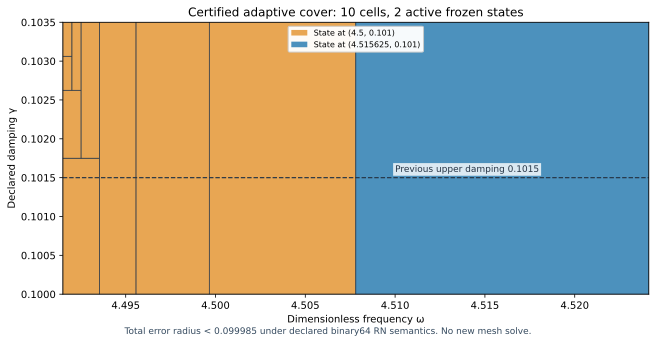

# Adaptive certified J₁ state selection and placement

The adaptive evaluator certifies the full rectangle

\[
\omega\in[4.4915,4.524125],\qquad\gamma\in[0.1,0.1035]
\]

with uniform continuum-plus-evaluation error **<0.099985**, under the declared binary64 RN ties-to-even primitive-operation model. It uses **10 parameter cells, 19 tree nodes, maximum depth9 and two active states**, reusing the four-state frozen bank. No new state solve, flux fit or mesh refinement was performed.

The damping width is7/2000, versus3/2000 previously: exactly7/3 times as wide, a133⅓% increase. Frequency span and absolute target0.1 are unchanged. This is conditional benchmark certification, not a native UD source/action/damping law or physical calibration.

## 1. Certified cell-selection rule

For state \(i\), let \(w_i,g_i\) be its exact center, \(d_i^2\) the flux defect squared, \(\nu_i^2\) the local volume-lift budget and \(m_i=\|v_i\|_{L^2}^2\). Its frozen corrected output family is

\[
J_i(z)=J_i(z_i)-(z-z_i)\int v_i^2\,d\mu,
\quad z=-\omega^2+2i\gamma\omega.
\]

For a positive parameter box \(Q=[w_-,w_+]\times[g_-,g_+]\), define

\[
D_{R,i}=\max\{|w_-^2-w_i^2|,|w_+^2-w_i^2|\},
\]
\[
D_{I,i}=2\max\{|g_-w_--g_iw_i|,|g_+w_+-g_iw_i|\},
\quad D_i=\sqrt{D_{R,i}^2+D_{I,i}^2},
\]
\[
K_Q=\sqrt{1+(w_+/2g_-)^2}.
\]

Positivity makes \(\omega^2\) and \(\gamma\omega\) monotone in the parameters. Therefore \(|z-z_i|\le D_i\) throughout the box, even when real/imaginary component maxima occur at different corners. The inherited continuum Poincaré bound \(C_P\le1/2\) gives the sufficient corrected-output bound

\[
U_i(Q)=K_Q\left(\sqrt{d_i^2}+\sqrt{\nu_i^2}
+\tfrac12D_i\sqrt{m_i}\right)^2+E_i(Q).
\]

Here \(E_i(Q)\) is the uniform error for the **actual new scalar evaluator**, including all coefficient quantization and sixteen primitive operations. Square roots and error bounds are rounded outward by exact integer/rational arithmetic. The bilinear mass \(\int v_i^2\) in the output differs from the Hermitian mass \(m_i\) in the residual bound. This formula applies to arbitrary exact meanfree frozen trials and requires no exact Galerkin solve premise.

Select the state minimizing the computed rational upper \(U_i(Q)\), breaking ties by state ID. Accept a cell only if its selected upper is at most1/10. A failed acceptance test is **UNRESOLVED**; it is not an actual-error lower bound.

## 2. Adaptive subdivision and exact selector

If a cell is unresolved, choose the larger squared parameter-variation score

\[
S_w^2=4(w_+^2+g_+^2)(w_+-w_-)^2,
\qquad S_g^2=4w_+^2(g_+-g_-)^2.
\]

These follow from \(|\partial_\omega z|\le2\sqrt{w_+^2+g_+^2}\) and \(|\partial_\gamma z|\le2w_+\). They define a deterministic placement/subdivision heuristic; no optimality theorem is claimed.

Split the chosen positive binary64 word range at its integer midpoint. Left runtime words end at the cut; right runtime words begin at the next word. The two closed proof boxes share the exact dyadic cut. Thus their union covers the parent's continuous parameter box, while their runtime word rectangles are disjoint and exhaustive. Recursion preserves both properties.

At an accepted leaf, the evaluator selects its frozen owner and passes the unchanged represented inputs into `kernel.trace`. Integer selection adds no output arithmetic. Taking the maximum accepted leaf bound proves the joined guarantee. There is no interpolation or output continuity/differentiability assertion.

The explicit depth18/leaf4096 caps bound the construction. Exhaustion rejects the cover as unresolved. This is a finite **parameter-partition** budget, not a finite element accuracy/termination theorem or a claim that every desired domain can be covered by this bank. Successful coverage here is established by the actual finite tree, not by an asymptotic regularity assumption.

## 3. Actual coverage and validation

| Quantity | Result |
| --- | --- |
| Certified frequency range | [4.4915,4.524125] |
| Certified damping range | [0.1,0.1035] |
| Uniform combined radius | 0.0999840123774598, approximately; exact rational upper retained |
| Maximum uniform evaluator contribution | <9.383×10⁻¹⁶ |
| Accepted cells / tree nodes / depth | 10 /19 /9 |
| Active owners | States at (4.5,0.101) and (4.515625,0.101) |
| Accepted represented input pairs | 9,263,990,586,468,007,557,233,446,268 |
| Supplemental native traces / node comparisons | 1,388 /22,208 |

All four bank members are source/hash/parameter checked. Only the two damping-shifted states are selected in this cover. This is local pruning for the current selector, not a retraction of earlier state records or a global dominance claim.

The uniform bound covers every accepted represented pair analytically; pairs were not enumerated. The tree audit verifies exact proof boxes, dyadic cuts, consecutive word indices, all reachable nodes, disjoint pair counts and recomputed leaf certificates. Supplemental native traces match an integer-only software RN oracle and an independently expanded exact corrected-estimator identity. Constants are exact source-bound rationals with nearest binary64 words. Input parsing, measurement uncertainty and physical Hertz calibration are outside scope.

The source AST matches all sixteen primitive operations and output extraction. Overflow is excluded by propagated magnitudes less than16; underflow is included by the additive2⁻¹⁰⁷⁵ term. The guarantee assumes binary64 RN ties-to-even without FMA/contraction. Native trace controls are constructor checks, not formal verification of every runtime/platform.

Rejection controls detect zeroed certificate bounds, altered cuts, missing words, a cyclic tree, exhausted depth/leaf budgets, out-of-domain values, wrong types and nonfinite inputs. Tie and subnormal RN controls pass. Saved read-only replay exactly reproduces `COVER.json`, `PLACEMENT_RESULTS.json` and `AUDIT_RESULTS.json`. No old capture bytes are changed. Prior state/flux payloads and their saved replay receipts are reused by hashed lineage; they are not regenerated here. The prior neighbor frequency-label correction remains in force.

## 4. Scoped placement witness

On a frozen9×9 rational probe grid in
\([4.4915,4.524125]\times[0.1035,0.11]\), evaluate the particular sufficient model formula

\[
T_i(w,g)=\sqrt{1+(w/2g)^2}
\left(\sqrt{d_i^2}+\sqrt{\nu_i^2}
+\tfrac12|z-z_i|\sqrt{m_i}\right)^2.
\]

Downward square roots give a lower enclosure \(L_i\le T_i\). Rank grid points by \(\min_iL_i\), with exact lexicographic coordinate tie breaks. The selected point is

\[
(w_{\mathrm{next}},g_{\mathrm{next}})=(8983/2000,11/100)=(4.4915,0.11),
\quad \min_iL_i>0.146838>0.1.
\]

Therefore none of the **four declared transported upper formulas with their current frozen norm budgets** can meet target0.1 at that point. Adding nonnegative evaluator error cannot fix that formula failure. This is a lower bound on these sufficient formulas, **not** on the actual transfer error. It does not rule out a tighter flux, different certificate, different state or lower actual error. The recommendation maximizes the certified lower score only on the declared finite probe grid; global optimality is not claimed.

The next state parameters are a **CANDIDATE**. They are outside the new certified rectangle and are not silently accepted by the evaluator. A fresh state solve and its own posterior flux/dual certificate are required before extending coverage there. No forecast of its eventual accuracy is treated as evidence.

## Reproduction, provenance and remaining gates

Run `PYTHONDONTWRITEBYTECODE=1 python3 replay.py` in this directory. It rebuilds the deterministic partition and placement results, compares saved JSON, and repeats the tree/source/oracle/control audit. The manifest binds sources, results, report and Project receipt/proof. PR/CI/merge receipts are recorded separately on GitHub after publication.

Classification: **DERIVED / EXACT CONDITIONAL** for the cover; **CANDIDATE** for next-state placement. Constructor checked; independent review absent; Scientific overall **OPEN**. Development — no registry entry; **physical promotion=0**. Full [0,6]×[0.1,1] coverage, quantitative finite mesh termination and native UD action/source/damping/metric identification remain open. No material/horn or GR/QFT identity follows.

The attached coefficient ledger v0.39 remains a source baseline, not a derivation of these externally declared benchmark dynamics. CRL2 subdivision remains a governance proposal, not enacted by citation. `Gap2_FINAL_Finite_Genesis.png` was unavailable and not read.

**A. CURRENT MISSION TRAJECTORY —** Place further certified states using verified parameter coverage and scoped obstruction diagnostics.

**B. WHAT WAS DONE —** Derived and replayed the adaptive selector/placement rule; certified10 cells using two active states; captured a next-state candidate.

**C. FINDING —** Full frequency span now reaches gamma0.1035 with total radius<0.099985 under declared IEEE RN semantics,7/3 times prior damping width, without a new mesh solve.

**D. UD GAP IMPACT —** Benchmark coverage and planning advance; independent review, full-band closure, finite mesh termination and native bridge remain OPEN. Physical promotion=0.

**NEXT —** Construct and certify the candidate state at (4.4915,0.11), then test overlap with this adaptive cover.
