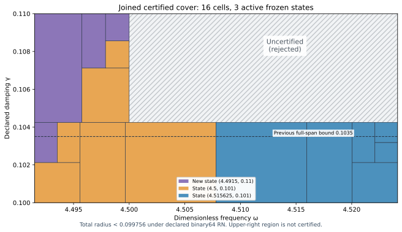

# Certified adaptive left state and joined J₁ cover

The proposed state at exact parameters \((\omega_c,\gamma_c)=(8983/2000,11/100)=(4.4915,0.11)\) now has its own saved P2 state and flux/local-lift continuum upper. The five-state adaptive bank passes on the union below, using three active states:

| Certified component | Frequency | Damping | Uniform total radius, outward rounded |
| --- | --- | --- | --- |
| Full frequency rectangle | [4.4915,4.524125] | [0.1,0.10425] | <0.099756 |
| Left extension | [4.4915,4.5] | [0.10425,0.11] | <0.094712 |

The joined continuum-plus-actual-evaluator radius is **<0.099756** under the declared primitive binary64 RN ties-to-even model. The two components share the exact rational boundary gamma417/4000. The upper-right region with omega>4.5 and gamma>0.10425 remains **uncertified and is rejected**. This is not a full-frequency guarantee through gamma0.11.

Certified parameter area grows from1827/16000000 to6001/32000000: ratio6001/3654, approximately1.6423098, a **64.23% increase**. Full-span damping width increases by17/14; the left band reaches gamma0.11. All previously certified inputs remain covered.

## Actual state and pointwise certificate

The new actual two-word state uses the unchanged meanfree conforming P2 space:12,288 tetrahedra and18,673 degrees of freedom including boundary nodes. The exact source remainsF=10(x+y), with source L² norm squared20; topology, metric and normalized measure are unchanged. State generation uses floating sparse solves and one exact-residual correction proposal; posterior exact arithmetic checks the saved words and exact mean removal.

Corrected J is approximately **-4.814748637477264 -1.2471639167272743i**. The corrected finite-Galerkin algebraic output budget is <1.083×10⁻¹³, passing the10⁻¹⁰ algebraic target. This algebraic result alone is not a continuum certificate.

The new projected-source RT1/root/patch flux has divergence \(z_c\Pi_1v-F\); the global affine-curl correction is reconstructed exactly. A nonzero cell-meanfree volume residual is included through the rigorous local Poincaré lift. Exact defect squared is approximately0.0005416487420784246. The direct actual reported-J continuum radius is **<0.011916**. The distinct phase proxy has its own radius<0.006380 and must not be confused with reported J.

Final checks include98,304 affine-divergence conditions,152,064 normal-trace conditions, projected-source volume budgets, global gradient orthogonality, exact curl norm decrease and direct degree-three full-P2-gradient cross moments matching projected-mass identities. Flux/witness/results parameters equal the bound state parameters. Corruption, incompatible divergence, boundary trace and wrong-mass controls pass. The saved state/flux read-only replay reproduces all exact result files without regenerating coefficients.

Both center parameters have nonzero binary64 quantization error. The state parameter labels are exact rationals. A runtime float denotes its exact represented value; neither the nearest frequency word nor the nearest damping word is silently identified with the rational center. The generic evaluator includes both quantization errors, as well as all other frozen constant and operation errors.

## Adaptive cover and native evaluator

The prior verified rectangle rule is reused with a fifth source-bound state. For each frozen trial \(v_i\), the exact corrected family is

\[
J_i(z)=J_i(z_i)-(z-z_i)\int v_i^2\,d\mu,
\quad z=-\omega^2+2i\gamma\omega.
\]

For a positive parameter boxQ, the sufficient upper is

\[
U_i(Q)=K_Q\left(\sqrt{d_i^2}+\sqrt{\nu_i^2}
+\tfrac12D_i(Q)\|v_i\|_{L^2}\right)^2+E_i(Q),
\quad K_Q=\sqrt{1+(w_+/2g_-)^2}.
\]

Real and imaginary parameter components are bounded by their endpoint absolute maxima; their squared sum bounds \(|z-z_i|^2\). The output uses bilinear mass, while the residual perturbation uses the Hermitian L² norm. This applies to arbitrary exact meanfree frozen trials, not only exact Galerkin solves. The inherited convex-domain Poincaré bound isCP≤1/2.

The planner chooses the minimum rational upper among states, accepts only a passing cell, and otherwise splits the parameter axis with the larger derivative-based variation score. Closed proof boxes share dyadic cuts; represented word boxes partition into consecutive disjoint ranges. The full component has11 leaves/depth6, and the extension has5 leaves/depth4. The explicit depth/leaf budgets can reject unresolved domains; parameter partition termination is not finite element accuracy termination.

The runtime first applies the exact union guard. At gamma≤417/4000 it selects the full component; above that value it requires omega≤9/2 and selects the extension. Since417/4000 is non-dyadic, the final accepted gamma word of the full component and the first accepted gamma word of the extension are consecutive. The scalar selector delegates unchanged inputs to the chosen leaf's sixteen-operation kernel. It adds no output arithmetic, interpolation or continuity assertion.

The proof analytically covers **15,214,342,503,939,621,642,107,912,609 accepted represented pairs**; it does not enumerate them. Supplemental2,211 native/software traces compare35,376 intermediate nodes, with exact closed-estimator identities and actual/component-selector agreement. Shared-boundary and upper-right rejection checks pass. Maximum uniform evaluator contribution is<4.147×10⁻¹⁵. All seven constant quantizations, per-operation rounding, additive2⁻¹⁰⁷⁵ underflow and magnitude<16 overflow exclusion are included. Source AST and frozen coefficients match the declared operation family.

The semantics remain conditional on primitive binary64 round-to-nearest ties-to-even without FMA/contraction. Constructor native controls do not formally verify every runtime/platform. No decimal parsing, measurement uncertainty or physical Hertz calibration is claimed.

## Placement result and remaining region

At the old recommended point(4.4915,0.11), the old four declared transported-upper formulas with their frozen norm budgets still have minimum value>0.146838. The new state's own formula and pointwise flux certificate pass there. The old formula obstruction retains its original scope; it was never an actual-error lower bound.

A frozen9×9 probe grid samples the remaining upper-right rectangle. Already certified boundary points are excluded. The64 remaining grid probes recommend the next candidate

\[
(\omega,\gamma)=(36193/8000,11/100)=(4.524125,0.11).
\]

All five current particular transported-upper formulas have minimum value>0.144083 there. This lower is on these **sufficient upper formulas with fixed norm budgets**, not on actual transfer error. It does not rule out tighter fluxes, alternate certificates or lower actual error. The ranking is only over the declared finite grid, not a global placement optimum. The candidate remains outside the certified union and must receive its own state/flux audit. A new solve at that point is not presumed to close the entire upper-right gap.

## Reproduction and governance

`PYTHONDONTWRITEBYTECODE=1 python3 replay.py` runs the saved candidate state/flux replay and the scalar adaptive replay. This capture ran `candidate/replay.py` and `replay.py --scalar-only` separately; receipts record the actual component commands. The scalar replay rebuilds both covers and placement results and compares all saved JSON. Earlier state/flux sources and their prior replay evidence are reused by hash. No earlier capture bytes are changed. Manifest/event and Project receipt/proof are included; GitHub publication/CI/merge receipts are posted separately after completion.

Classification: **DERIVED / EXACT CONDITIONAL** for the new state/cover, **CANDIDATE** for the next proposed state. Constructor checked; independent review absent; Scientific overall **OPEN**. Development — no registry entry; **physical promotion=0**. Full [0,6]×[0.1,1] precision, quantitative finite mesh termination and native UD action/source/damping/metric identification remain open. No material/horn or GR/QFT identity follows.

The attached coefficient ledger v0.39 is the source baseline, not a derivation of the benchmark parameters. CRL2 subdivision remains a governance proposal, not enacted by citation. `Gap2_FINAL_Finite_Genesis.png` was unavailable and not read.

**A. CURRENT MISSION TRAJECTORY —** Grow the certified parameter cover using actual adaptively placed states.

**B. WHAT WAS DONE —** Constructed and audited the left state and its own flux; added it to the bank; verified two joined adaptive covers and their native evaluator.

**C. FINDING —** Full span reaches gamma0.10425; left band reaches0.11. Total radius<0.099756 under declared IEEE RN; certified area increases64.23%.

**D. UD GAP IMPACT —** Benchmark coverage advances. Independent review, full-band closure, finite mesh termination and native bridge remain OPEN. Physical promotion=0.

**NEXT —** Construct and certify the recommended right-side state(4.524125,0.11), then test the remaining gap.
