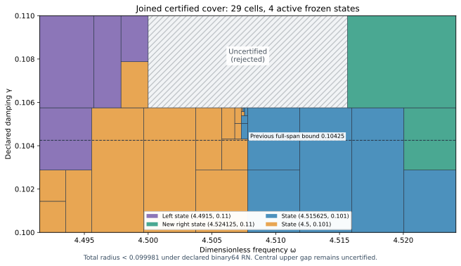

# Certified right J₁ state and three-component parameter cover

The actual state at exact (ωc,γc)=(36193/8000,11/100)=(4.524125,0.11) now has its own projected-source RT1/curl/local-lift continuum upper certificate. The frozen bank contains six actual saved states. Its adaptive evaluator passes on the three-component union below, preserving the previous union.

| Certified component | Dimensionless frequency | Declared damping | Uniform total radius, outward rounded |
| --- | --- | --- | --- |
| Full frequency rectangle | [4.4915,4.524125] | [0.1,0.10575] | <0.099981 |
| Left extension | [4.4915,4.5] | [0.10575,0.11] | <0.097164 |
| Right extension | [4.515625,4.524125] | [0.10575,0.11] | <0.098860 |

The joined continuum-plus-evaluator radius is **<0.099981**, conditional on declared primitive binary64 round-to-nearest ties-to-even semantics. For γ>0.10575, the interval 4.5<ω<4.515625 remains **uncertified and rejected**. This is not a full-frequency guarantee through γ0.11.

Certified parameter area is 1663/6400000, versus 6001/32000000 previously: ratio 8315/6001, approximately 1.385602400, an increase of **38.56%**. Area measures certified parameter rectangles, not accuracy or physical performance.

## Actual new state and own flux

The source, meanfree space, metric and normalized measure remain unchanged: F=10(x+y), source L² norm squared20,12,288 tetrahedra and18,673 conforming P2 degrees of freedom, including boundary nodes. Floating sparse factorization and one exact-residual correction propose four saved binary64 coefficient arrays. Posterior rational arithmetic audits their exact two-word sum and exact mean subtraction. Corrected J≈**-4.50555763760367-1.09152912621447i**. Its finite-Galerkin corrected algebraic output budget is 3.84809e-13, below10⁻¹⁰. That algebraic check alone is not a continuum upper.

The new flux is reconstructed for this state at its own exact parameters. It satisfies divτ=zc Π1v−F, homogeneous normal trace and an affine curl correction. The nonzero cell-meanfree volume residual zc(Π1v−v) is included via the rigorous local Poincaré lift. Defect squared is approximately0.0004709597450738319; the direct actual reported-J continuum radius is 0.01044680689861577. The distinct phase proxy radius is 0.005598628534080982; its center is a different output and is not substituted for reported J.

Final exact checks include98,304 affine-divergence and152,064 normal-trace constraints, cellwise volume budgets, global gradient orthogonality, curl norm decrease and direct full-P2 gradient cross moments. Projected-mass identities remain separate from full-P2 output mass. State, flux and result parameters agree and bind the exact state/payload hashes. Structural corruption, wrong-mass and nonfinite/truncated coefficient controls reject their mutants. The saved state/flux read-only replay reproduces the result JSON without regenerating coefficients.

Both center parameters are nonbinary rationals. The runtime nearest words are not identified with their exact rational centers. The evaluator includes frequency and damping center quantizations, the other frozen constant errors and all operation errors. No decimal parser or measurement uncertainty is covered.

## Continuum and evaluator certificate

For each exact meanfree frozen trial vi, the corrected family is Ji(z)=Ji(zi)−(z−zi)∫vi²dμ. The exact arbitrary-trial identity H−Ji=ri(Az⁻¹ri) does not assume exact Galerkin coefficients. With convex-domain CP≤1/2, the sufficient box upper is

\[
U_i(Q)=\sqrt{1+(w_+/(2g_-))^2}
\left(\sqrt{d_i^2}+\sqrt{\nu_i^2}+
\tfrac12D_i(Q)\|v_i\|_{L^2}\right)^2+E_i(Q).
\]

Here D bounds |z−zi| from endpoint real and imaginary component extrema; E is the uniform evaluator contribution. Bilinear ∫vi² is used in output correction, while the residual transport uses the Hermitian L² norm. The volume-lift budget is an implicit dual lift, not an explicit full-source flux. Payne–Weinberger supplies a lower bound on the continuum gap; λ*=4 is not asserted equal to λ1.

The deterministic planner chooses the least rational certified upper among **six** states, with lexicographic ties. A cell is accepted only when its upper≤0.1. Otherwise it splits the axis with the larger derivative-based variation score at the integer midpoint of represented positive binary64 words. Closed proof boxes share exact dyadic cuts; runtime word boxes are disjoint consecutive partitions. Budgets remain depth18 and4096 leaves; unresolved cells fail. Parameter-partition termination does not establish finite element accuracy termination.

The three components use leaf counts[24, 4, 1] and depths[13, 3, 0]; active owners are adaptive_left, adaptive_right, shifted_neighbor, shifted_original. The actual selector uses the full rectangle at exact represented γ≤423/4000; above it, it selects the left strip at ω≤9/2, the right strip at ω≥289/64, and rejects the central gap. The shared non-dyadic γ boundary lies strictly between consecutive accepted words. Root bounds, recursive splits, all leaves, pair counts and exact ownership-domain guards are checked. The selector adds no output arithmetic or interpolation.

The proof covers **21,081,029,481,796,043,240,850,498,644 accepted represented parameter pairs** analytically. Supplemental 3,993 native/software traces compare 63,888 intermediate nodes, independently check the closed estimator and agree with component/global selectors. 27 seam controls pass. Maximum uniform floating contribution is 4.1501837e-15. All seven frozen constant quantizations, sixteen primitive operations, additive2⁻¹⁰⁷⁵ underflow and magnitude<16 overflow exclusion are included. The AST binds the actual output kernel to the audited operation family; corruption, budget exhaustion, domain/type/nonfinite and software ties-to-even controls pass. Constructor controls do not formally certify every platform or FMA/contraction mode.

## Goal diagnostic and remaining region

PARAMETER_FREEZE.json preserves the original provisional full-span ceilingγ0.106. GOAL_DIAGNOSTIC.json records the exact six-formula obstruction there and the smaller certified ceiling. This obstruction is a lower on the declared sufficient upper expressions with fixed norm budgets, **not an actual-error lower or a no-go theorem**. No state or source was retuned. The inherited contract's stale phrase “four states” is corrected to six in this new capture's owner_rule; the actual previous five-state code already minimized over its whole bank, and all old bytes remain unchanged.

A frozen9×9 grid probes only the remaining central upper rectangle and excludes the accepted boundary points. Its 56 points recommend the next candidate **(ω,γ)=(577/128,11/100)≈(4.507812500,0.110000000)**. The minimum of the six particular transported-upper formulas is >0.131134 there. This ranks only the declared finite grid; it is not a global placement optimum, an actual-error lower, or a prediction that a new state closes the whole gap. The next candidate requires its own actual solve and flux/dual upper.

## Reproduction and governance

`PYTHONDONTWRITEBYTECODE=1 python3 replay.py` composes saved state/flux and scalar replays. This turn ran `candidate/replay.py` and `replay.py --scalar-only` separately; REPLAY_RECEIPTS.json records the actual commands and log hashes. SCALAR_INITIAL.log preserves a bootstrap import-order failure; SCALAR_CONTROLS_INITIAL.log preserves a negative-control failure when the new right cover required only one leaf. The composing wrapper now builds covers before importing the evaluator; a single-leaf component uses a root-bound corruption control in place of a nonexistent split-word control. The corrected scalar audit passes. The scalar replay rebuilds all three covers, the goal diagnostic and placement results, compares saved JSON, then reruns the exact/native/control audit. Old state/flux sources and their prior replay evidence are reused by hash. No old capture bytes are changed.

Classification **DERIVED / EXACT CONDITIONAL** for state/union, **CANDIDATE** for next placement. Constructor checked; independent review absent; Scientific overall **OPEN**; Development—no registry entry; **physical promotion=0**. Full[0,6]×[0.1,1] precision, quantitative finite mesh termination and native UD action/source/damping/metric identification remain open. This external scalar-wave benchmark establishes no horn/material, GR/QFT or empirical identity.

Attached ledgerv0.39 is source data, not a derivation of benchmark dynamics. CRL2 remains a proposal, not enacted by citation. Gap2_FINAL_Finite_Genesis.png was unavailable and not read. Manifest/event inventory all new evidence, including Project gate readback and screenshot; GitHub publication/CI/merge receipts are posted after completion.

**A. CURRENT MISSION TRAJECTORY —** Extend certified parameter coverage through actual adaptively placed states.

**B. WHAT WAS DONE —** Built and audited the right state and own flux; verified a six-state, three-component adaptive evaluator and saved replays.

**C. FINDING —** Full span reachesγ0.10575; left and right strips reach0.11. Radius<0.099981; certified area+38.56%.

**D. UD GAP IMPACT —** Central upper gap, independent review, full-band closure, finite mesh termination and native bridge remain OPEN. Physical promotion=0.

**NEXT —** Construct and certify the central candidate(577/128,11/100) and test the remaining gap.
