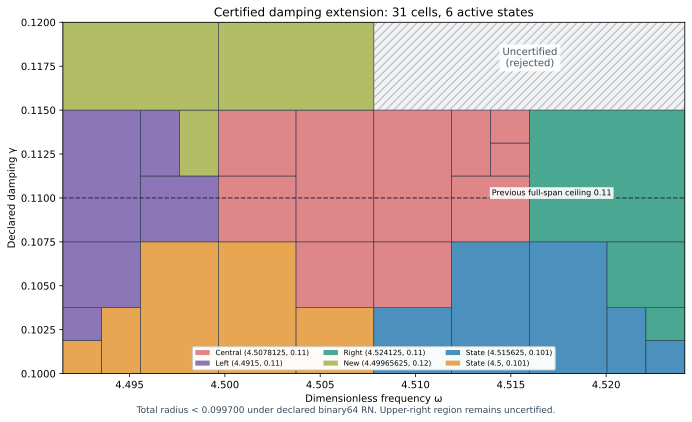

# Certified wider-damping J₁ state and joined extension

The actual state at exact(ωc,γc)=(143989/32000,3/25)=(4.49965625,0.12) now has its own projected-source RT1/curl/local-lift continuum upper. Added to the prior seven-state bank, it supports the two-component certified union below.

| Component | Dimensionless frequencyω | Declared dampingγ | Total radius, outward rounded |
| --- | --- | --- | --- |
| Full span | [4.4915,4.524125] | [0.1,0.115] | <0.099700 |
| Left extension | [4.4915,4.5078125] | [0.115,0.12] | <0.099666 |

The uniform continuum-plus-actual-evaluator radius is **<0.099700**, conditional on primitive binary64 RN ties-to-even. The prior complete rectangle throughγ0.11 is preserved. Atγ>0.115 onlyω≤4.5078125 is accepted; the upper-right region is **uncertified and rejected**. This is not a full-spanγ0.12 guarantee.

Certified parameter area is1827/3200000, versus261/800000 previously: ratio**7/4**, a **75% increase**. Full-span damping width grows by3/2; the additional half-frequency strip gives another quarter of the prior area. Area measures coverage, not physical performance or error tightness.

## Actual state and own continuum certificate

The sourceF=10(x+y), normalized source L² norm squared20, meanfree conforming P2 space, normalized measure and gradient/flux metric remain unchanged. The mesh has12,288 tetrahedra and18,673 P2 degrees of freedom, including boundary nodes. Exact source comparison checks that only the two parameter literals changed. Floating sparse factorization plus one exact-residual correction proposes saved two-word coefficients; posterior rational arithmetic audits their exact sum and exact mean subtraction.

Corrected J≈**-4.67988262332003-1.29989727594159i**. Its finite-Galerkin corrected algebraic output budget is3.48857e-13, below10⁻¹⁰. That algebraic check alone is not a continuum upper.

The new RT1/root/patch flux satisfiesdivτ=zcΠ1v−F, homogeneous normal trace and an exact-reconstructed affine-curl correction. The nonzero cell-meanfree volume residualzc(Π1v−v) is included by a rigorous local Poincaré dual lift. Defect squared≈0.0005166942724973963. Direct actual reported-J continuum radius=0.01044348670633259; the distinct phase-proxy radius=0.005592963039693893. Those outputs have different centers and are not interchanged.

Checks include98,304 affine-divergence and152,064 normal-trace constraints, exact projection/lift budgets, global gradient orthogonality, curl norm decrease and direct full-P2-gradient cross moments. Flux cross identities use projected mass; output correction uses full-P2 bilinear mass. State/flux/result parameters and state/payload hashes agree. Wrong-mass, incompatible divergence, boundary-trace, truncated and nonfinite controls reject their mutants. Saved read-only state/flux replay reproduces the exact result JSON without regenerating coefficient proposals.

Both center parameters are nonbinary rationals. Their nearest binary64 words are not identified with the exact state centers. Both center quantization errors, every other frozen constant error and all operation errors are included. A runtime input denotes its exact represented value. Decimal parser uncertainty, measurement error and SI/Hertz calibration are outside scope.

## Exact continuum and evaluator bounds

For an arbitrary exact meanfree frozen trialvi, Ji(z)=Ji(zi)−(z−zi)∫vi²dμ andH−Ji=ri(Az⁻¹ri), withz=−ω²+2iγω. This avoids an exact-Galerkin assumption. Convex-domainCP≤1/2 yields the positive-box sufficient upper

\[
U_i(Q)=\sqrt{1+(w_+/(2g_-))^2}
\left(\sqrt{d_i^2}+\sqrt{\nu_i^2}+
\tfrac12D_i(Q)\|v_i\|_{L^2}\right)^2+E_i(Q).
\]

D bounds|z−zi| from endpoint real/imaginary extrema;E uniformly bounds the actual evaluator. Bilinear mass appears in output correction, Hermitian mass in residual transport. The cell lift is a dual existence bound, not an explicit full-source polynomial flux. The continuum gapλ*=4 is a lower bound, not equality withλ1. Earlier continuum/flux premises remain source-bound; citation does not turn inherited conditional premises into independent verification.

The deterministic planner minimizes the exact rational upper over eight states with lexicographic ties. It accepts onlyupper≤0.1; otherwise it splits the axis with larger derivative-based variation score at the integer midpoint of positive binary64 words. Closed proof boxes share dyadic cuts; represented word boxes partition disjointly. Frozen budgets remain depth18 and4096 leaves; exhaustion rejects unresolved regions. Parameter partition termination is distinct from finite element accuracy termination.

The components have leaf counts[29, 2] and depths[7, 1]; active owners:adaptive_central, adaptive_left, adaptive_right, damping_left, shifted_neighbor, shifted_original. Exact roots, source hashes, every split/leaf certificate and all pair counts are checked. At representedγ≤23/200 the runtime selects the full component; above it, it requiresω≤577/128 and selects the left extension. Since23/200 is nonbinary, the full component's lastγ word and extension's firstγ word are consecutive. This adds no output arithmetic, interpolation or continuity claim.

The new analytic accepted-pair count is**46,319,952,932,340,181,197,667,865,419**. It equals the previous count plus13,234,272,266,382,867,938,904,923,240 full-span damping pairs and6,617,136,133,191,614,113,437,556,440 left-extension pairs exactly. Supplemental4,290 native/software traces compare68,640 intermediate nodes and check the independent closed estimator identity. All174 internal-seam and15 component-seam controls pass, including upper-right rejection. Maximum uniform floating contribution=4.1523356e-15. AST/source, corruption, budget, type/domain/nonfinite and software ties-to-even controls pass.

The evaluator proof includes seven frozen constant quantizations, sixteen primitive RN operations, additive2⁻¹⁰⁷⁵ underflow and magnitude<16 overflow exclusion. Constructor native controls do not formally verify every platform or FMA/contraction mode.

## Next candidate and reproduction

PREGEN_PREFLIGHT.json records the earlier81-point exploratory grid on the seven-state bank, with approximate presentations only. It guided provisional goals and is not a uniform certificate; the record was written after generation started and is not presented as a prospective file freeze. The selected state remains the previous frozen9×9 recommendation.

The old seven particular transported-upper formulas remain>0.137347 at the new state's center, while the new state's own upper passes. This scoped obstruction concerned sufficient formulas with fixed norm budgets, never actual error or all possible certificates.

A frozen9×9 grid probes the remaining upper-right rectangle, excluding accepted boundaries. Its64 points recommend **(ω,γ)=(144511/32000,3/25)≈(4.515968750,0.120000000)**. The minimum of eight downward-enclosed particular formulas is approximately0.129343928; all-eight-above-target flag:**True**. This is a finite-grid ranking, not a global optimum, actual-error lower, alternate-certificate no-go or assumed new-state precision. The candidate remains outside the accepted union and is rejected until separately certified.

`PYTHONDONTWRITEBYTECODE=1 python3 replay.py` composes saved candidate state/flux and scalar replay. This capture executed`candidate/replay.py` and`replay.py --scalar-only` separately; REPLAY_RECEIPTS.json identifies actual commands/log hashes. Scalar read-only replay rebuilds and compares both covers, placement and audit results. Earlier sources and replay evidence are reused by hash. Manifest/event inventory all new evidence, including Project readback/proof. Publication/CI/merge receipts are posted after completion. Old capture bytes remain unchanged.

Classification**DERIVED / EXACT CONDITIONAL** for state/union,**CANDIDATE** for next placement. Constructor checked; independent review absent; Scientific overall**OPEN**; Development—no registry entry;**physical promotion=0**. Full[0,6]×[0.1,1] precision, quantitative finite mesh termination, native UD action/source/damping/metric derivation and experimental identification remain open. No material/horn or GR/QFT identity follows.

The attached ledger v0.39 is a provenance baseline, not a derivation of benchmark dynamics. CRL2 subdivision remains a proposal, not enacted by citation. Gap2_FINAL_Finite_Genesis.png was unavailable and not read.

**A. CURRENT MISSION TRAJECTORY —** Extend the benchmark's certified damping region with an actual new state.

**B. WHAT WAS DONE —** Constructed and audited the wider-damping P2/own-flux witness; verified an eight-state joined evaluator and saved replays.

**C. FINDING —** Full span reachesγ0.115; left half reaches0.12. Radius<0.099700; area+75%.

**D. UD GAP IMPACT —** Upper-right region, independent review, full-band precision, mesh termination and native bridge remain OPEN. Physical promotion=0.

**NEXT —** Construct and certify the upper-right candidate(144511/32000,3/25).
