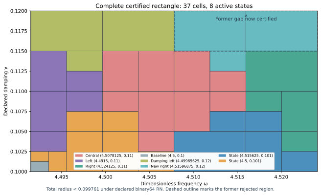

# Certified right-damping J₁ state and complete parameter rectangle

The actual right state at exact(ωc,γc)=(144511/32000,3/25)=(4.51596875,0.12) has its own projected-source RT1/curl/local-lift continuum upper. The frozen bank now contains nine saved states, and the adaptive evaluator certifies the complete rectangle

\[
\omega\in[8983/2000,36193/8000]=[4.4915,4.524125],
\qquad\gamma\in[1/10,3/25]=[0.1,0.12].
\]

Uniform continuum-plus-actual-evaluator error radius **<0.099761**, under declared primitive binary64 RN ties-to-even semantics. The previously rejected regionω>4.5078125,γ>0.115 is now included throughγ0.12. Both PR272 component domains are preserved as subsets. The runtime uses one complete rectangular guard and one adaptive tree; it requires no external component switches.

| Quantity | Verified result |
| --- | --- |
| Uniform total radius | 0.099760861413727697 |
| Leaves / maximum depth | 37 / 8 |
| Active owners in nine-state bank | 8: adaptive_central, adaptive_left, adaptive_right, baseline_original, damping_left, damping_right, shifted_neighbor, shifted_original |
| Accepted represented pairs, analytic count | 52,937,089,065,531,435,023,135,232,219 |
| Newly accepted former-gap pairs | 6,617,136,133,191,253,825,467,366,800 |
| Certified parameter area | 261/400000 |
| Previous union area | 1827/3200000 |
| Area ratio / increase | 8/7 / 14.29% |

Area measures parameter coverage, not precision improvement or physical performance. This is a narrow dimensionless frequency rectangle, not the full audit band[0,6]×[0.1,1].

## Actual state and own continuum upper

The source remainsF=10(x+y), mean zero and normalized L² norm squared20. The state uses the unchanged meanfree conforming P2 space with12,288 tetrahedra and18,673 degrees of freedom, including boundary nodes. Only the frequency-center literal changed relative to the prior left-damping source; topology, forcing, metric and measure sources match. Floating sparse solves plus one exact-residual correction propose four saved binary64 arrays; exact posterior arithmetic audits their two-word sums and exact weighted mean subtraction.

Corrected J≈**-4.53030554410341-1.21695528769515i**. The finite-Galerkin corrected algebraic output budget is 2.63764e-13, below10⁻¹⁰. That algebraic check alone supplies no continuum certificate.

The new RT1/root/patch flux and coupled affine-curl correction are built for this actual state at its own exact parameters. They satisfy divτ=zcΠ1v−F and homogeneous normal trace. The full nonzero volume residual zc(Π1v−v) is cellwise meanfree and included via a rigorous local Poincaré lift. Exact defect squared is approximately0.0004821440025248084. The direct actual reported-J continuum radius is 0.009785699697214746. The distinct phase proxy has radius0.005243158258040762; its center differs from reported J and is not silently substituted.

Final checks include98,304 affine-divergence and152,064 normal-trace constraints, exact cellwise projection/lift budgets, global gradient orthogonality, curl norm decrease and direct degree-three full-P2-gradient cross moments matching projected-mass identities. Projected mass is used for those flux cross identities; full-P2 bilinear mass is used in output correction. Parameter labels, state/payload hashes and exact results agree. Truncated/nonfinite coefficients, incompatible divergence, boundary trace and wrong-mass controls reject their mutants. Saved state/flux replay reconstructs the witnesses and reproduces the exact result JSON without regenerating coefficient proposals.

Both center parameters144511/32000 and3/25 are nonbinary rationals. The actual evaluator includes both nonzero center quantization errors and every other frozen constant/operation error; a literal0.12 is never silently identified with the exact rational endpoint. A runtime input denotes its exact represented value. Decimal parsing, measurement uncertainty and SI/Hertz calibration are outside scope.

## Continuum and floating certificate

For any exact meanfree frozen trialvi, let Ji(z)=Ji(zi)−(z−zi)∫vi²dμ, withz=−ω²+2iγω. The arbitrary-trial identityH−Ji=ri(Az⁻¹ri) avoids an exact-Galerkin premise. Convex-domain PoincaréCP≤1/2 gives the sufficient positive-box upper

\[
U_i(Q)=\sqrt{1+(w_+/(2g_-))^2}
\left(\sqrt{d_i^2}+\sqrt{\nu_i^2}
+\tfrac12D_i(Q)\|v_i\|_{L^2}\right)^2+E_i(Q).
\]

D bounds|z−zi| using real and imaginary endpoint extrema, andE bounds the actual evaluator error uniformly onQ. The output uses bilinear mass, while residual transport uses the Hermitian L² norm. The cell lift is a dual existence bound, not an explicit full-source polynomial flux. The inherited continuum gapλ*=4 is a valid lower bound, not equality withλ1. Source-bound continuum/flux premises remain conditional on their cited source proofs; dependence does not become independent confirmation by citation.

At each cell the deterministic planner minimizes the rational upper over all nine states, with lexicographic ties, and accepts only whenupper≤0.1. Otherwise it splits the axis with larger derivative-based variation score at the midpoint of represented positive binary64 word indices. Closed proof boxes share dyadic cuts; runtime word boxes form consecutive disjoint partitions. Frozen budgets aredepth18 and4096 leaves. Exhaustion rejects unresolved cells; parameter-tree termination does not prove finite element accuracy termination.

The exact audit checks root/domain/source hashes, every split, every leaf certificate and the accepted pair count. The former union's disjoint word counts plus the new upper-right-gap word rectangle equal the new root count exactly. 6 specific former-gap controls confirm the actual runtime now accepts inputs it previously rejected. Every internal dyadic cut is checked on both adjacent words at the other-axis endpoints/middle: 216 controls. The guard and traversal ASTs match the declared scalar selector; it adds no output arithmetic, interpolation or continuity claim.

Supplemental5,108 native/software traces compare81,728 intermediate nodes and independently check the exact closed estimator identity. Maximum uniform evaluator contribution is4.1523919e-15. The proof includes seven constant quantizations, sixteen primitive RN operations, additive2⁻¹⁰⁷⁵ underflow and magnitude<16 overflow exclusion. Corruption, domain/type/nonfinite, budget exhaustion and software ties-to-even controls pass. These constructor controls are not a formal verification of every platform or FMA/contraction mode.

## Next-state diagnostic

At the former right candidate, the old eight particular transported-upper formulas remain>0.129343, while the new state's own formula and pointwise flux upper pass. The old obstruction was always a lower on those particular sufficient expressions with fixed norm budgets, not on actual transfer error.

A frozen9×9 grid probesω[4.4915,4.524125],γ(0.12,0.13], excluding the newly certified boundary. Its72 probes recommend **(ω,γ)=(8983/2000,13/100)≈(4.491500000,0.130000000)**. The minimum of the nine particular formulas there is approximately0.129082546; the exact downward enclosure and per-state values are retained. All-nine-above-target flag: **True**. This ranking applies only to the finite declared grid and frozen norm budgets. It proves neither a global placement optimum nor actual-error lower/no-go, and presumes no new-state accuracy. The next candidate lies outside the new accepted rectangle and remains rejected until separately certified.

## Reproduction, provenance and governance

`PYTHONDONTWRITEBYTECODE=1 python3 replay.py` composes saved candidate state/flux replay and scalar replay. This turn executed`candidate/replay.py` and`replay.py --scalar-only` separately; REPLAY_RECEIPTS.json records the actual commands and log hashes. The scalar replay reconstructs and compares the complete cover, placement and audit results. Earlier state/flux proofs and replay evidence are reused by hash. All new evidence is inventoried by size/SHA256 in the manifest and unique event; old capture bytes remain unchanged. GitHub publication/CI/merge receipts are posted after completion.

The attached coefficient ledger v0.39 is the current provenance baseline, not a derivation of this benchmark's dynamics. CRL2 subdivision is a governance proposal, not enacted by citation. Gap2_FINAL_Finite_Genesis.png, Notes Backup 17-04-2026 07-13.txt and ASTER_Project_Folder_Instruction_Block_v1.md were unavailable and not read.

Classification **DERIVED / EXACT CONDITIONAL** for the new state/rectangle, **CANDIDATE** for next placement. Constructor checked; independent review absent; Scientific overall **OPEN**; Development—no registry entry; **physical promotion=0**. Full-band precision, quantitative finite mesh termination, native UD action/source/damping/metric derivation and experimental calibration remain open. This external scalar-wave benchmark establishes no material/horn or GR/QFT identification.

**A. CURRENT MISSION TRAJECTORY —** Close the declared upper-right parameter gap with an actual right state and own upper certificate.

**B. WHAT WAS DONE —** Constructed the right P2/flux witness and audited a nine-state complete-rectangle evaluator and saved replays.

**C. FINDING —** Fullω[4.4915,4.524125]×γ[0.1,0.12] passes with radius<0.099761; prior upper-right gap included; area+14.29%.

**D. UD GAP IMPACT —** Local parameter gap closed conditionally. Independent review, full-band closure, finite mesh termination and native bridge remain OPEN. Physical promotion=0.

**NEXT —** Certify the frozen-grid candidate(8983/2000,13/100) before widening the accepted rectangle.
