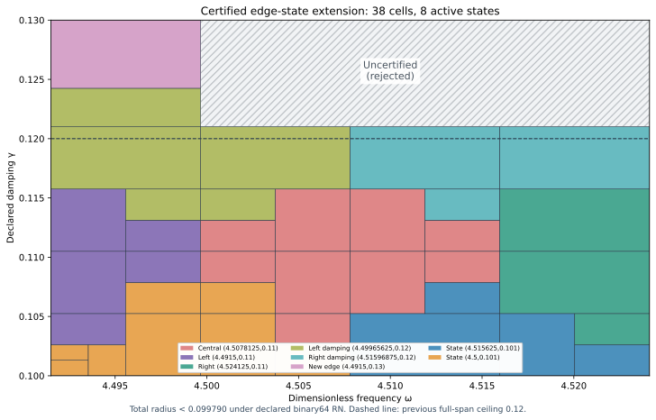

# Certified J₁ edge-damping state and joined parameter extension

An actual saved state at exact (ωc,γc)=(8983/2000,13/100)=(4.4915,0.13) has its own continuum upper certificate. Added to the prior nine states, it supports the two-component certified union below. The full frequency span reaches γ=121/1000=0.121; the left quarter reaches γ=13/100=0.13.

| Component | Exact frequency interval | Exact damping interval | Total radius, outward rounded |
| --- | --- | --- | --- |
| Full span | [8983/2000,36193/8000] | [1/10,121/1000] | <0.099790 |
| Left extension | [8983/2000,143989/32000] | [121/1000,13/100] | <0.098293 |

Uniform continuum-plus-actual-evaluator radius **<0.099790**, conditional on declared primitive binary64 RN ties-to-even. All of PR275's full rectangle through γ=3/25 is preserved. At γ>121/1000, only ω≤143989/32000=4.49965625 is accepted. The upper-right region is **uncertified and rejected**.

Certified parameter area=24273/32000000, compared with 261/400000: exact ratio **93/80**, an increase of **16.25%**. Coverage area is not physical performance or proof of error tightness.

## Actual state and its own upper certificate

The source F=10(x+y), normalized μ(Ω)=2, meanfree Neumann space, gradient metric and flux metric are unchanged. The conforming P2 mesh has 12,288 tetrahedra and 18,673 degrees of freedom. Exact source comparison permits only the two center-parameter literals to change relative to PR275's constructor. Sparse factorization plus one exact-residual correction proposes four saved binary64 arrays; exact arithmetic audits their two-word sum and weighted mean subtraction.

Corrected J≈-4.697658650061053-1.438105288455758i. The corrected finite-Galerkin algebraic output budget is 1.19851e-13, below 10⁻¹⁰. This alone is not continuum certification. The projected-source RT1/root/patch flux with exact affine-curl correction satisfies divτ=zcΠ1v−F and zero boundary normal trace. The remaining cell-meanfree source zc(Π1v−v) receives a rigorous local Poincaré dual lift.

Exact defect squared≈0.0005285749533129104. Direct actual reported-J continuum radius=0.009843899039029219. The separate phase-proxy radius=0.00527068985664832 has a different output center and is not substituted for the J radius. Saved flux replay checks divergence, normal traces, curl corrections and direct full-P2-gradient moments. Flux identities use projected mass, while output correction uses full-P2 bilinear mass; residual transport uses the Hermitian mass. State/flux/result parameters and source/payload hashes agree.

Both center parameters are nonbinary rationals. Their nearest binary64 words are not the exact state centers; both quantization errors are explicitly budgeted. Inputs denote exact represented values. Measurement uncertainty, decimal parsing uncertainty and physical time/frequency calibration are outside this contract.

## Continuum and evaluator contract

For an arbitrary exact meanfree frozen trial vᵢ and z=−ω²+2iγω, define Jᵢ(z)=Ji(zi)−(z−zi)∫vi²dμ and residual rᵢ. Then H−Ji=ri(Az⁻¹ri); no exact-Galerkin premise is needed. Convex-domain Cₚ≤1/2 and rotated coercivity imply the sufficient positive-box upper

\[
U_i(Q)=\sqrt{1+(w_+/(2g_-))^2}
\left(\sqrt{d_i^2}+\sqrt{\nu_i^2}+
\tfrac12D_i(Q)\|v_i\|_{L^2}\right)^2+E_i(Q).
\]

D encloses |z−zi| using endpoint extrema; E bounds the actual evaluator uniformly. The local lift is a dual existence bound, not an explicit full-source polynomial flux. The continuum spectral gap λ*=4 remains a lower bound, not equality with λ₁. The cited continuum and flux premises retain their source-bound conditional status; reused evidence does not become independent review.

The deterministic planner minimizes rational certified upper bounds over ten states, with lexicographic ties. A cell is accepted only when upper≤1/10. Otherwise it splits the axis with larger variation score at the integer midpoint of positive binary64 words. Closed proof boxes share cuts; represented word boxes form disjoint consecutive partitions. Frozen limits are depth 18 and 4096 leaves. Budget exhaustion means unresolved. Parameter partition termination does not prove finite element accuracy termination.

Component leaf counts=[36, 2], depths=[8, 1]; active owners: adaptive_central, adaptive_left, adaptive_right, damping_left, damping_right, edge_damping, shifted_neighbor, shifted_original. Root/domain/source hashes, every split and leaf, uniform-radius maximum and analytic word counts are checked. The runtime selects the full component for represented γ≤121/1000, otherwise requires ω≤143989/32000 and selects the extension. Both component boundary parameters are nonbinary; floor/ceiling word bounds are checked, and the last full γ word and first extension γ word are consecutive. No output interpolation or continuity claim is added.

Analytic accepted-pair count=**59,885,082,005,382,314,414,348,890,102**, exactly prior count plus 2,646,854,453,276,573,587,780,984,648 new full-span pairs and 4,301,138,486,574,305,803,432,673,235 left-extension pairs. Supplemental 5,264 native/software traces compare 84,224 intermediate nodes and check the closed output identity. All 216 internal-seam and 15 component-seam controls pass, including rejected upper-right words. Uniform floating contribution≤4.15403629e-15. Corruption, uniform-radius tampering, budget exhaustion, AST/source, type/domain/nonfinite and software ties-to-even controls pass.

The proof includes seven constant quantizations, sixteen primitive RN operations, additive 2⁻¹⁰⁷⁵ underflow and magnitude <16 overflow exclusion. These constructor checks do not formally verify every platform or FMA/contraction mode.

## Frozen placement and reproduction

The state and provisional union were frozen before generation; both goals passed without domain revision. A frozen 9×9 grid probes the remaining upper-right region, excluding already accepted boundaries. Its 64 points recommend next **(ω,γ)=(36193/8000,13/100)≈(4.524125000,0.130000000)**. The minimum of the ten downward-enclosed particular transported-upper formulas is≈0.127223107; all-ten-above-target flag: **True**. This ranks only a finite declared grid with fixed norm budgets. It is not an actual-error lower bound, global optimum, alternate-certificate no-go or presumed new-state accuracy. The next candidate is outside the accepted union.

`PYTHONDONTWRITEBYTECODE=1 python3 replay.py` composes candidate state/flux and scalar replay. This capture separately executed `candidate/replay.py` and `replay.py --scalar-only`; REPLAY_RECEIPTS.json records actual commands and log hashes. Scalar replay rebuilds and compares both covers, placement and audit results. Earlier states and proofs are reused by hash. Manifest/event inventory every new file; old capture bytes remain unchanged. GitHub/CI/merge receipts are posted after completion.

The attached ledger v0.39 remains the coefficient provenance baseline, not a derivation of this benchmark's source or damping. CRL2 is a governance proposal, not enacted by citation. ASTER and the opening/indexed scope of the Notes Backup were inspected as context, not adopted as proof. Gap2_FINAL_Finite_Genesis.png was unavailable and not read.

Classification **DERIVED / EXACT CONDITIONAL** for state/union; **CANDIDATE** for next placement. Constructor checked; independent review absent; Scientific overall **OPEN**; Development—no registry entry; **physical promotion=0**. Full-band precision, quantitative finite mesh termination, native UD action/source/damping/metric derivation and experimental identification remain OPEN. This external scalar-wave benchmark supplies no material/horn or GR/QFT identification.

**A. CURRENT MISSION TRAJECTORY —** Extend the certified damping region with an actual edge state and its own flux upper.

**B. WHAT WAS DONE —** Constructed the edge P2/flux witness, audited the ten-state joined evaluator and reproduced saved results.

**C. FINDING —** Full span through γ0.121; left quarter through γ0.13; uniform radius<0.099790; area+16.25%.

**D. UD GAP IMPACT —** Local coverage extended conditionally. Upper-right region, independent review, full-band closure, finite mesh termination and native bridge remain OPEN. Physical promotion 0.

**NEXT —** Construct and certify the selected state (36193/8000,13/100).
