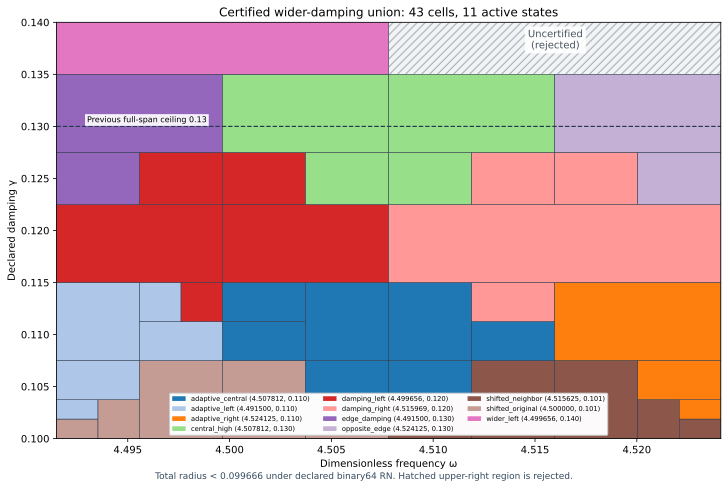

# Certified J₁ wider-left damping state and joined interval cover

The actual saved state at exact (ωc,γc)=(143989/32000,7/50)=(4.49965625,0.14) has its own continuum upper certificate. Added to the prior twelve states, it supports the following certified union.

| Component | Dimensionless frequency ω | Declared damping γ | Total radius, outward rounded |
| --- | --- | --- | --- |
| Full span | [4.4915,4.524125] | [0.1,0.135] | <0.099666 |
| Left extension | [4.4915,4.5078125] | [0.135,0.14] | <0.083328 |

Uniform continuum-plus-actual-evaluator radius **<0.099666**, conditional on primitive binary64 RN ties-to-even. The previous complete rectangle through γ=0.13 is preserved. Above γ=0.135 only ω≤577/128 is accepted; the upper-right region remains **uncertified and rejected**. This is not a full-span γ=0.14 guarantee.

| Quantity | Verified result |
| --- | --- |
| Uniform total radius | 0.099665787600637837 |
| Component leaves / depths | [42, 1] / [8, 0] |
| Active owners / bank size | 11 / 13 |
| Accepted represented pairs, analytic count | 82,714,201,664,892,941,225,179,396,178 |
| Newly accepted full-span pairs | 6,617,136,133,191,433,969,452,461,620 |
| Newly accepted left-extension pairs | 3,308,568,066,595,807,056,718,778,220 |
| Certified area / previous area | 783/640000 / 783/800000 |
| Area ratio / increase | 5/4 / 25.00% |

Area measures parameter coverage, not physical performance or error tightness.

## Actual state and own flux upper

The declared forcing F=10(x+y), normalized μ(Ω)=2, meanfree Neumann space, gradient and flux metrics remain unchanged. The conforming P2 mesh has 12,288 tetrahedra and 18,673 degrees of freedom. Source comparison allows only the two center-parameter literals to change. Sparse factorization plus one exact-residual correction proposes saved two-word coefficients. Exact arithmetic audits their sum and weighted mean subtraction.

Corrected J≈-4.561973470786275-1.478369019419363i, with finite-Galerkin corrected algebraic output budget 3.95064e-13, below 10⁻¹⁰. That check alone does not certify continuum accuracy.

The own projected-source RT1/root/patch flux with an exact reconstructed affine-curl correction satisfies divτ=zcΠ1v−F and zero boundary normal trace. A rigorous local Poincaré dual lift includes the remaining cell-meanfree volume residual zc(Π1v−v). Defect squared≈0.0005037783689380633. Direct actual reported-J continuum radius=0.008732555291929088. Separate phase-proxy radius=0.00467681591539596; it has a different output center and is not substituted for the J radius.

Saved read-only flux replay checks exact divergence, normal traces, projection/lift budgets, reconstructed curl and direct full-P2-gradient cross moments. Flux cross identities use projected mass; output correction uses full-P2 bilinear mass; residual transport uses Hermitian mass. State/flux/result parameters and source/payload hashes agree. Both new center coordinates are nonbinary; both quantization errors are explicitly included. Inputs denote exact represented values. Measurement and decimal parsing uncertainty and physical frequency calibration remain outside scope.

## Continuum and actual evaluator certificate

For any exact meanfree trial vᵢ, with z=−ω²+2iγω, define Jᵢ(z)=Jᵢ(zᵢ)−(z−zᵢ)∫vᵢ²dμ and residual rᵢ. The identity H−Jᵢ=rᵢ(Az⁻¹rᵢ) avoids an exact-Galerkin premise. Convex-domain Cₚ≤1/2 and rotated coercivity give the sufficient box upper

\[
U_i(Q)=\sqrt{1+(w_+/(2g_-))^2}
\left(\sqrt{d_i^2}+\sqrt{\nu_i^2}+
\tfrac12D_i(Q)\|v_i\|_{L^2}\right)^2+E_i(Q).
\]

D encloses |z−zᵢ| using endpoint extrema; E bounds the actual evaluator uniformly. The local lift is a dual existence bound, not an explicit full-source polynomial flux. The continuum spectral gap λ*=4 is a lower bound, not equality with λ₁. Earlier continuum/flux premises remain source-bound and conditional; citation does not create independent review.

The deterministic planner minimizes rational upper bounds over thirteen states with lexicographic ties. Acceptance requires upper≤1/10. Otherwise the larger variation score determines an integer-word midpoint split. Closed proof boxes share cuts; represented word boxes partition disjointly. Frozen limits are depth 18 and 4096 leaves. Exhaustion means unresolved; finite parameter partition termination does not imply finite element accuracy termination.

The runtime selects the full component at represented γ≤27/200. Above it, ω≤577/128 is required and the left extension is selected. The nonbinary damping split has consecutive last/first words. The binary-exact frequency split includes its endpoint in the left domain. No interpolation or continuity claim is introduced.

Every root/domain/source hash, split, leaf certificate, uniform-radius maximum and analytic word count is checked. The prior rectangle plus two disjoint new word regions equal the new total exactly. All 246 internal-seam and 15 component-seam controls pass. Upper-right inputs are rejected, including one frequency word beyond the left strip.

Supplemental 5,971 native/software traces compare 95,536 intermediate nodes and an independent closed output identity. Uniform floating contribution≤4.15233558e-15. Zero uniform-radius, corrupted certificate/split/root/word/hash, exhausted-budget, AST/source, type/domain/nonfinite and software ties-to-even controls pass. Seven frozen constant quantizations, sixteen primitive RN operations, additive 2⁻¹⁰⁷⁵ underflow and magnitude<16 overflow exclusion are included. Native constructor checks do not formally verify every platform or FMA/contraction mode.

## Prospective freeze, next candidate and reproduction

The actual new state and both provisional cover goals were frozen before generation and passed unchanged. A frozen 9×9 grid probes the remaining upper-right rectangle, excluding its accepted lower and left boundaries (64 probes). It recommends **(ω,γ)=(144511/32000,7/50)≈(4.515968750,0.140000000)**. Minimum of thirteen downward-enclosed particular transported-upper formulas≈0.108202144; all-thirteen-above-target flag: **True**. This is a finite-grid ranking with fixed norm budgets, not an actual-error lower, global optimum, alternate-certificate no-go or assumed new-state precision. The candidate remains outside the accepted union.

`PYTHONDONTWRITEBYTECODE=1 python3 replay.py` composes candidate state/flux and scalar replay. This capture separately executes `candidate/replay.py` and `replay.py --scalar-only`; REPLAY_RECEIPTS.json records actual commands and log hashes. Scalar replay rebuilds and compares both covers, placement and audit. Earlier state/proof bytes are reused by hash. Manifest/event inventory every new file; older captures remain byte-identical. Publication, CI and merge receipts follow completion.

PR281's concurrent backend-budget/acquisition capture is preserved without importing its claims into this benchmark proof. Ledger v0.39 remains coefficient provenance, not a derivation of benchmark dynamics. CRL2 remains a proposal, not enacted by citation. Notes Backup and ASTER were previously inspected as context, not mathematical dependencies; no private archive contents are copied. Gap2_FINAL_Finite_Genesis.png remains unavailable and unused.

Classification **DERIVED / EXACT CONDITIONAL** for the state/union, **CANDIDATE** for next placement. Constructor checked; independent review absent; Scientific overall **OPEN**; Development—no registry entry; **physical promotion=0**. Full-band precision, quantitative finite mesh termination, native UD action/source/damping/metric derivation and experimental identification remain OPEN. External scalar-wave benchmark only; no material/horn or GR/QFT identification follows.

**A. CURRENT MISSION TRAJECTORY —** Extend certified damping coverage with a new actual state and own flux upper.

**B. WHAT WAS DONE —** Constructed and audited the P2/flux state, thirteen-state joined evaluator and saved replays.

**C. FINDING —** Full span reaches γ=0.135; left half reaches γ=0.14. Radius<0.099666; area+25%.

**D. UD GAP IMPACT —** Independent review, upper-right region, full-band precision, mesh termination and native bridge remain OPEN. Physical promotion=0.

**NEXT —** Construct and certify (144511/32000,7/50) in the remaining upper-right region.
