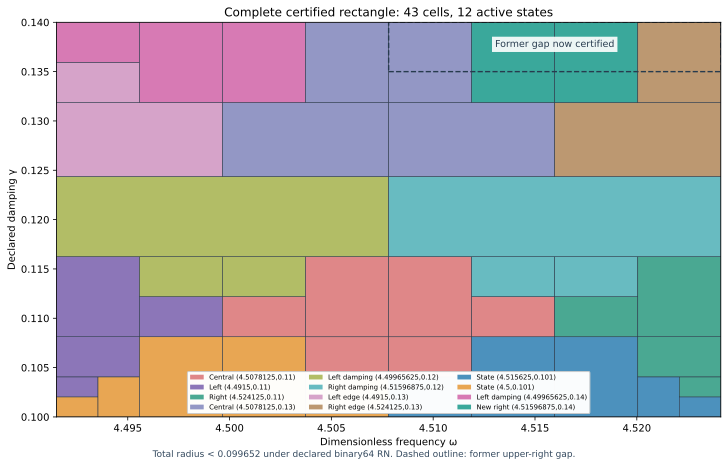

# Certified J₁ wider-right state and complete local parameter rectangle

The actual saved state at exact (ωc,γc)=(144511/32000,7/50)=(4.51596875,0.14) has its own continuum upper certificate. Added to the prior thirteen states, it certifies the complete rectangle

\[
\omega\in[8983/2000,36193/8000]=[4.4915,4.524125],
\qquad\gamma\in[1/10,7/50]=[0.1,0.14].
\]

Uniform continuum-plus-actual-evaluator radius **<0.099652**, conditional on declared primitive binary64 RN ties-to-even. The entire PR282 two-component union is preserved. Its formerly rejected upper-right region is now included. Runtime evaluation uses one rectangular guard and one tree, with no component switch.

| Quantity | Verified result |
| --- | --- |
| Uniform total radius | 0.099651367742709676 |
| Leaves / maximum depth | 43 / 8 |
| Active owners in fourteen-state bank | 12 |
| Accepted represented pairs, analytic count | 86,022,769,731,488,568,137,913,079,578 |
| Newly accepted former-gap pairs | 3,308,568,066,595,626,912,733,683,400 |
| Certified area | 261/200000 |
| Previous joined area | 783/640000 |
| Area ratio / increase | 16/15 / 6.67% |

Coverage area measures the certified parameter domain, not physical performance or error tightness.

## Actual state and own continuum upper

The declared source F=10(x+y), meanfree Neumann space, normalized μ(Ω)=2, gradient metric and flux metric remain unchanged. The conforming P2 mesh has 12,288 tetrahedra and 18,673 degrees of freedom. Exact source comparison permits only the frequency literal to change relative to PR282's constructor. Sparse factorization plus one exact-residual correction proposes four binary64 arrays; exact arithmetic audits their two-word sum and weighted mean subtraction.

Corrected J≈-4.422894546812346-1.386147667327084i. Its corrected finite-Galerkin algebraic output budget is 3.11182e-13, below 10⁻¹⁰. This alone is not continuum certification. The new projected-source RT1/root/patch flux with exact affine-curl correction satisfies divτ=zcΠ1v−F and zero boundary normal trace. The remaining cell-meanfree source zc(Π1v−v) receives a rigorous local Poincaré dual lift.

Exact defect squared≈0.0004708088567812357. Direct actual reported-J continuum radius=0.008194983215964407. The separate phase-proxy radius=0.004390981554513239 has a different center and is not substituted for the J radius. Saved flux replay checks exact divergence, normal traces, affine-curl corrections and direct full-P2-gradient moments. Flux cross identities use projected mass; output correction uses full-P2 bilinear mass; residual transport uses the Hermitian mass. Source/state/parameter/payload bindings pass.

Both center parameters are nonbinary rationals. Their constant quantization errors remain explicitly included and checked. Inputs denote exact represented values. Measurement uncertainty, decimal parsing uncertainty and physical time/frequency calibration are outside this contract.

## Continuum and actual evaluator proof

For any exact meanfree trial vᵢ, with z=−ω²+2iγω, define Jᵢ(z)=Jᵢ(zᵢ)−(z−zᵢ)∫vᵢ²dμ and residual rᵢ. The identity H−Jᵢ=rᵢ(Az⁻¹rᵢ) avoids an exact-Galerkin premise. Convex-domain Cₚ≤1/2 and rotated coercivity give the sufficient box upper

\[
U_i(Q)=\sqrt{1+(w_+/(2g_-))^2}
\left(\sqrt{d_i^2}+\sqrt{\nu_i^2}+
\tfrac12D_i(Q)\|v_i\|_{L^2}\right)^2+E_i(Q).
\]

D encloses |z−zᵢ| using endpoint extrema; E bounds the actual evaluator uniformly. The local lift is a dual existence bound, not an explicit full-source polynomial flux. The continuum spectral gap λ*=4 is a lower bound, not equality with λ₁. Earlier continuum/flux premises remain source-bound and conditional; citation does not create independent review.

The deterministic planner minimizes rational upper bounds over fourteen states with lexicographic ties. It accepts only upper≤1/10; otherwise it splits the larger variation score at the midpoint of represented positive binary64 words. Closed proof boxes share cuts; runtime word boxes form disjoint consecutive partitions. Frozen limits are depth 18 and 4096 leaves. Exhaustion means unresolved. Finite parameter partition termination does not imply finite element accuracy termination.

Every root/domain/source hash, split, leaf certificate, uniform-radius maximum and analytic word count is checked. Both former component domains are subsets of the new rectangle. Their disjoint word counts plus the formerly rejected upper-right word rectangle equal the new root count exactly. Six specific former-gap controls confirm runtime acceptance immediately inside the former gap boundaries and at the neighboring state’s rounded frequency word. All 252 internal-seam controls pass.

Supplemental 5,971 native/software traces compare 95,536 intermediate nodes and the exact closed output identity. Uniform floating contribution≤4.15512335e-15. Uniform-radius tampering, corrupted certificates/splits/words/domain/hashes, budget exhaustion, AST/source, type/domain/nonfinite and software ties-to-even controls pass. Active owners: adaptive_central, adaptive_left, adaptive_right, central_high, damping_left, damping_right, edge_damping, opposite_edge, shifted_neighbor, shifted_original, wider_left, wider_right.

The evaluator proof includes seven constant quantization budgets (including zero errors where exact), sixteen primitive RN operations, additive 2⁻¹⁰⁷⁵ underflow and magnitude <16 overflow exclusion. No interpolation or continuity claim is added. These constructor checks do not formally verify every platform or FMA/contraction mode.

## Prospective freeze, next placement and reproduction

The selected state and full-rectangle goal were frozen before generation and passed unchanged. A frozen 9×9 grid probes above γ=7/50 through 3/20, excluding its lower damping row. Its 72 probes recommend next **(ω,γ)=(8983/2000,3/20)≈(4.491500000,0.150000000)**. The minimum of fourteen downward-enclosed particular transported-upper formulas is≈0.108775337; all-fourteen-above-target flag: **True**. This ranks only a finite declared grid with fixed norm budgets. It is not an actual-error lower, global optimum, alternate-certificate no-go or assumed new-state precision. The candidate remains outside the accepted rectangle.

`PYTHONDONTWRITEBYTECODE=1 python3 replay.py` composes candidate state/flux and scalar replay. This capture separately executed `candidate/replay.py` and `replay.py --scalar-only`; REPLAY_RECEIPTS.json records actual commands/log hashes. Scalar replay rebuilds and compares the complete cover, placement and audit results. Earlier states/proofs are reused by hash. Manifest/event inventory every new file; previous capture bytes remain unchanged. GitHub/CI/merge receipts are posted after completion.

Ledger v0.39 remains the coefficient provenance baseline, not a derivation of the benchmark source/damping. CRL2 remains a proposal, not enacted by citation. The Notes Backup and ASTER context were inspected previously and are not benchmark proof sources. Gap2_FINAL_Finite_Genesis.png remains unavailable and unused.

Classification **DERIVED / EXACT CONDITIONAL** for state/rectangle; **CANDIDATE** for next placement. Constructor checked; independent review absent; Scientific overall **OPEN**; Development—no registry entry; **physical promotion=0**. The declared local parameter gap is conditionally closed; full-band precision, quantitative finite mesh termination, native UD action/source/damping/metric derivation and experimental identification remain OPEN. External scalar-wave benchmark only; no material/horn or GR/QFT identification.

**A. CURRENT MISSION TRAJECTORY —** Close the local upper-right gap with an actual neighboring state and own upper.

**B. WHAT WAS DONE —** Constructed and audited the P2/flux state, fourteen-state complete evaluator and saved replays.

**C. FINDING —** Complete ω[4.4915,4.524125]×γ[0.1,0.14] passes; radius<0.099652; former gap included; area+6.67%.

**D. UD GAP IMPACT —** Local gap closed conditionally. Independent review, full-band precision, finite mesh termination and native bridge remain OPEN. Physical promotion 0.

**NEXT —** Construct and certify the selected wider-damping state (8983/2000,3/20).
