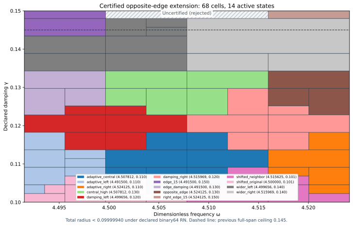

# Certified J₁ opposite-edge state and three-component extension

The actual saved state at exact (ωc,γc)=(36193/8000,3/20)=(4.524125,0.15) has its own continuum upper certificate. Added to the prior fifteen states, it supports this certified union:

| Component | Exact frequency interval | Exact damping interval | Total radius, outward rounded |
| --- | --- | --- | --- |
| Full span | [8983/2000, 36193/8000] | [1/10, 37/250] | <0.09999940 |
| Left extension | [8983/2000, 143989/32000] | [37/250, 3/20] | <0.06403865 |
| Right extension | [144511/32000, 36193/8000] | [37/250, 3/20] | <0.05730522 |

Uniform continuum-plus-actual-evaluator radius **<0.09999940**, conditional on declared primitive binary64 RN ties-to-even. The entire PR285 union is preserved. The full span reaches γ=37/250=0.148, and both outer quarters reach γ=3/20=0.15. Above γ=0.148, the central frequency interval 4.49965625<ω<4.51596875 remains **uncertified and rejected**.

Certified parameter area is 12789/8000000, compared with 9657/6400000: exact ratio **196/185**, an increase of **5.95%**. Coverage area is not physical performance or error tightness.

## Actual state and continuum upper

The declared source F=10(x+y), meanfree Neumann space, normalized μ(Ω)=2, gradient metric and flux metric remain unchanged. The conforming P2 mesh has 12,288 tetrahedra and 18,673 degrees of freedom. Exact source comparison permits only the frequency literal to change relative to PR285's constructor. Sparse factorization plus one exact-residual correction proposes four binary64 arrays; exact arithmetic audits their two-word sum and weighted mean subtraction.

Corrected J≈-4.300789076253409-1.420859913431883i. Its corrected finite-Galerkin algebraic budget is 3.35972e-13, below 10⁻¹⁰. This alone is not continuum certification. The new projected-source RT1/root/patch flux with exact affine-curl correction satisfies divτ=zcΠ1v−F and zero boundary normal trace. The remaining cell-meanfree source zc(Π1v−v) receives a rigorous local Poincaré dual lift.

Exact defect squared≈0.0004497401062053815. Direct actual reported-J continuum radius=0.007323714717624716. The separate phase-proxy radius=0.003925133101055044 has a different center and is not substituted for the J radius. Saved flux replay checks exact divergence, normal traces, affine-curl corrections and direct full-P2-gradient moments. Flux cross identities use projected mass; output correction uses full-P2 bilinear mass; residual transport uses the Hermitian mass. Source/state/parameter/payload bindings pass.

Both center parameters are nonbinary rationals. Their nearest binary64 words are not the exact centers. Both quantization errors are explicitly included. Inputs denote exact represented values; measurement uncertainty, decimal parsing uncertainty and SI/Hertz calibration are outside this contract.

## Continuum, partition and evaluator proof

For any exact meanfree trial vᵢ, with z=−ω²+2iγω, define Jᵢ(z)=Jᵢ(zᵢ)−(z−zᵢ)∫vᵢ²dμ and residual rᵢ. The identity H−Jᵢ=rᵢ(Az⁻¹rᵢ) avoids an exact-Galerkin premise. Convex-domain Cₚ≤1/2 and rotated coercivity give the sufficient box upper

\[
U_i(Q)=\sqrt{1+(w_+/(2g_-))^2}
\left(\sqrt{d_i^2}+\sqrt{\nu_i^2}+
\tfrac12D_i(Q)\|v_i\|_{L^2}\right)^2+E_i(Q).
\]

D encloses |z−zᵢ| using endpoint extrema; E bounds the actual evaluator uniformly. The local lift is a dual existence bound, not an explicit full-source polynomial flux. The continuum spectral gap λ*=4 is a lower bound, not equality with λ₁. Earlier continuum/flux premises remain source-bound and conditional; citation does not create independent review.

The deterministic planner minimizes rational upper bounds over sixteen states with lexicographic ties. It accepts only upper≤1/10; otherwise it splits the larger variation score at the midpoint of represented positive binary64 words. Closed proof boxes share cuts; runtime word boxes form disjoint consecutive partitions. Frozen limits are depth 18 and 4096 leaves. Exhaustion means unresolved. Finite parameter partition termination does not imply finite element accuracy termination.

Component leaf counts are [66, 1, 1], depths [8, 0, 0]; active owners: adaptive_central, adaptive_left, adaptive_right, central_high, damping_left, damping_right, edge_15, edge_damping, opposite_edge, right_edge_15, shifted_neighbor, shifted_original, wider_left, wider_right. Root/domain/source hashes, every split and leaf, uniform-radius maximum and analytic word counts are checked. The actual guard selects the full component for represented γ≤37/250; otherwise it selects the left strip when ω≤143989/32000 and the right strip when ω≥144511/32000. Inputs in between are rejected. All three boundaries are nonbinary: exact rational guards and neighboring floor/ceiling words are verified. This adds no output interpolation or continuity claim.

The accepted-pair count is **97,933,614,771,233,113,254,130,491,530**. Exact novelty bookkeeping excludes the already covered prior left strip: the prior union gains 2,977,711,259,936,172,307,851,371,952 new full-span words outside that strip, plus 661,713,613,319,125,382,546,736,680 right-extension words. The raised left component and the full component together preserve the old left domain.

Supplemental 9,418 native/software traces compare 150,688 intermediate nodes and the exact closed output identity. All 390 internal-seam and 24 component-seam controls pass, including central-gap rejection. Uniform floating contribution≤4.16896501e-15. Uniform-radius tampering, corrupted certificates/splits/words/hashes, budget exhaustion, AST/source, type/domain/nonfinite and software ties-to-even controls pass.

The proof includes seven constant quantizations, sixteen primitive RN operations, additive 2⁻¹⁰⁷⁵ underflow and magnitude <16 overflow exclusion. These constructor checks do not formally verify every platform or FMA/contraction mode.

## Prospective freeze, placement and reproduction

The selected state and provisional three-component goals were frozen before generation and passed unchanged. PREGEN_PREFLIGHT.json was also recorded before generation; its 132 old-bank point enclosures reproduce in the scalar audit and are finite-grid diagnostics, not a uniform proof, actual-error lower or globally optimal ceiling. Uniform acceptance comes from the later complete adaptive box audit.

A frozen 9×9 grid probes the remaining upper-center region, excluding both frequency endpoints and its lower damping row. Its 56 probes recommend next **(ω,γ)=(577/128,3/20)≈(4.507812500,0.150000000)**. The minimum of sixteen downward-enclosed particular transported-upper formulas is≈0.102560757; all-sixteen-above-target flag: **True**. This ranks only a finite declared grid with fixed norm budgets. It is not an actual-error lower, global optimum, alternate-certificate no-go or assumed new-state precision. The candidate remains outside the accepted union.

`PYTHONDONTWRITEBYTECODE=1 python3 replay.py` composes candidate state/flux and scalar replay. This capture separately executed `candidate/replay.py` and `replay.py --scalar-only`; REPLAY_RECEIPTS.json records actual commands/log hashes. Scalar replay rebuilds and compares all three covers, placement and audit results. Earlier states/proofs are reused by hash. Manifest/event inventory every new file; previous capture bytes remain unchanged. GitHub/CI/merge receipts are posted after completion.

Concurrent PR286 is preserved without importing its adjoint/retained-spectrum claims into this benchmark proof. Ledger v0.39 remains the coefficient provenance baseline, not a derivation of the benchmark source/damping. CRL2 remains a proposal, not enacted by citation. Notes Backup and ASTER were previously inspected as context, not mathematical dependencies; no private archive content is copied. Gap2_FINAL_Finite_Genesis.png remains unavailable and unused.

Classification **DERIVED / EXACT CONDITIONAL** for state/union; **CANDIDATE** for next placement. Constructor checked; independent review absent; Scientific overall **OPEN**; Development—no registry entry; **physical promotion=0**. Central upper coverage, full-band precision, quantitative finite mesh termination, native UD action/source/damping/metric derivation and experimental identification remain OPEN. External scalar-wave benchmark only; no material/horn or GR/QFT identification.

**A. CURRENT MISSION TRAJECTORY —** Extend the certified union with an actual opposite-edge state and its own upper.

**B. WHAT WAS DONE —** Constructed and audited the P2/flux state, sixteen-state evaluator and saved replays.

**C. FINDING —** Full span through γ0.148 and both outer quarters through γ0.15; radius<0.09999940; area+5.95%.

**D. UD GAP IMPACT —** Coverage extended conditionally; upper central gap, independent review, full-band closure, finite mesh termination and native bridge remain OPEN. Physical promotion 0.

**NEXT —** Construct and certify the selected central state (577/128,3/20).
