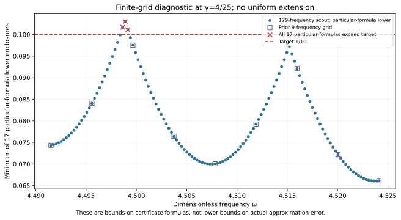

# Existing-bank extension to γ=4/25: unresolved cover and exact formula obstruction

The unchanged seventeen-state bank does **not** certify the proposed complete ω∈[8983/2000,36193/8000], γ∈[1/10,4/25] rectangle under either frozen partition budget. Both attempts reproducibly stop at an unresolved cell. A separately frozen denser scout finds three points where all seventeen particular transported-bound formulas exceed 1/10. An exact binary64 input inside the proposed rectangle witnesses this formula-family obstruction.

**Current certified coverage remains PR289's rectangle through γ=3/20**, with uniform continuum-plus-actual-evaluator radius <0.09981147. No new state, flux, runtime guard, accepted-pair count, area increase or uniform precision certificate is added.

| Attempt | Frozen depth / leaves | Observed result |
| --- | --- | --- |
| Initial complete rectangle | 18 / 4096 | UNRESOLVED; first stopped box upper 0.100255239529 |
| Separate prospective refinement | 24 / 4096 | UNRESOLVED; first stopped box upper 0.100024711393 |
| Prior scout | 9×8=72 points | Every sampled minimum model upper <0.1; not uniform coverage |
| Denser frozen scout | 129×8=1032 points | 3 sampled formula-family gaps |
| Corrected represented-input witness | All 17 formulas | Minimum particular-formula lower >0.10301094 |

The depth-18 first stopped box is approximately ω∈[4.498509277344,4.498636718750], γ∈[0.159750976563,0.159833984375]. Its midpoint lower≈0.099380638700 is below target. That local observation motivated the separately frozen depth-24 attempt; it did not promise success. Both original contracts and failed logs are retained. Neither partial traversal is presented as a cover.

## Exact scope of the obstruction

For each saved state i the unchanged formula is

\[
U_i(Q)=\sqrt{1+(w_+/(2g_-))^2}
\left(\sqrt{d_i^2}+\sqrt{\nu_i^2}+
\tfrac12 D_i(Q)\|v_i\|_{L^2}\right)^2+E_i(Q).
\]

The source-bound meanfree Neumann scalar-wave benchmark, Cₚ≤1/2 and λ*=4 lower bound are unchanged. Every defect, local-lift norm, full-P2 Hermitian mass, output bilinear mass and frozen output constant is reused by hash. The actual 16-operation evaluator and seven quantized constants are unchanged. No new finite element or flux solve was performed. The prospective complete-cover evaluator/audit source is retained but was never reached because construction exhausted its budget; no new native-evaluator or seam pass is claimed.

The denser scout keeps nine damping levels with the lower level excluded, but refines frequency from 9 to 129 samples. It is frozen before evaluation and ranks only the declared finite grid. Selected rational candidate:

\[
(\omega_c,\gamma_c)=(921373/204800, 4/25)
\approx(4.498891601562,0.16).
\]

At that rational point the minimum of seventeen downward-enclosed particular formulas is≈0.103010945282273. The corrected inside-goal represented input is exactly

- ω=2532650817547141/562949953421312 (`0x1.1fedd70a3d70ap+2`),
- γ=2882303761517117/18014398509481984 (`0x1.47ae147ae147ap-3`).

All seventeen source-bound lower enclosures exceed 1/10 there; their minimum is≈0.103010945282274. The declared box formula is monotone under box inclusion: its κ, shift and norm terms dominate their values at any contained point, with nonnegative evaluator budget. Thus no further subdivision alone can certify this represented input using this fixed formula family and target. This conclusion is **not** an actual-error lower, a failure of the scalar-wave continuum problem, or an exclusion of alternate flux/dual constructions. Tighter residual budgets or another state can change the family.

## Corrections and reproducibility

The initial wrapper imported its prospective evaluator before a cover existed. Initialization order was corrected; INITIALIZATION_ATTEMPT.log records that early error. The mathematical goal and initial budget were unchanged.

Nearest binary64 rounding of exact 4/25 lies slightly above the proposed upper boundary. The first rounded witness is therefore preserved only as ROUNDED_OUTSIDE_GOAL_WITNESS.json, with original source/log and BOUNDARY_CORRECTION.json. The authoritative FORMULA_GAP_WITNESS.json instead uses the preceding binary64 damping and explicitly verifies exact inclusion in the goal. Its all-seventeen obstruction still holds. Only this corrected inside-goal witness supports the scope above.

Run `PYTHONDONTWRITEBYTECODE=1 python3 replay.py` in this capture. It reproduces the expected initial and refined cover exhaustions, the 1032-point scout, all seventeen exact represented-input formula bounds, unchanged bank/source/constant/AST checks, and compares the four saved result files. Replay PASS means these **unresolved/obstruction results reproduce**, not that uniform extension passed. Earlier state/flux proofs are reused from their saved hash-bound evidence; they were not regenerated or independently reviewed this turn.

PARAMETER_FREEZE.json and INITIAL_CONTRACT.json preserve the initial prospective attempt. REFINEMENT_FREEZE.json and CONTRACT.json preserve the separate prospective refinement. SCOUT_FREEZE.json binds the denser diagnostic. Old captures remain byte-identical. Manifest/event, actual replay receipts, Project saved/reloaded screenshot and CI/merge receipts provide provenance, not independent scientific review.

Ledger v0.39 is the provenance baseline, not a derivation of benchmark source/damping. CRL2 remains a proposal, not enacted by citation. Notes Backup and ASTER remain contextual inputs, not proof. Gap2_FINAL_Finite_Genesis.png remains unavailable and unused. External scalar-wave benchmark only; no native UD action/source/damping/metric, horn/material, GR/QFT or experimental identification.

**A. CURRENT MISSION TRAJECTORY —** Test existing-bank uniform extension before adding states.

**B. WHAT WAS DONE —** Reproduced two frozen-budget failures; refined the scout and checked an exact inside-goal formula obstruction; preserved and corrected the boundary-rounding attempt.

**C. FINDING —** Existing formulas cannot meet target throughout the proposed γ≤4/25 rectangle. Certified γ remains≤3/20.

**D. UD GAP IMPACT —** DERIVED / EXACT CONDITIONAL formula-family result; Scientific OPEN; Constructor checked only; Development/no registry entry; physical promotion 0.

**NEXT —** Construct a state and own flux upper at exact(921373/204800,4/25); then repeat the complete rectangle audit. Its precision and coverage remain unproven.
