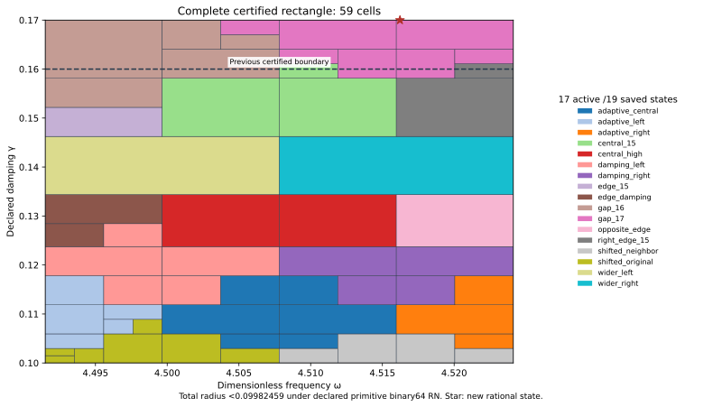

# New J₁ gap state and complete rectangle through damping 17/100

The actual state at exact (ωc,γc)=(4624613/1024000,17/100)≈(4.516223632813,0.17) has its own continuum upper. Added to the unchanged prior eighteen states, it certifies the complete rectangle

\[
\omega\in[8983/2000,36193/8000]=[4.4915,4.524125],\qquad
\gamma\in[1/10,17/100]=[0.1,0.17].
\]

Uniform continuum-plus-actual-evaluator radius **<0.09982459**, conditional on declared primitive binary64 RN ties-to-even. The state, complete rectangle, depth 24 and 4096-leaf budget were frozen before generation and passed unchanged. The prior complete rectangle is preserved and the full-width upper strip is included. One rectangular guard and one adaptive integer-word tree are used.

| Quantity | Verified result |
| --- | --- |
| Uniform total radius | 0.099824582965012759 |
| Leaves / maximum depth | 59 / 9 |
| Active owners / saved states | 17 /19 |
| Accepted represented pairs, analytic count | 125,725,586,530,637,135,222,143,388,557 |
| Newly accepted upper-strip pairs | 13,234,272,266,382,867,938,904,923,240 |
| Certified area | 1827/800000 |
| Previous certified area | 783/400000 |
| Area ratio / increase | 7/6 / 16.67% |

Coverage area measures the certified parameter domain, not physical performance or actual-error tightness.

## New state and own flux upper

The meanfree Neumann scalar-wave benchmark keeps F=10(x+y), μ(Ω)=2, gradient/flux metrics, source and mesh unchanged: 18673 P2 degrees of freedom on 12288 tetrahedra. Source comparison permits only the two exact parameter literals to change from PR292's constructor. A sparse solve and exact-residual correction propose four binary64 arrays. Exact arithmetic audits their two-word sum and weighted mean subtraction.

Corrected J≈-4.241098981637615-1.61322700929157i; corrected finite-Galerkin algebraic output budget≈2.53216e-13<10⁻¹⁰. This alone is not continuum precision. The new projected-source RT1/root/patch flux and exact affine-curl correction satisfy divτ=zcΠ1v−F, zero boundary normal trace and exact source/state/payload bindings. Remaining cell-meanfree zc(Π1v−v) receives a rigorous local Poincaré dual lift.

Defect squared≈0.0004513674321050711. Direct actual reported-J continuum radius=0.006476804139036701. The distinct phase-proxy radius=0.003470561728229815 has a different center and is not substituted for the J radius. Flux cross identities use projected mass; output correction uses full-P2 bilinear mass; residual transport uses full Hermitian mass. Saved flux replay checks exact divergence, normal traces, affine-curl reconstruction and direct full-P2-gradient moments.

## Certificate-family change and endpoint audit

The previous eighteen-state family has minimum particular-formula lower≈0.192668921879>0.1 at the new rational center. The new state's model upper there is≈0.006476804139. This changes the formula family; the previous records remain intact. It is not an actual-error lower.

Both new center constants are nonbinary, and both quantization errors are included. Nearest binary64 to exact 17/100 lies above the exact upper boundary. The audit asserts the stored damping constant is one word above the greatest accepted damping word, and that the next word is rejected by the guard. It also constructs an exact represented input inside the proposed domain, at frequency `0x1.2109ced916873p+2` and damping `0x1.5c28f5c28f5c2p-3`. All eighteen previous particular-formula lower enclosures exceed target there (minimum≈0.192668921879); the joined evaluator now accepts this input with a certified upper. Constants and accepted inputs remain distinct objects. Decimal parsing/measurement uncertainty and physical frequency calibration are outside this contract.

## Uniform continuum and actual evaluator audit

For an exact meanfree trial vi, z=−ω²+2iγω and Ji(z)=Ji(zi)−(z−zi)∫vi²dμ, the identity H−Ji=ri(Az⁻¹ri) avoids an exact-Galerkin premise. Cₚ≤1/2 and the valid continuum gap lower λ*=4 give the box upper

\[
U_i(Q)=\sqrt{1+(w_+/(2g_-))^2}
\left(\sqrt{d_i^2}+\sqrt{\nu_i^2}+
\tfrac12D_i(Q)\|v_i\|_{L^2}\right)^2+E_i(Q).
\]

D bounds |z−zi| by endpoint extrema and E bounds actual output arithmetic uniformly. The local lift is a dual existence bound, not an explicit polynomial full-source flux. The theorem premises are unchanged and source-bound; λ*=4 is not equality with λ₁. Constructor checks do not create independent review.

The planner minimizes exact rational upper enclosures over nineteen states with lexicographic ties and accepts only upper≤1/10. It splits the larger squared z-variation score at the midpoint of represented positive binary64 words. Closed proof boxes share cuts while runtime word partitions are consecutive and disjoint. Every source hash, domain/root, split, leaf certificate, uniform maximum and analytic word count is checked. Previous word count plus new full-width strip count equals the new root count exactly; area ratio is 7/6.

Supplemental native/software checks: 8,212 input traces, 131,392 intermediate nodes, 348 internal seams and 9 extension-boundary controls. Uniform floating contribution≤4.16626058e-15. The actual evaluator source/AST, all seven constant quantizations, 16 primitive RN operations, additive 2⁻¹⁰⁷⁵ underflow budget, magnitude <16 overflow exclusion, source/type/domain/nonfinite/ties controls, budget exhaustion and corrupted certificate/split/word/domain/hash/uniform-maximum rejection checks pass.

The arithmetic model excludes FMA/contraction and does not formally verify every platform. No interpolation or continuity claim is added. Finite parameter partition success does not establish finite element accuracy termination or a quantitative mesh rate.

## Next placement and replay

A prospectively frozen 129×9 grid probes γ>17/100 through 9/50, excluding its lower damping row: 1032 points. Its selected raw candidate is exact(8983/2000,9/50). Minimum of nineteen particular-formula lower enclosures≈0.193221055271; all-nineteen-above-target flag=True. All 1032 sampled minimum model uppers below target: **False**; maximum≈0.193221055271. This ranks a declared finite grid only; it is not a global optimum, actual-error lower, alternate-certificate no-go or presumed candidate precision. Uniform 9/50 coverage is not claimed.

NEXT_STEP_REASSESSMENT.json records: **Construct an own state/flux upper at exact(8983/2000,9/50), then repeat the expanded-region audit.**

`PYTHONDONTWRITEBYTECODE=1 python3 replay.py` composes the candidate state/flux and scalar replay. This capture separately executes `candidate/replay.py` and `replay.py --scalar-only`; REPLAY_RECEIPTS.json records actual commands/log hashes. Saved scalar replay rebuilds and compares the cover, 1032-point placement and audit. Prior 18 state/flux proofs are reused by hash. Manifest/event inventory every new file; old evidence remains byte-identical. Project save/reload and CI/merge receipts are provenance, not independent scientific review.

Ledger v0.39 remains the coefficient provenance baseline, not a derivation of the source/damping. CRL2 remains a proposal, not enacted by citation. Notes Backup and ASTER remain context, not proof. Gap2_FINAL_Finite_Genesis.png remains unavailable and unused. External scalar-wave benchmark only; no native UD action/source/damping/metric, material/horn, GR/QFT or experimental identification.

**A. CURRENT MISSION TRAJECTORY —** Close the former formula-family gap with an actual new state and own upper.

**B. WHAT WAS DONE —** Constructed and audited the new P2/flux state, nineteen-state full rectangle and saved replays.

**C. FINDING —** Complete γ≤17/100 passes; radius<0.09982459; area+16.67%; previous obstacle input included.

**D. UD GAP IMPACT —** DERIVED / EXACT CONDITIONAL benchmark result; Scientific OPEN; Constructor checked only; Development/no registry entry; physical promotion 0. Independent review,full-band precision,mesh termination and native bridge remain OPEN.

**NEXT —** Construct an own state/flux upper at exact(8983/2000,9/50), then repeat the expanded-region audit.
