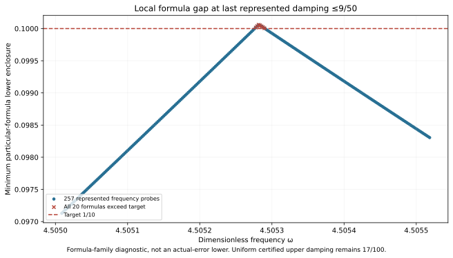

# New J₁ boundary-state upper; damping 0.18 rectangle unresolved

The actual state at exact (ωc,γc)=(8983/2000,9/50)=(4.4915,0.18) has an own continuum flux/dual-lift upper and a separate exact represented-input continuum-plus-floating certificate. The proposed complete ω[4.4915,4.524125]×γ[0.1,0.18] rectangle remains **UNRESOLVED**: frozen depth 24 and separately frozen depth 30 attempts both exhaust their budget. Neither partial traversal is a cover.

**Current uniform coverage remains PR293's γ≤17/100 rectangle**, with radius <0.09982459. No new uniform guard, accepted-pair count, area gain or complete-region precision is claimed.

| Object / attempt | Verified result |
| --- | --- |
| New exact state reported-J continuum radius | 0.0066065032279925395 |
| Distinct phase-proxy radius, different center | 0.0035376042076938042 |
| Exact represented corner total certificate | 0.0066065032279029835 |
| Initial frozen cover, depth 24 / 4096 leaves | UNRESOLVED; first stopped box upper≈0.100047935051 |
| Separate refinement, depth 30 / 4096 leaves | UNRESOLVED; first stopped box upper≈0.100000718971 |
| Post-state full-width 1032-point scout | Every saved minimum model upper <0.1; finite samples only |
| Local 257-frequency scout at upper accepted damping | 7 probes with all 20 particular-formula lowers >0.1 |
| Selected local exact represented-input lower | 0.100059049463319>0.1 |

## Actual state, source and own upper

The external scalar-wave model keeps F=10(x+y), normalized μ(Ω)=2, meanfree Neumann space, geometry and metrics unchanged. The mesh has 18673 P2 nodal coefficients with one exact mean constraint on 12288 tetrahedra. Source comparison permits only the two frozen exact parameter literals to change from PR293's constructor. A sparse solve plus exact-residual correction proposes saved binary64 words; exact arithmetic audits their two-word sum and mean subtraction.

Corrected J≈-4.355586339010205-1.846345210051i. The finite-Galerkin algebraic output budget≈9.4109e-14<10⁻¹⁰ does not itself certify continuum accuracy. The own projected-source RT1/root/patch flux, affine-curl correction and rigorous local Poincaré lift provide that upper: divτ=zcΠ1v−F and zero normal trace are checked exactly; the remaining source is cell-meanfree. Defect squared≈0.0004903804472440549. Direct full-P2-gradient moments match the projected-mass cross identities. Output correction uses full-P2 bilinear mass; residual transport uses Hermitian mass. Source/state/parameter/payload bindings pass.

The distinct phase proxy has a different center and is not substituted for the reported-J radius. The earlier λ*=4 is a continuum lower bound, not exact λ₁; Cₚ≤1/2 remains a declared convex-domain theorem anchor. No mesh-fitted continuum gap or quantitative regularity/mesh rate is introduced.

## Changed endpoint directions and one-input certificate

Both center constants are nonbinary. For exact lower frequency 8983/2000, nearest binary64 is strictly ABOVE the lower bound and is the first proposed accepted frequency word. For exact upper damping 9/50, nearest binary64 is strictly BELOW the upper bound and is the last proposed accepted damping word. The above-guard behavior of PR293's 17/100 constant is not inherited.

The exact represented input is ω=2528489715791823/562949953421312 (`0x1.1f74bc6a7ef9ep+2`), γ=3242591731706757/18014398509481984 (`0x1.70a3d70a3d70ap-3`). Its point certificate includes both center quantization budgets and all 16 explicit primitive RN operations. Native words match software rounding at all 16 nodes; the exact corrected-output identity and uniform point arithmetic radius hold. All nineteen older particular-formula lowers exceed target here, while the new gap_18 point upper is below target. This closes this **point/formula** gap, not the full rectangle.

The actual scalar kernel trace is exercised at this input without publishing a new global selector. The prospective complete-cover evaluator/audit source is retained but never reached because cover construction failed. It has no COVER.json and is not a new runtime API. The preceding PR293 evaluator and its guard remain authoritative. Exact rational parameters, quantized constants, represented inputs and distinct output centers are kept separate. Measurement/decimal-parsing uncertainty, physical frequency calibration, FMA/contraction and whole-platform formal conformance are outside this conditional model.

## Why the uniform extension remains unresolved

The initial depth 24 goal/budget were frozen before state generation. Its first unresolved box is approximately ω[4.505263671875,4.505279602051], γ[0.179961547852,0.179974365234]. Its midpoint particular-formula lower remains below target. A separately frozen 1032-point post-state scout likewise has every sampled minimum model upper below target. Those observations motivated the separate prospective depth 30 refinement, with the same domain, bank, target and 4096-leaf limit. It also exhausts; both original contracts, freezes and failed logs remain intact.

A local 257-frequency scout was then frozen around the full-width scout's selected frequency, spanning one original frequency-grid spacing to each side and using the greatest represented damping≤9/50. Its selected exact represented frequency is 5072496126221877/1125899906842624; damping is 3242591731706757/18014398509481984. Every one of the twenty specified transported-upper formulas has a lower enclosure exceeding 1/10 there; the minimum≈0.100059049463319. All twenty bounds are saved explicitly. The input is checked to lie inside the proposed rectangle.

The declared box upper is

\[
U_i(Q)=\sqrt{1+(w_+/(2g_-))^2}
\left(\sqrt{d_i^2}+\sqrt{\nu_i^2}+\tfrac12D_i(Q)\|v_i\|_{L^2}\right)^2+E_i(Q).
\]

Its nonnegative terms dominate the point model for any contained input. Therefore further subdivision alone cannot certify this particular input within the unchanged twenty-formula family and target. This is **not** a lower bound on actual approximation error, a failure of the continuum problem, or an exclusion of tighter flux/dual constructions. The 257-point ranking is not a global optimum.

The local scout recommends next exact (590516269/131072000,9/50)≈(4.505281593323,0.18). The state does not yet exist; its precision and resulting coverage are unproven. NEXT_STEP_REASSESSMENT.json records the next action.

## Reproduction and provenance

Run `PYTHONDONTWRITEBYTECODE=1 python3 replay.py`. The actual executed components are saved `candidate/replay.py` and `replay.py --scalar-only`, recorded separately in REPLAY_RECEIPTS.json. Saved state/flux replay reproduces P2, curl and upper results. Scalar replay reproduces the two expected budget exhaustions, post-state and local scouts, and actual state/point audit. Replay PASS means these scoped results reproduce; it does not mean uniform 0.18 coverage passed.

PARAMETER_FREEZE.json / INITIAL_CONTRACT.json preserve the initial depth 24 attempt. REFINEMENT_FREEZE.json / CONTRACT.json preserve the separate depth 30 attempt. SCALAR_GENERATION.log and REFINEMENT_GENERATION.log are failed cover logs. DIAGNOSTIC_GENERATION.log and FINAL_SCALAR_GENERATION.log record the later diagnostic/point calculations. The historical prospective, point-diagnostic and refined replay source versions are retained explicitly. Old captures remain byte-identical; previous proofs are reused by hash. No independent review is created by constructor checks, manifests or CI.

Concurrent PR294 is preserved without importing its identity/provenance-HOLD claims. Ledger v0.39 remains the coefficient provenance baseline, not a derivation of source/damping. CRL2 remains a proposal, not enacted by citation. Notes Backup and ASTER remain context, not proof. Gap2_FINAL_Finite_Genesis.png remains unavailable and unused. External scalar-wave benchmark only; no native UD action/source/damping/metric, material/horn, GR/QFT or experimental identification. Development/no registry entry; Scientific OPEN; physical promotion 0.

**A. CURRENT MISSION TRAJECTORY —** Construct the boundary state and test full damping 0.18 coverage.

**B. WHAT WAS DONE —** Own state/flux and exact represented-input upper pass; two frozen cover attempts fail; local scout verifies a residual twenty-formula gap.

**C. FINDING —** New point radius<0.00660651. Uniform extension unresolved; certified upper γ stays 17/100.

**D. UD GAP IMPACT —** DERIVED / EXACT CONDITIONAL point/formula results; Constructor checked only; independent review,full-band precision,mesh termination and native bridge remain OPEN. Physical promotion 0.

**NEXT —** Construct an actual own state/flux upper at exact(590516269/131072000,9/50), then repeat the complete-region audit.
