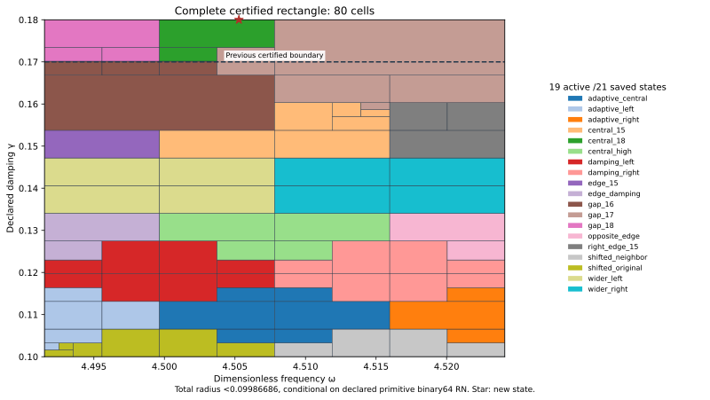

# Central J₁ state closes the complete rectangle through damping 9/50

The new exact state (ωc,γc)=(590516269/131072000,9/50), with its own flux upper, joins the unchanged previous 20 states. The complete rectangle ω∈[8983/2000,36193/8000]=[4.4915,4.524125], γ∈[1/10,9/50]=[0.1,0.18] passes with uniform continuum-plus-actual-evaluator radius **<0.09986686**, conditional on the declared primitive binary64 RN ties-to-even model. The center, full goal, depth 30 and 4096-leaf budget were frozen before generation and passed unchanged.

| Quantity | Constructor-verified result |
| --- | --- |
| Uniform total radius | 0.099866856765887899 |
| Leaves / maximum depth | 80 / 10 |
| Active / saved states | 19 /21 |
| Accepted represented input pairs | 138959858797020003161048311797 |
| Newly accepted upper-strip pairs | 13234272266382867938904923240 |
| Area / previous certified area | 261/100000 / 1827/800000 |
| Area ratio | 8/7 (+14.2857%) |

## New state and own upper

The unchanged meanfree Neumann scalar-wave benchmark uses F=10(x+y), μ(Ω)=2, 18673 nodal P2 coefficients with one exact mean constraint, and 12,288 tetrahedra. Relative to PR295's constructor, only the exact frequency literal changes. Flux, curl and replay constructors remain byte-identical. Exact decoding, weighted mean subtraction and residual correction audit the proposed two-word state; no exact-Galerkin premise is assumed for its continuum certificate.

Corrected J≈-4.254830025689116-1.752302510397382i. Finite-Galerkin algebraic output budget≈5.0969e-13. Own defect squared≈0.0004641137483679809. Direct actual reported-J continuum radius=0.006274570348033677. The distinct phase-proxy radius=0.003361198251502786 has a different center and is never substituted for J precision.

The projected-source RT1/root/patch flux plus exact affine-curl correction obeys divτ=zcΠ1v−F and zero boundary normal trace. The cell-meanfree remainder zc(Π1v−v) receives a local Poincaré dual lift. This lift is a dual existence bound, not a polynomial full-source flux. Exact full-P2-gradient moments, normal/divergence identities and source/payload bindings are replayed. Full Hermitian mass controls residual transport; full bilinear mass controls output correction; projected mass appears only in flux cross identities.

## Join and former obstruction

P234's depth24/depth 30 failures and all20-formula obstruction remain valid records for that particular family. At the new rational center, their minimum formula lower≈0.100059049463>0.1. New-state model upper≈0.006274570348. The new 21-state family accepts the exact represented obstruction input `['0x1.2056889ba5e35p+2', '0x1.70a3d70a3d70ap-3']` with owner central_18. This is a certificate-family improvement, not an actual-error lower or proof that other flux/dual choices could not succeed.

The prior full rectangle is PR293's γ≤17/100 certificate. P234 had no full γ≤9/50 cover. One new rectangular runtime guard and adaptive integer-word tree preserve the prior complete domain and add the full-width upper strip. Prior word count plus novel-strip count equals the new root count exactly; certified area grows by 8/7. Area measures the certified parameter domain, not physical performance.

Both center constants are nonbinary and both errors are included in floating propagation. Nearest frequency is below the exact interior rational center; it is not the first accepted frequency word. Nearest damping is below exact 9/50 and equals the last accepted damping word. The next damping word is rejected. Exact represented inputs, stored constants and rational state centers are distinct objects. Measurement/decimal-parsing uncertainty and physical calibration are outside scope.

## Uniform and actual arithmetic checks

For an exact meanfree trial vi, Ji(z)=Ji(zi)−(z−zi)∫vi² and H−Ji=ri(Az⁻¹ri). Cₚ≤1/2 and λ*=4, a valid lower bound rather than equality with λ₁, yield the source-bound transported box upper

\[
U_i(Q)=\sqrt{1+(w_+/(2g_-))^2}\left(\sqrt{d_i^2}+\sqrt{\nu_i^2}+\tfrac12D_i(Q)\|v_i\|_{L^2}\right)^2+E_i(Q).
\]

Every root, split, leaf upper, uniform maximum, analytic count and source dependency is checked. Owners minimize certified rational upper with lexicographic ties. Closed proof boxes share cuts; runtime word partitions are disjoint and consecutive. Frozen budget exhaustion remains UNRESOLVED. Finite parameter partition success does not establish FEM termination or an a priori mesh rate.

Supplemental native/software controls: 11104 input traces; 177664 intermediate nodes; 474 internal seams; 9 extension-boundary controls. Uniform floating radius≤4.15891562e-15. Source/AST, seven constant errors, 16 primitive RN operations, additive 2⁻¹⁰⁷⁵ underflow, magnitude<16 overflow exclusion, ties, type/nonfinite/domain rejection and corrupted certificate/split/word/domain/hash/uniform-radius controls pass. FMA/contraction is excluded; these checks are not an all-platform formal proof.

## Next step and evidence

The frozen 129-frequency×8-positive-damping-row scout contains 1032 points above 9/50 through 19/100. Raw next candidate=(36193/8000,19/100); sampled minimum formula lower≈0.180871223507. All sampled minimum model uppers below target: False; maximum≈0.180871223507. The preceding turn showed that such a coarse scout can miss a narrow cusp. It is diagnostic only, not uniform 19/100 coverage, global optimization, actual-error lower or presumed candidate precision.

**Next:** Construct an own state/flux upper at exact(36193/8000,19/100), then repeat the full expanded-region audit.

The default replay wrapper composes candidate state/flux and scalar-only replay. Actual saved executions run those components separately; REPLAY_RECEIPTS.json binds their commands and log hashes. Prior 20 state/flux records are reused by hash. Manifest/event inventory all new evidence; no old capture is rewritten. Figure inspected; Project saved and reloaded. CI checks repository integrity and rejection controls, not independent scientific review.

Ledger v0.39 is coefficient provenance, not a source/damping derivation. CRL2 remains a proposal. Notes Backup and ASTER are context, not proof. Gap2_FINAL_Finite_Genesis.png remains unavailable and unused. External scalar-wave benchmark only; no native UD action/source/damping/metric, material/horn, GR/QFT or experimental identification.

**A. CURRENT MISSION TRAJECTORY —** Close the narrow former 20-formula gap with a new state and own upper.

**B. WHAT WAS DONE —** Generated and replayed the central P2/flux state and full 21-state rectangle.

**C. FINDING —** Complete γ≤9/50 passes; uniform radius<0.09986686; certified area+14.2857%.

**D. UD GAP IMPACT —** DERIVED / EXACT CONDITIONAL benchmark; Scientific OPEN; Constructor checked only; independent_review:false; Development/no registry; physical promotion 0. Independent review, full-band precision, mesh termination and native UD bridge remain OPEN.

**NEXT —** Construct an own state/flux upper at exact(36193/8000,19/100), then repeat the full expanded-region audit.
