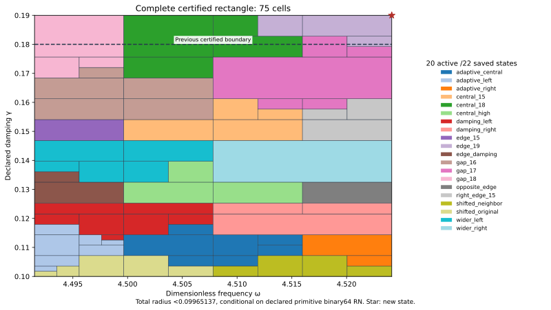

# Edge J₁ state and complete rectangle through damping 19/100

The new exact state (ωc,γc)=(36193/8000,19/100)=(4.524125,0.19), with its own flux upper, joins the unchanged previous 21 states. The complete rectangle ω∈[8983/2000,36193/8000]=[4.4915,4.524125], γ∈[1/10,19/100]=[0.1,0.19] passes with uniform continuum-plus-actual-evaluator radius **<0.09965137**, conditional on the declared primitive binary64 RN ties-to-even model. The center, full goal, depth 30 and 4096-leaf budget were frozen before generation and passed unchanged.

| Quantity | Constructor-verified result |
| --- | --- |
| Uniform total radius | 0.099651367742709676 |
| Leaves / maximum depth | 75 / 9 |
| Active / saved states | 20 /22 |
| Accepted represented input pairs | 152194131063402834367468774296 |
| Newly accepted upper-strip pairs | 13234272266382831206420462499 |
| Area / previous certified area | 2349/800000 / 261/100000 |
| Area ratio | 9/8 (+12.5%) |

## State and own upper

The unchanged meanfree Neumann scalar-wave benchmark uses F=10(x+y), μ(Ω)=2, 18,673 nodal P2 coefficients with one exact mean constraint, and 12,288 tetrahedra. Relative to PR297's constructor, only the exact frequency and damping literals change. Flux, curl and replay constructors remain byte-identical. Exact decoding, weighted mean subtraction and residual correction audit the proposed two-word state; no exact-Galerkin premise is assumed for its continuum certificate.

Corrected J≈-4.059503186867491-1.698875558215111i. Finite-Galerkin algebraic output budget≈3.53328e-13. Own defect squared≈0.0004247361645597397. Direct actual reported-J continuum radius=0.005468120543089255. The distinct phase-proxy radius=0.002930849616839617 has a different center and is never substituted for J precision.

The projected-source RT1/root/patch flux plus exact affine-curl correction obeys divτ=zcΠ1v−F and zero boundary normal trace. The cell-meanfree remainder zc(Π1v−v) receives a local Poincaré dual lift. This lift is a dual existence bound, not a polynomial full-source flux. Exact full-P2-gradient moments, normal/divergence identities and source/payload bindings are replayed. Full Hermitian mass controls residual transport; full bilinear mass controls output correction; projected mass appears only in flux cross identities.

## Join and endpoint audit

At the new rational center, the previous 21 particular transported formulas have minimum lower enclosure≈0.180871223507>0.1. New-state model upper≈0.005468120543. The new 22-state family accepts an exact represented input inside the proposed goal, `['0x1.218b439581062p+2', '0x1.851eb851eb851p-3']`, whose previous 21 minimum particular-formula lower≈0.180871223507>0.1; owner edge_19. This changes the formula family; it is not an actual-error lower, a global optimum or an exclusion of alternative flux/dual certificates.

One rectangular runtime guard and adaptive integer-word tree preserve PR297's entire γ≤9/50 domain and add the full-width upper strip. Prior word count plus novel-strip count equals the new root count exactly; certified area grows by 9/8. Area measures the certified parameter domain, not physical performance or certificate tightness. Earlier failed families and captures remain unchanged.

Both center constants are nonbinary. Nearest frequency lies below exact 36193/8000 and is the last accepted frequency word. Nearest damping lies above exact 19/100 and is one word above the last accepted damping word; the guard rejects it. Both constant quantization errors are included in arithmetic propagation. Exact stored-minus-rational errors are δω=-19/70368744177664000 and δγ=1/450359962737049600. Exact represented inputs, stored constants and rational state centers are distinct objects. Measurement/decimal-parsing uncertainty and physical calibration are outside scope.

## Uniform and actual arithmetic checks

For an exact meanfree trial vi, Ji(z)=Ji(zi)−(z−zi)∫vi² and H−Ji=ri(Az⁻¹ri). Cₚ≤1/2 and λ*=4, a valid lower bound rather than equality with λ₁, yield the source-bound transported box upper

\[
U_i(Q)=\sqrt{1+(w_+/(2g_-))^2}\left(\sqrt{d_i^2}+\sqrt{\nu_i^2}+\tfrac12D_i(Q)\|v_i\|_{L^2}\right)^2+E_i(Q).
\]

Every root, split, leaf upper, uniform maximum, analytic count and source dependency is checked. Owners minimize certified rational upper with lexicographic ties. Closed proof boxes share cuts; runtime word partitions are consecutive and disjoint. Frozen budget exhaustion remains UNRESOLVED. Finite parameter partition success does not establish FEM termination or an a priori mesh rate.

Supplemental native/software controls: 10426 input traces; 166816 intermediate nodes; 444 internal seams; 9 extension controls. Uniform floating radius≤4.16620668e-15. Source/AST, seven constant errors, 16 primitive RN operations, additive 2⁻¹⁰⁷⁵ underflow, magnitude<16 overflow exclusion, ties, type/nonfinite/domain rejection and corrupted certificate/split/word/domain/hash/uniform-radius controls pass. FMA/contraction is excluded; these checks are not an all-platform formal proof.

## Next step and evidence

The frozen 129-frequency×8-positive-damping-row scout contains 1,032 points above 19/100 through 1/5. Raw next candidate=(1151129/256000,1/5); sampled minimum formula lower≈0.170167375187. All sampled minimum model uppers below target: False; maximum≈0.170167375187. P234 demonstrated that this coarse scout can miss a narrow cusp. It is diagnostic only, not uniform 1/5 coverage, global optimization, actual-error lower or presumed candidate precision.

**Next:** Construct an own state/flux upper at exact(1151129/256000,1/5), then repeat the full expanded-region audit.

The default replay wrapper composes candidate state/flux and scalar-only replay. Actual saved executions run those components separately; REPLAY_RECEIPTS.json binds commands and log hashes. Prior 21 state/flux records are reused by hash. Manifest/event inventory all new evidence; no old capture is rewritten. Figure inspected; Project saved and reloaded. A browser screenshot was captured, but its shared-directory synchronization failed after five seconds, so no screenshot attachment is claimed. CI checks repository integrity and rejection controls, not independent scientific review.

Ledger v0.39 is coefficient provenance, not a source/damping derivation. CRL2 remains a proposal. Notes Backup and ASTER are context, not proof. Gap2_FINAL_Finite_Genesis.png remains unavailable and unused. External scalar-wave benchmark only; no native UD action/source/damping/metric, material/horn, GR/QFT or experimental identification.

**A. CURRENT MISSION TRAJECTORY —** Extend the certified continuum benchmark region with an actual edge state and own upper.

**B. WHAT WAS DONE —** Generated and replayed the new P2/flux state and full 22-state rectangle.

**C. FINDING —** Complete γ≤19/100 passes; uniform radius<0.09965137; certified area+12.5%.

**D. UD GAP IMPACT —** DERIVED / EXACT CONDITIONAL benchmark; Scientific OPEN; Constructor checked only; independent_review:false; Development/no registry; physical promotion 0. Independent review, full-band precision, mesh termination and native UD bridge remain OPEN.

**NEXT —** Construct an own state/flux upper at exact(1151129/256000,1/5), then repeat the full expanded-region audit.
