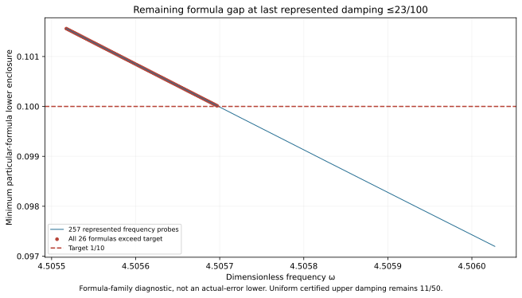

# New J₁ upper-boundary state; damping 0.23 rectangle unresolved

The actual state at exact (ωc,γc)=(36193/8000,23/100)=(4.524125,0.23) passes its own continuum upper and one exact represented-input continuum-plus-floating certificate. The proposed complete ω∈[4.4915,4.524125],γ∈[0.1,0.23] rectangle is **UNRESOLVED**: the prospectively frozen depth-30 /4096-leaf attempt exhausts its budget. No partial traversal is published as coverage.

**Current uniform coverage remains PR304's γ≤11/50 rectangle**, with total radius <0.09999451. No new runtime guard, complete-region precision, accepted-pair count or area gain is claimed.

| Object | Constructor-verified result |
| --- | --- |
| New own reported-J continuum radius | 0.0042344808040558051 |
| Distinct phase-proxy radius, different center | 0.0022698422168041751 |
| Exact represented corner total radius | 0.0042344808037463643 |
| Frozen complete rectangle, depth30 /4096 leaves | UNRESOLVED |
| First stopped box minimum total upper | 0.10000684849985363 |
| First stopped box midpoint model lower | 0.099992439937233418 |
| Local scout | 257 points; 91 have all 26 formula lowers >0.1 |
| Selected local minimum formula lower | 0.10155876996842828>0.1 |

## State and own upper

The unchanged external scalar-wave benchmark uses F=10(x+y),μ(Ω)=2,meanfree Neumann space,and 18,673 P2 nodal coefficients with one exact mean constraint on 12,288 tetrahedra. Only the two exact parameter literals change from the selected parent's state constructor;flux,curl and candidate replay constructors remain byte-identical. Exact decoding,weighted mean subtraction and residual correction audit the proposed two-word coefficients;the continuum certificate does not assume an exact Galerkin solve.

Corrected J≈-3.796372210320135-1.923359087889053i. Corrected finite-Galerkin algebraic output budget≈3.12955e-13;this is not itself continuum precision. Own defect squared≈0.0003974683084030099. Projected-source RT1/root/patch flux plus exact affine-curl correction satisfies divτ=zcΠ1v−F and zero boundary normal trace. The nonzero cell-meanfree remainder receives a rigorous local Poincaré dual lift;this does not construct an explicit polynomial full-source flux. Direct full-P2-gradient moments match projected-mass cross identities. Full Hermitian mass controls residual transport;full bilinear mass controls output correction. The phase-proxy radius has a different output center and is not substituted for reported-J precision.

## Endpoint words and a scoped point certificate

Both center constants are nonbinary. The nearest frequency word lies below the exact upper frequency guard and is its last proposed accepted word. The nearest damping constant lies above the exact upper damping guard,one word beyond its last proposed accepted input. Frozen stored-minus-rational errors are δω=-19/70368744177664000 and δγ=9/900719925474099200. Exact source/result/parameter/payload,bank equality and constant-word bindings pass.

The point input is ω=2546855958022193/562949953421312 (`0x1.218b439581062p+2`),γ=517913957147607/2251799813685248 (`0x1.d70a3d70a3d70p-3`). Its kernel trace matches software RN ties-to-even at all 16 primitive nodes. Exact corrected-output identity and propagated floating radius are checked,including both constant quantization errors. All 25 older particular-formula lowers exceed target here,while the new corner_23 point upper is below target. This closes this one input's formula gap,not the full rectangle.

The prospective full-cover evaluator/audit remain as attempted sources and have no COVER.json. They were not executed as a global API;the previous PR304 selector and guard remain authoritative. Primitive binary64 RN,FMA/contraction exclusion and exact represented inputs remain conditional assumptions. Measurement/decimal-parsing uncertainty and physical frequency calibration are outside this contract.

## Budget exhaustion and the residual formula gap

The single full goal and depth30 /4096-leaf budget were frozen before state generation and remain unchanged in PARAMETER_FREEZE.json and CONTRACT.json. The initial SCALAR_GENERATION.log preserves the expected failed construction. Diagnostic replay reproduces the first stopped box and each of its 26 certificate uppers. Its midpoint lower is below target,so exhaustion alone is not claimed as a pointwise obstruction.

After that result,a local 257-frequency scout was frozen before evaluation. Its frequency interval spans one original 1/128-band grid step on each side of the first exhausted-box midpoint,clipped to the goal. Damping is the greatest represented binary64≤23/100. LOCAL_SCOUT_FREEZE.json binds its bank and source diagnostic hashes. The selected represented input lies inside the proposed goal and has all 26 specified point-formula lower enclosures above 1/10. The selected rational frequency is 158523806250434577/35184372088832000≈4.50551755905151;exact candidate damping is 23/100. All 26 selected bounds and all 257 rows are retained. Formula counts,state names and threshold booleans are checked against the actual bank.

For every proof box containing that input,the declared nonnegative transported upper dominates its point model. Consequently further subdivision alone cannot make the unchanged 26-formula family pass there at target 1/10. This is a limitation of these particular formulas,not an actual-error lower,a continuum instability,a global optimum,or an exclusion of tighter flux/dual certificates. A new state or tighter own upper is a concrete next option. The candidate does not yet exist and has no precision guarantee.

The initially frozen future 1032-point scout above 23/100 through 6/25 was not executed,because the complete 0.23 rectangle did not pass. NEXT_STEP_REASSESSMENT.json instead directs work to the verified residual gap at the same upper damping.

## Replay, correction and provenance

Run `PYTHONDONTWRITEBYTECODE=1 python3 replay.py`. Actual saved executions run candidate state/flux and scalar-only replay separately;REPLAY_RECEIPTS.json binds commands and log hashes. Scoped scalar replay reproduces the expected cover exhaustion,the local scout,and the own-state/point audit. Replay PASS does not mean the uniform extension passed.

The first point-diagnostic wrapper stopped at a stale INITIAL_CONTRACT.json filename inherited from an older two-attempt capture. This capture has one CONTRACT.json. Original point_audit.py,POINT_DIAGNOSTIC_REPLAY_v0_1.py and FINAL_SCALAR_GENERATION.log are preserved;point_audit_v0_2.py changes only that filename. FINAL_SCALAR_GENERATION_v0_2.log and saved scalar replay pass. CORRECTION_REGISTRY.json records this construction-found packaging correction;no mathematical result or threshold changed,and no frozen mathematical retraction is made. A full-session retraction ratio is not computed without a complete claim inventory.

Old captures are unchanged;the previous 25 state results are reused by hash. Source dependencies are pinned in CONTRACT.json. Figure inspected;native Project saved/reloaded with proof. CI checks append-only integrity and rejection controls,not independent scientific review. Concurrent weighted-observer PR305 is preserved without importing its conclusions into this scalar benchmark.

Ledger v0.39 remains coefficient provenance,not a source/damping derivation. CRL2 remains a proposal. Notes Backup and ASTER are context,not proof. Gap2_FINAL_Finite_Genesis.png remains unavailable and unused. External scalar-wave benchmark only;no native UD action/source/damping/metric,material/horn,GR/QFT or experimental identification.

**A. CURRENT MISSION TRAJECTORY —** Add the upper-boundary state and test full damping 0.23 coverage.

**B. WHAT WAS DONE —** Own state/flux and one-input certificate pass;frozen cover exhaustion reproduces;local scout verifies a remaining 26-formula gap.

**C. FINDING —** New own radius<0.00423449. Uniform extension unresolved;accepted upper damping remains 11/50.

**D. UD GAP IMPACT —** DERIVED / EXACT CONDITIONAL point/formula results;Scientific OPEN;Constructor checked only;independent_review:false;Development/no registry;physical promotion 0. Independent review,full-band precision,FEM termination,native UD bridge remain OPEN.

**NEXT —** Construct an own state/flux upper at exact (158523806250434577/35184372088832000,23/100), then repeat the complete-region audit.
