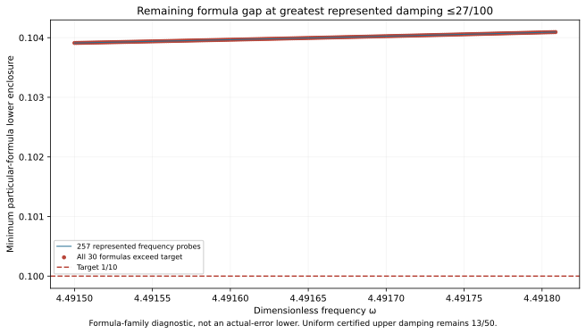

# New J₁ upper corner state; damping 27/100 rectangle unresolved

The actual state at exact (ωc,γc)=(36193/8000,27/100)=(4.524125,0.27) passes its own continuum upper and one exact represented-input continuum-plus-floating certificate. The proposed complete ω∈[4.4915,4.524125],γ∈[0.1,0.27] rectangle is **UNRESOLVED**: the prospectively frozen depth-30 /4096-leaf attempt exhausts its depth budget. No partial traversal is published as coverage.

**Current uniform coverage remains PR315's γ≤13/50 rectangle**, with total radius <0.09998653. No new runtime guard, complete-region precision, accepted-pair count or area gain is claimed.

| Object | Constructor-verified result |
| --- | --- |
| New own reported-J continuum radius | 0.0033582485689567431 |
| Distinct phase-proxy radius, different center | 0.0018003456417940589 |
| Exact represented corner total radius | 0.0033582485686244573 |
| Frozen full rectangle, depth30 /4096 leaves | UNRESOLVED |
| First stopped box minimum total upper | 0.10000002666447901 |
| First stopped box midpoint model lower | 0.099986818976544947 |
| Local scout | 257 points; 257 have all 30 formula lowers >0.1 |
| Selected local minimum formula lower | 0.10409422654081328>0.1 |

## State and own upper

The unchanged external scalar-wave benchmark uses F=10(x+y),μ(Ω)=2, meanfree Neumann space, and 18,673 P2 nodal coefficients with one exact mean constraint on 12,288 tetrahedra. Only the exact frequency and damping literals change from `captures/2026-10-21T011136Z-codex-j1-central-25-6d36cf09`. Flux, curl and candidate replay constructors remain byte-identical. The placement/bank/last complete uniform source is separately bound to `captures/2026-10-21T012822Z-codex-j1-bank-26-5b4bbc69`. All 29 prior bank entries remain exactly equal.

Exact decoding, weighted mean subtraction and residual correction audit the proposed two-word state. The continuum certificate does not assume an exact Galerkin solve. Corrected J≈-3.524376872347007-2.096254324001721i. Corrected finite-Galerkin algebraic output budget≈3.35548e-13; this alone is not continuum precision. Own defect squared≈0.0003692816458766193.

The projected-source RT1/root/patch flux plus exact affine-curl correction satisfies divτ=zcΠ1v−F and zero boundary normal trace. The nonzero cell-meanfree remainder receives a rigorous local Poincaré dual lift; this does not construct an explicit polynomial full-source flux. Direct full-P2-gradient moments match projected-mass cross identities. Full Hermitian mass controls residual transport; full bilinear mass controls output correction. The phase-proxy radius has a different output center and is not substituted for reported-J precision.

## Exact boundary words and point certificate

Both center constants are nonbinary. Nearest frequency lies below the exact upper frequency guard and is its last proposed accepted word. Its stored-minus-rational error is -19/70368744177664000. Nearest damping lies above the exact 27/100 upper guard, one word beyond its last accepted input. Its error is 1/56294995342131200. Frozen hex words, exact errors, state/result/parameter/payload and prior-bank bindings pass.

The point input is ω=2546855958022193/562949953421312 (`0x1.218b439581062p+2`),γ=4863887597560135/18014398509481984 (`0x1.147ae147ae147p-2`). Its kernel trace matches software RN ties-to-even at all 16 primitive nodes. The exact corrected-output identity and propagated floating radius include all seven constant quantization errors, including both nonzero center errors. All 29 older particular-formula lowers exceed target here, while the new corner_27 point upper is below target. This closes this one input's formula gap, not the full rectangle.

The prospective full-cover evaluator/audit remain as attempted sources and have no COVER.json. They were not executed as a global API; PR315's selector and guard remain authoritative. Primitive binary64 RN, FMA/contraction exclusion and exact represented inputs remain conditional assumptions. Measurement/decimal-parsing uncertainty and physical frequency calibration are outside this contract.

## Frozen exhaustion and remaining formula gap

The full goal and depth30 /4096-leaf budget were frozen before state generation and remain unchanged in PARAMETER_FREEZE.json and CONTRACT.json. SCALAR_GENERATION.log preserves the failed construction. Diagnostic replay reproduces the first stopped box and each of its 28 certificate uppers. Its midpoint lower is below target, so exhaustion alone is not a pointwise obstruction.

After that result, a local 257-frequency scout was frozen before evaluation. Its interval spans one original 1/128-band frequency step on either side of the first exhausted-box midpoint, clipped to the goal. Damping is the greatest represented binary64≤27/100. LOCAL_SCOUT_FREEZE.json binds the bank and diagnostic hashes. The selected represented input lies inside the proposed goal and has all 30 specified point-formula lower enclosures above 1/10. Selected rational frequency=1264331734346891259/281474976710656000≈4.49180864715576; candidate damping=27/100. The selected point is at the upper endpoint of this finite local grid; no global or local-continuous optimum is asserted. All 30 selected bounds and all 257 rows are retained. Counts, state names and threshold booleans are checked against the actual bank.

For a proof box containing that input, the declared nonnegative transported upper dominates its point model. Further subdivision alone cannot make this unchanged 30-formula family pass at target 1/10. This is a limitation of these formulas, not an actual-error lower, continuum instability, global optimum, or exclusion of tighter flux/dual certificates. A new state or tighter own upper is a concrete next option. The candidate does not yet exist and has no precision guarantee.

The initially frozen future 1032-point scout above 27/100 through 7/25 was not executed, because the complete 27/100 rectangle did not pass. NEXT_STEP_REASSESSMENT.json directs work to the verified residual gap at the same upper damping.

## Replay and provenance

`PYTHONDONTWRITEBYTECODE=1 python3 replay.py` composes candidate state/flux and scoped scalar replay. Actual saved executions run those components separately; REPLAY_RECEIPTS.json binds commands and log hashes. Scalar replay reproduces the expected exhaustion, the local scout, and the own-state/point audit. Replay PASS does not mean the uniform extension passed. PROSPECTIVE_REPLAY.py preserves the original full-cover wrapper. No mathematical threshold or frozen goal changed; no new frozen mathematical retraction is made. The full-session retraction ratio is not computed without a complete claim inventory.

Old captures are unchanged; prior 29 state/flux records are reused by hash. Source dependencies are pinned in CONTRACT.json. Figure inspected; native Project saved/reloaded with a separate screenshot delivery receipt. CI checks append-only integrity, not independent scientific review. Other captures remain separate; their conclusions are not imported here.

Ledger v0.39 remains coefficient provenance, not a source/damping derivation. CRL2 remains a proposal. Notes Backup and ASTER are context, not proof. Gap2_FINAL_Finite_Genesis.png remains unavailable and unused. External scalar-wave benchmark only; no native UD action/source/damping/metric, material/horn, GR/QFT or experimental identification.

**A. CURRENT MISSION TRAJECTORY —** Add a boundary state and test full damping 0.27 coverage.

**B. WHAT WAS DONE —** Own state/flux and one-input certificate pass; frozen cover exhaustion reproduces; local scout verifies a remaining 30-formula gap.

**C. FINDING —** New own radius<0.00335825. Uniform extension unresolved; accepted upper damping remains 13/50.

**D. UD GAP IMPACT —** DERIVED / EXACT CONDITIONAL point/formula results; Scientific OPEN; Constructor checked only; independent_review:false; Development/no registry; physical promotion 0. Independent review, full-band precision, FEM termination, native UD bridge remain OPEN.

**NEXT —** Construct an own state/flux upper at exact (1264331734346891259/281474976710656000,27/100), then repeat the complete-region audit.
