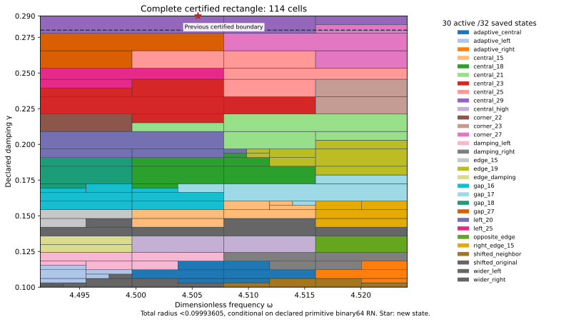

# New J₁ interior-frequency boundary state and complete rectangle through damping 29/100

The new exact state (ωc,γc)=(4613651/1024000,29/100)=(4.5055185546875,0.29), with its own flux upper, joins the unchanged previous 31 states. The complete rectangle ω∈[8983/2000,36193/8000]=[4.4915,4.524125],γ∈[1/10,29/100]=[0.1,0.29] passes with **uniform continuum-plus-actual-evaluator radius <0.09993605**, conditional on declared primitive binary64 RN ties-to-even. The center, full goal, depth 30 and 4096-leaf budget were frozen before generation and passed unchanged.

| Quantity | Constructor-verified result |
| --- | --- |
| Uniform total radius | 0.099936046967512793 |
| Leaves / maximum depth | 114 / 11 |
| Active / saved states | 30 / 32 |
| Accepted represented pairs | 258068309194465704413739238734 |
| Newly accepted upper-strip pairs | 6617136133191433969452461620 |
| Area ratio / increase | 19/18 / 5.55556% |

## State and own upper

The unchanged meanfree Neumann scalar-wave benchmark uses F=10(x+y),μ(Ω)=2, and 18,673 nodal P2 coefficients with one exact mean constraint on 12,288 tetrahedra. Relative to `captures/2026-10-21T020123Z-codex-j1-gap-27-b2339936`, only the exact frequency and damping literals change. Flux, curl and candidate replay constructors remain byte-identical. Exact decoding, weighted mean subtraction and residual correction audit the proposed two-word state; the continuum certificate does not assume an exact Galerkin solve.

Corrected J≈-3.454767554430702-2.291658231153672i. Finite-Galerkin algebraic output budget≈7.7609e-14; this alone is not continuum precision. Own defect squared≈0.0003774016804887067. Direct actual reported-J continuum radius=0.003184150217219618. The distinct phase-proxy radius=0.001706200613315525 has a different center and is not substituted for J precision.

The projected-source RT1/root/patch flux plus exact affine-curl correction obeys divτ=zcΠ1v−F and zero boundary normal trace. The cell-meanfree remainder zc(Π1v−v) receives a local Poincaré dual lift. This is a dual existence bound, not an explicit polynomial full-source flux. Saved replay checks direct divergence, normal traces, affine correction and full-P2-gradient moments. Full Hermitian mass controls residual transport; full bilinear mass controls output correction; projected mass appears only in flux cross identities.

## Join and rounded boundaries

At the new rational center, the previous 31 particular transported formulas have minimum lower enclosure≈0.133810192034>0.1. New-state model upper≈0.003184150217. The exact represented input `['0x1.205a6a7ef9db2p+2', '0x1.28f5c28f5c28fp-2']`, inside the goal, has previous-family minimum formula lower≈0.133810192034>0.1 and is now accepted with owner central_29. This is a change in certificate family, not an actual-error lower, a global optimum or exclusion of alternative flux/dual certificates.

One rectangular runtime guard and adaptive integer-word tree preserve the previous full γ≤7/25 domain and add the full-width upper strip. Previous count plus novel-strip count equals the new root count exactly. Area ratio=19/18; area measures certified parameter coverage, not physical performance or certificate tightness.

Both center constants are nonbinary. Nearest frequency lies below the exact interior center and is distinct from both frequency guard endpoints. Nearest damping lies below the exact upper damping guard and is its last accepted input word; the adjacent word above the guard is rejected. Stored-minus-rational errors are δω=-11/70368744177664000 and δγ=-9/450359962737049600. The frozen hex words and exact errors are checked; both errors enter arithmetic propagation. Rational state centers, stored constants and exact represented inputs remain distinct. Measurement/decimal-parsing uncertainty and physical calibration are outside this contract.

The placement/bank and last complete uniform source is `captures/2026-10-21T021712Z-codex-j1-bank-28-e01894e7`, using `PLACEMENT_RESULTS.json`. The state constructor source is separately bound to `captures/2026-10-21T020123Z-codex-j1-gap-27-b2339936`. This 29/100 goal extends the successful 7/25 parent;the state constructor is separately bound above. All previous 31 bank entries remain exactly equal. Scout metadata derives its formula count from the actual bank and checks every row's count, state keys and threshold flag. No mathematical formula or threshold changes. No new frozen mathematical retraction is made; the full-session retraction ratio is not computed without a complete claim inventory.

## Uniform and actual arithmetic audit

For exact meanfree trial vi, Ji(z)=Ji(zi)−(z−zi)∫vi² and H−Ji=ri(Az⁻¹ri). Cₚ≤1/2 and λ*=4, a valid continuum lower bound rather than equality with λ₁, yield

\[
U_i(Q)=\sqrt{1+(w_+/(2g_-))^2}
\left(\sqrt{d_i^2}+\sqrt{\nu_i^2}+\tfrac12D_i(Q)\|v_i\|_{L^2}\right)^2+E_i(Q).
\]

Every source dependency, root, split, leaf bound, uniform maximum and analytic count is checked. Owners minimize certified rational upper with lexicographic ties. Closed proof boxes share cuts; runtime word partitions are disjoint and consecutive. Frozen budget exhaustion remains UNRESOLVED. Successful finite parameter partitioning does not prove FEM accuracy termination or an a priori mesh rate.

Supplemental native/software controls: 15849 input traces,253584 intermediate nodes,678 internal seams, and 9 extension controls. Uniform floating radius≤4.77068671e-15. Source/AST, seven constant errors,16 primitive RN operations, additive 2⁻¹⁰⁷⁵ underflow, magnitude<16 overflow exclusion, ties, type/nonfinite/domain rejection, and corrupted certificate/split/word/domain/hash/uniform-radius checks pass. FMA/contraction is excluded; these checks are not an all-platform formal proof. No interpolation or continuity claim is added.

## Next action and replay

The prospectively frozen 129-frequency×8-positive-damping-row scout contains 1,032 points above 29/100 through 3/10, with 32 formulas per point. Raw next candidate=(36193/8000,3/10); sampled minimum formula lower≈0.095440989181. All sampled minimum model uppers below target: yes; maximum≈0.095440989181. This remains diagnostic only. No uniform 3/10 cover, actual-error lower, global optimum or presumed candidate precision is claimed.

**Next:** Audit the complete region through γ=3/10 with the existing 32-state bank; if unresolved, inspect a prospectively frozen local scout before choosing a new state.

The standard root replay wrapper composes candidate state/flux and scalar-only replay. Actual saved executions run the components separately; REPLAY_RECEIPTS.json binds commands and log hashes. Prior 31 state/flux records are reused by hash. Manifest/event inventory every new artifact; old captures are unchanged. Figure inspected; native Project saved and reloaded. CI checks capture integrity and rejection controls, not independent scientific review.

Ledger v0.39 is coefficient provenance, not a source/damping derivation. CRL2 remains a proposal. Notes Backup and ASTER remain context, not proof. Gap2_FINAL_Finite_Genesis.png remains unavailable and unused. External scalar-wave benchmark only; no native UD action/source/damping/metric, material/horn, GR/QFT or experimental identification.

**A. CURRENT MISSION TRAJECTORY —** Extend certified continuum coverage with a boundary state and own upper.

**B. WHAT WAS DONE —** Constructed and replayed the new P2/flux state and complete 32-state rectangle.

**C. FINDING —** Complete γ≤29/100 passes; uniform radius<0.09993605; certified area+5.55556%.

**D. UD GAP IMPACT —** DERIVED / EXACT CONDITIONAL benchmark; Scientific OPEN; Constructor checked only; independent_review:false; Development/no registry; physical promotion 0. Independent review, full-band precision, FEM termination and native UD bridge remain OPEN.

**NEXT —** Audit the complete region through γ=3/10 with the existing 32-state bank; if unresolved, inspect a prospectively frozen local scout before choosing a new state.
