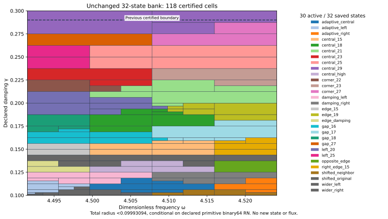

# Existing J₁ state bank certifies the complete rectangle through γ=3/10

The unchanged 32-state bank now certifies

\[
\omega\in[8983/2000,36193/8000]=[4.4915,4.524125],\qquad
\gamma\in[1/10,3/10]=[0.1,0.3].
\]

The uniform continuum-plus-actual-evaluator radius is **<0.09993094**, conditional on the declared primitive binary64 RN ties-to-even model. No new coefficients, state or flux witness were constructed. The exact goal and depth-30 /4096-leaf budget were frozen before execution and passed unchanged.

| Quantity | Constructor-verified result |
| --- | --- |
| Uniform total radius | 0.099930936808390144 |
| Leaves / maximum depth | 118 / 11 |
| Active / saved states | 30 / 32 |
| Accepted represented input pairs | 264685445327657138383191700354 |
| Newly accepted upper-strip pairs | 6617136133191433969452461620 |
| Certified area / previous area | 261/40000 / 4959/800000 |
| Area ratio / increase | 20/19 / 5.26316% |

## Scope and reused scientific evidence

BANK.json, kernel.py, rounding.py, evaluator.py and planner.py are byte-identical to `captures/2026-10-21T022502Z-codex-j1-central-29-cfccae61`. The bank contains the same 32 actual P2 states and own projected-source RT1/curl/local-lift results. Exact source-result hashes, full bilinear/Hermitian mass identities, defect/lift budgets and all seven quantized constants per state are checked against their source results. Prior coefficient/flux witnesses and saved replay receipts are pinned transitively in CONTRACT.json. They were reused by hash; their expensive state/flux replays were not rerun in this capture.

The meanfree Neumann scalar-wave benchmark keeps F=10(x+y), normalized μ(Ω)=2, the same J₁ geometry and metrics, and 18,673 P2 nodal coefficients with one exact mean constraint on 12,288 tetrahedra. Cₚ≤1/2 and λ*=4 remain continuum theorem anchors; λ* is a lower bound, not equality with λ₁. These are inherited conditional mathematical premises, not a native UD constitutive law or empirical calibration.

For an exact meanfree trial vi, the corrected bilinear output Ji(z)=Ji(zi)−(z−zi)∫vi² obeys H−Ji=ri(Az⁻¹ri). Each declared closed proof box Q has the certified upper

\[
U_i(Q)=\sqrt{1+(w_+/(2g_-))^2}
\left(\sqrt{d_i^2}+\sqrt{\nu_i^2}+\tfrac12D_i(Q)\|v_i\|_{L^2}\right)^2+E_i(Q).
\]

The own projected-source flux enforces divτ=ziΠ1vi−F and zero normal trace. The remaining cell-meanfree source uses a local Poincaré dual lift. Full Hermitian mass controls residual transport; full bilinear mass controls corrected output. No exact Galerkin solve assumption, inherited discrete spectral gap, new rate constant or explicit full-source polynomial flux is introduced. Distinct phase-proxy output centers/radii remain distinct from reported-J precision.

## Complete cover and actual arithmetic audit

Every source dependency, root box, split, leaf certificate, uniform maximum and accepted-pair count is checked. Owners minimize exact rational total upper, with lexicographic ties. Closed proof boxes share split cuts; consecutive integer-word runtime partitions are disjoint. The previous complete γ≤29/100 rectangle is included, and previous pair count plus the new full-width strip count equals the new root count exactly. Area measures parameter coverage, not physical performance.

Supplemental native/software controls comprise 16390 input traces, 262240 intermediate nodes, 702 internal seams and 9 extension controls. Every trace checks all 16 primitive RN operations against exact software rounding and the propagated node budgets. The trace, tree-verifier and native-control functions are AST-identical to the parent audit. Seven constant quantization errors, additive 2⁻¹⁰⁷⁵ underflow, magnitude<16 overflow exclusion, ties, invalid types, nonfinite/out-of-domain inputs, and corrupted certificate/split/word/domain/hash/uniform-radius controls are checked. Artificial depth/leaf exhaustion is rejected as UNRESOLVED.

No interpolation, estimator continuity, successful FEM termination, quantitative mesh rate or all-platform formal conformance is claimed. FMA/contraction is excluded. Measurement/decimal-parsing uncertainty and physical frequency calibration are outside this conditional contract.

For the exact upper input guard 3/10, nearest binary64 is `0x1.3333333333333p-2`, strictly below the rational guard by 1/90071992547409920. It is the last accepted damping input; the adjacent higher word lies above the exact guard and is rejected. The audit checks the last accepted word below the guard and this adjacent excluded word. This is guard/input representation metadata, not a new state-center constant or damping law. Original state-center constants remain unchanged.

## Next task and reproduction

The source 32-state scout in PR322 had every sampled minimum model upper below target through 3/10, maximum≈0.09544098918108053. That finite-grid observation selected this uniform-audit task; it did not certify the extension. The new complete tree and actual-evaluator audit supply the extension certificate.

A separately prospectively frozen 129-frequency×8-positive-damping-row scout contains 1,032 points above 3/10 through 31/100. It uses 32 formulas per point, with each row's formula count, state keys and threshold flag checked. Raw selected candidate=(36193/8000,31/100); sampled minimum formula lower≈0.143403192902. All sampled minimum model uppers below target: False; maximum≈0.143403192902. The historical coarse scout missed a narrow cusp, so this remains a diagnostic ranking only. No uniform 31/100 coverage, actual-error lower, global optimum, alternate-certificate no-go or presumed new-state precision is claimed.

**Next:** Construct an own state/flux upper at exact (36193/8000,31/100), then repeat the complete expanded-region audit.

Run `PYTHONDONTWRITEBYTECODE=1 python3 replay.py`. The saved replay reproduces COVER.json, PLACEMENT_RESULTS.json and AUDIT_RESULTS.json; REPLAY_RECEIPTS.json binds its exit status and log hash. Existing state/flux receipts are reused, not claimed as newly executed. Figure inspected; Project save/reload and screenshot delivery are recorded separately. Manifests/events preserve old captures unchanged. Concurrent captures remain separate; their conclusions are not imported here. CI checks capture integrity, not independent scientific review.

Ledger v0.39 remains coefficient provenance, not a source/damping derivation. CRL2 remains a proposal. Notes Backup and ASTER are context, not proof. Gap2_FINAL_Finite_Genesis.png remains unavailable and unused. External scalar-wave benchmark only; no native UD action/source/damping/metric, material/horn, GR/QFT or experimental identification. No new frozen mathematical retraction is made; a full-session retraction ratio is not computed without a complete inventory.

**A. CURRENT MISSION TRAJECTORY —** Extend the certified continuum region using the existing bank.

**B. WHAT WAS DONE —** Reused all 32 states by hash and replayed the new complete cover and actual evaluator audit.

**C. FINDING —** Full γ≤3/10 passes; total radius<0.09993094; certified area+5.26316%.

**D. UD GAP IMPACT —** DERIVED / EXACT CONDITIONAL benchmark; Scientific OPEN; Constructor checked only; independent_review:false; Development/no registry; physical promotion 0. Independent review, full-band precision, FEM termination and native UD bridge remain OPEN.

**NEXT —** Construct an own state/flux upper at exact (36193/8000,31/100), then repeat the complete expanded-region audit.
