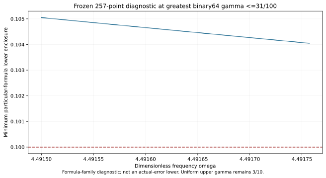

# J1 corner state at exact(36193/8000,31/100)

The new own state and one exact represented-input continuum-plus-floating certificate pass; point total radius=0.002709349558929478. The complete 31/100 rectangle is **UNRESOLVED** at the frozen depth 30/4096-leaf budget. Current complete uniform coverage remains PR323's gamma<=3/10, total radius<0.09993094. No partial cover, new runtime guard, area gain or accepted-pair count is published.

The parameters, complete goal and depth 30/4096-leaf budget were frozen before generation. The new state extends the prior 32-state bank; all previous entries remain exactly equal. Constructor source: `captures/2026-10-21T022502Z-codex-j1-central-29-cfccae61`. Placement/bank/last complete uniform source: `captures/2026-10-21T024059Z-codex-j1-bank-30-7fcf86a1`. These sources are independently hash-bound; only exact frequency and damping literals changed in the state constructor. Flux, curl and candidate replay source bytes are unchanged.

| New state quantity | Constructor result |
| --- | --- |
| Corrected J | -3.253903283111948-2.22230539873862i |
| Finite-Galerkin algebraic output budget | 2.66462e-13 |
| Own defect squared | 0.0003412524226690597 |
| Own reported-J continuum radius | 0.002709349559193178 |
| Distinct phase-proxy radius, different center | 0.001452657037332049 |

The external normalized scalar-wave benchmark remains meanfree Neumann on the same convex J1 domain, with F=10(x+y), mu(Omega)=2, 18,673 nodal P2 coefficients, one exact mean constraint and 12,288 tetrahedra. Exact weighted mean removal and residual correction avoid assuming an exact Galerkin solve. The own projected-source RT1/patch/curl flux obeys div(tau)=zc Pi1(v)-F and zero boundary normal trace. The remaining cell-meanfree source receives a local Poincare dual lift; this is not an explicit polynomial full-source flux. Direct divergence, normal traces, affine correction and full-P2-gradient moments are checked. Full Hermitian mass controls residual transport; full bilinear mass controls output correction; projected mass appears only in cross identities. The distinct phase-proxy radius is not substituted for reported-J precision.

The inherited continuum anchors are Cp<=1/2 and lambda*=4, a lower bound rather than equality with lambda1. For exact meanfree trial v, the corrected output J(z)=J(zc)-(z-zc) integral(v²) and H-J=r(Az^-1 r). The box certificate is

\[
U(Q)=\sqrt{1+(w_+/(2g_-))^2}
\left(\sqrt{d^2}+\sqrt{\nu^2}+\tfrac12D(Q)\|v\|_{L^2}\right)^2+E(Q).
\]

Both center constants are nonbinary and round below the exact upper frequency/damping guards. They are each the last accepted input word on that boundary; adjacent higher words lie outside the proposed guard. Stored-minus-exact errors are omega:-19/70368744177664000 and gamma:-1/450359962737049600. Frozen hex words and both exact quantization errors are checked and propagated. Exact rational centers, stored constants and exact represented inputs remain distinct. Primitive binary64 RN ties-to-even, 16 separate operations, no FMA/contraction and declared finite/overflow assumptions remain conditional. Measurement/decimal-parsing uncertainty and physical calibration are outside scope.

Diagnostic replay reproduces the first stopped box and all 33 certificate uppers. Its minimum box upper≈0.1000147101920262; midpoint minimum formula lower≈0.09999570169478877. The midpoint lower is below 1/10, so exhaustion alone is not a pointwise formula obstruction. The own-state/point audit checks source/parameter/payload and prior-bank bindings, exact corrected-output identity, and all 16 primitive RN nodes for one represented corner input. The prospective global evaluator/selector/rejection suite was not executed as a global API; PR323's guard remains authoritative.

After the failed cover attempt, a 257-frequency local grid was prospectively frozen around the first stopped-box midpoint at greatest represented gamma<=31/100. Selected rational candidate=(8983/2000,31/100); minimum 33-formula lower at its represented input≈0.105049569410; formula obstruction:True. If positive above 1/10, this excludes closing that input using only subdivision of these unchanged 33 transported-upper formulas. The selected rational point is the lower endpoint of this finite grid, not a continuous optimum. It is not an actual-error lower or exclusion of tighter flux/dual certificates. The initially frozen future 1032-point scout through 8/25 was not executed.

**Next:** Construct an own state/flux upper at exact(8983/2000,31/100), then repeat the unchanged full-goal audit.

The saved root wrapper composes candidate state/flux and scalar replay. Execution receipts bind the separately executed components and exact log hashes. Prior 32 state/flux results and receipts are reused by hash. Budget exhaustion is UNRESOLVED, not an actual-error lower or successful FEM accuracy-termination theorem. No quantitative mesh rate, interpolation, estimator continuity or all-platform formal conformance is claimed.

Workspace maintenance removed the prior local checkout/helpers. Frozen records were restored from GitHub and all 7010 recorded baseline files verified; RESTORE_RECEIPT.json records scope. Separate PR324 is preserved without transferring its conclusions. Ledger v0.39 is coefficient provenance, not a source/damping derivation; CRL2 remains a proposal. Notes Backup/ASTER are not proof. Gap2_FINAL_Finite_Genesis.png remains unavailable/unused. No native UD action/source/damping/metric, material/horn, GR/QFT or experimental identification is made. 0 new frozen mathematical retractions; full-session ratio not computed without a complete inventory.

**A. CURRENT MISSION TRAJECTORY —** Extend certified continuum coverage with an own corner-state upper.

**B. WHAT WAS DONE —** Constructed the new P2/flux state and scoped scalar audit; old 32 entries preserved.

**C. FINDING —** Own state/point PASS; full 31/100 extension UNRESOLVED; current uniform upper gamma remains 3/10.

**D. UD GAP IMPACT —** DERIVED / EXACT CONDITIONAL benchmark; Scientific OPEN; Constructor checked; independent_review:false; Development/no registry; physical promotion 0. Independent review, full-band precision, FEM termination and native UD bridge remain OPEN.

**NEXT —** Construct an own state/flux upper at exact(8983/2000,31/100), then repeat the unchanged full-goal audit.
