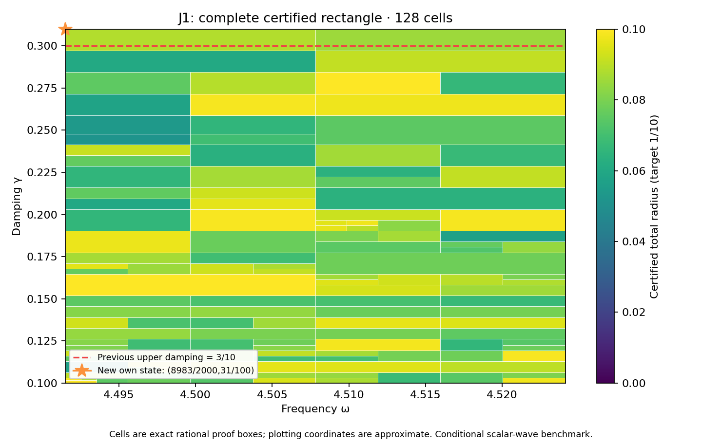

# J1 left-corner state and complete damping rectangle through 31/100

**Result: own state/flux PASS; complete frozen rectangle PASS.** Conditional external scalar-wave benchmark. Scientific OPEN; constructor checked; independent review pending. Development — no registry entry; physical promotion 0.

The new exact rational center is
\[
(\omega_c,\gamma_c)=(8983/2000,31/100).
\]
It was selected before generation by P251's frozen 257-frequency local scout, whose particular-formula lower enclosure exceeded the target at the represented input. That selection was a finite-grid diagnostic, never an actual-error lower or continuous optimum. P251/PR325 remains immutable and accurately records its failed 33-state attempt.

## Construction and certificate

Only the frequency literal changed in P251's state constructor; damping remains 31/100. Flux, curl and candidate replay sources are byte-identical. The source, geometry, metric, normalized measure and 12,288-tetrahedron meanfree P2 mesh with 18,673 nodal coefficients are unchanged. A new two-word floating state was generated, then audited using exact decoded words and exact mean removal. It has a separately generated projected-source RT1 flux, patch equilibration, curl correction and cellwise-meanfree residual lift.

The actual corrected output is approximately (-3.352126883528068-2.447881672053792j). Its own reported-J continuum radius is **0.0029792814362322**, and the continuum-plus-floating certificate at the exact represented input is **0.0029792814361616**. The separate phase-proxy radius is 0.0015958846100782; its center differs from reported J and is not substituted silently. The defect squared is 0.000378336570128507. Source/state/flux payload hashes, exact full P2 mass and parameter equality are checked.

The Neumann constant remains C_P<=1/2 with continuum spectral lower bound lambda_*=4, not an asserted equality for the first eigenvalue. The local residual transport certificate is
\[
r_Q=\kappa_Q\left(\sqrt{d_c^2}+\sqrt{\nu_c^2}+\tfrac12 D_{z,Q}\sqrt{m_c}\right)^2+E_Q.
\]
Here d_c^2 is the own flux defect, nu_c^2 is the local residual-lift budget, m_c is the full Hermitian state mass, and D_z bounds the parameter shift. The estimator transports J using the full bilinear mass. The projected mass is confined to its cross-identity role. No exact Galerkin premise is imposed on saved floating coefficients.

## Joined region

The prospectively frozen domain and finite algorithm budget are unchanged from P251:

| Parameter | Exact interval / budget |
|---|---|
| Frequency | [8983/2000,36193/8000] |
| Damping | [1/10,31/100] |
| Depth / leaves | 30 / 4096 |
| Target | 1/10 |

Adding one new entry preserves all prior 33 bank entries byte-for-byte. The complete audit passes with **128 cells**, maximum depth **11**, 32 active owners, and uniform total radius **0.0997743730885966 < 1/10**. It includes the entire previous PR323 rectangle through 3/10 and the new full-width upper strip. Exact area ratio is **21/20**, a 5% increase; accepted represented-input pairs total **271302581460848572352644161974**, including **6617136133191433969452461620** new pairs. Proof boxes share cuts; word partitions are disjoint and exhaust the rectangular guard.

The nearest frequency constant `0x1.1f74bc6a7ef9ep+2` lies above the exact lower boundary by `19/70368744177664000` and is the first accepted word. The damping constant `0x1.3d70a3d70a3d7p-2` lies below the exact upper boundary by the signed offset `-1/450359962737049600` and is the last accepted word. Both quantization errors enter the floating bound. Adjacent outside words are rejected by the exercised global API.

## Verification and next gate

The unchanged evaluator, planner, kernel and rounding sources preserve the 16-operation primitive RN model, exact rational square-root enclosure, outward error grid, underflow allowance and magnitude checks. The new audit reuses the unchanged tree/source/native-control functions and adds source-specific left-corner binding. It checks 17776 native traces, 284416 node comparisons, 762 seam controls, and 9 old/new-strip boundary controls. Tampered certificates/trees/domain/hash, exhausted budgets, out-of-range words, nonfinite inputs, wrong types and ties-to-even cases are exercised. These are scoped checks under the declared primitive binary64 model, not an all-platform formal proof.

The first scalar wrapper attempt exited 1 because it imported the evaluator before COVER.json existed. The import order was corrected before the full audit; the failure log and ENGINEERING_CORRECTION.json are retained. The state/flux mathematics was unchanged. Final generation and replay outcomes are recorded separately.

Saved candidate state/flux and scalar replay components are recorded separately in REPLAY_RECEIPTS.json; the default composing wrapper is not separately executed. Prior 33 states reuse immutable results and receipts by hash; their state/flux solvers are not rerun. Root repository integrity and publication receipts are reported separately. Preparation base is `ed2290e8ff6105a173a0eba4f242b840926cafb6`; concurrent research tracks remain separate.

After full-cover success, the prospectively frozen 129-by-8 scout above 31/100 executes all **1032** probes against **34** formulas. It selects exact (922939/204800,8/25) with minimum formula lower approximately 0.0685414797920169; all-formula obstruction flag **False**. This is a finite-grid diagnostic only. The next action is: Audit unchanged34-state bank against prospectively frozen full rectangle through8/25;do not assume coverage.

The supplied coefficient ledger preserves typed provenance; it does not derive this benchmark source or damping. The supplied CRL-2 document is a governance proposal and is not enacted by citation. Constructor checking is not independent review. No empirical calibration, material/horn identification, native UD action, full audit-band closure, quantitative mesh-termination theorem or GR/QFT correspondence follows. The unavailable Gap2_FINAL_Finite_Genesis.png was not used.

**A. CURRENT MISSION TRAJECTORY —** Extend certified parameter coverage using actual own state/flux witnesses.

**B. WHAT WAS DONE —** New left-corner state/flux, full joined rectangle, represented-input audit and saved replay components; see receipts.

**C. FINDING —** Complete31/100 rectangle PASS; uniform radius 0.0997743730885966; area ratio21/20 relative to PR323.

**D. UD GAP IMPACT —** DERIVED / EXACT CONDITIONAL benchmark only; ScientificOPEN, independent review pending, Development/no registry, physical promotion0.

**NEXT —** Audit unchanged34-state bank against prospectively frozen full rectangle through8/25;do not assume coverage.
