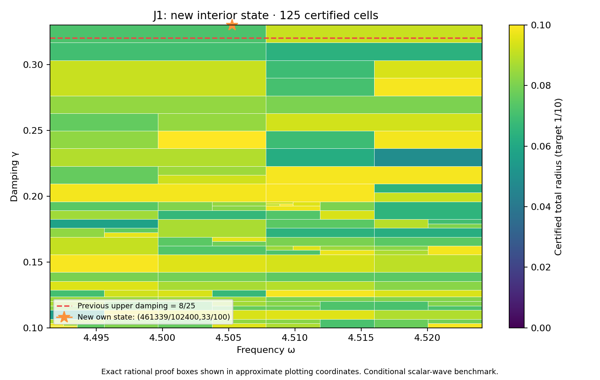

# J1 interior state and complete rectangle through 33/100

**PASS — new own state/flux and complete frozen rectangle.** DERIVED / EXACT CONDITIONAL external scalar-wave benchmark; Scientific OPEN; constructor checked; independent review pending. Development — no registry entry; physical promotion0.

## Construction

The new exact rational center is (omega,gamma)=(461339/102400,33/100). P253/PR328's prospectively frozen finite-grid scout selected it because all34 particular transported-upper formulas exceed the target there. This was a rational probe,not a represented-input measurement,actual-error lower,continuous optimum or no-go against every possible certificate.

Frequency and damping literals changed in P252/PR326's constructor. Flux,curl and candidate replay sources are byte-identical. Geometry,source F=10(x+y),normalized measure,metric and meanfree P2 mesh remain unchanged:18,673 nodal coefficients,one exact mean constraint,12,288 tetrahedra. The new saved two-word state is decoded exactly and its exact weighted mean removed. New projected-source RT1 flux,patch equilibration,curl correction and cellwise-meanfree residual lift are constructed directly from that state within this constructor workflow.

Corrected output is approximately (-3.1699474593413686-2.3942572366964168j). Own reported-J continuum radius is **0.002577873684670634**; the continuum-plus-floating point radius at the declared represented input is **0.00257787368455121**. Defect squared is 0.0003468216745686342. The phase-proxy radius is 0.001381509559970556,with a different center;it is not silently substituted for reported J. Source/state/flux payload hashes,parameter equality,full P2 mass,projected cross identity and own residual reconstruction are checked.

## Frozen full goal and guarantee

| Quantity | Exact scope |
|---|---|
| Frequency | [8983/2000,36193/8000] |
| Damping | [1/10,33/100] |
| Target total radius | 1/10 |
| Maximum depth / leaves | 30 / 4096 |
| Saved states | 35,including unchanged prior34 entries |

PARAMETER_FREEZE.json records this goal and budget before generation. The unchanged planner,evaluator,kernel and rounding sources produce a complete cover with **125 cells**,maximum depth **12**,and uniform total radius **0.0999319045419301<1/10**. There are 33 active owners. It includes the previous rectangle through8/25 and the full-width new upper strip. Exact area ratio is **23/22** (+1/22,approximately4.54545%). Accepted represented-input pairs total **284536853727231403559064624473**,including **6617136133191433969452461620** new pairs.

The inherited meanfree continuum bound uses C_P<=1/2 and lambda_*=4 as a spectral lower bound,not first-eigenvalue equality or the old discrete mesh gap. Each proof box Q uses
\[
r_Q=\kappa_Q\left(\sqrt{d_c^2}+\sqrt{\nu_c^2}+\tfrac12 D_{z,Q}\sqrt{m_c}\right)^2+E_Q.
\]
Here own flux defect d_c^2 and local lift nu_c^2 bound the residual;full Hermitian mass m_c controls transport;full bilinear mass controls the output estimator. Exact-Galerkin orthogonality is not assumed for saved floating coefficients. Continuum enclosures hold on exact rational proof boxes;primitive binary64 additions hold on the associated represented-input word partitions. Proof boxes share cuts,word partitions are disjoint and exhaustive.

## Center constants versus runtime inputs

Both center constants are nonbinary. The frequency constant `0x1.20563d70a3d71p+2` lies above its exact interior center by `9/28147497671065600`. The damping constant `0x1.51eb851eb851fp-2` lies above the exact33/100 guard by `7/450359962737049600` and is the first excluded damping word. The point audit uses the last accepted damping word `0x1.51eb851eb851ep-2` below the guard,alongside the nearest interior frequency. The estimator's stored center constant and its runtime input are separate objects;all relevant quantization enters the outward error bound. The global API actually rejects the adjacent upper word,which here is the nearest damping constant.

## Verification,provenance and next step

The full audit checks exact source binding,unchanged prior34 bank entries,all35 result-derived constants,tree/leaf/word/pair identities and uniform radius. It executes **17374 native traces**,**277984 operation comparisons**,**744 seam controls** and **9 extension boundary controls**. Tampered trees,certificates,radius,domain and hash;budget exhaustion;outside words;wrong types;nonfinite values;normal/subnormal ties-to-even are checked. The own represented point adds16 primitive node comparisons. Primitive RN operations,non-fused evaluation,underflow allowance and bounded magnitudes remain declared conditions;this is not an all-platform formal proof.

Saved candidate state/flux and scalar replay components run separately and reproduce their result files. REPLAY_RECEIPTS.json records actual exits/log hashes;the default composing wrapper is not separately executed. Prior34 own-state/flux receipts are reused by hash,not rerun. Preparation base `d6fedc3b63c9a67e4c6136bae0a109e5b04dcf1a` includes concurrent PR329 ledger recovery,kept as a separate track without importing its action-scale claims. The supplied v0.39 attachment bytes are unchanged context;the CRL-2 amendment remains a proposal,not enacted by citation.

After full-cover success,the frozen129-by-8 scout above33/100 executes1032 probes. Selected rational point **(36193/8000,17/50)** has minimum particular-formula lower approximately **0.07936644979474344**;all-formula obstruction flag **False**. Every minimum model upper below target: **True**. This is finite-grid diagnostic only,not future continuous coverage or actual-error lower. Next action: **Prospectively freeze and audit unchanged35-state bank on the full rectangle through17/50;do not assume coverage.**

Full audit-band closure,quantitative mesh termination,native UD constitutive/metric/clock bridge,material/horn identification,empirical calibration and physical promotion remain open. Gap2_FINAL_Finite_Genesis.png was unavailable and unused.

**A. CURRENT MISSION TRAJECTORY —** Extend certified coverage with actual own state/flux witnesses.

**B. WHAT WAS DONE —** New interior state/flux,full33/100 rectangle,actual estimator audit and saved replay components.

**C. FINDING —** PASS;uniform radius 0.0999319045419301;area ratio23/22 versus PR328.

**D. UD GAP IMPACT —** DERIVED / EXACT CONDITIONAL benchmark;Scientific OPEN,independent review pending,Development/no registry,physical promotion0.

**NEXT —** Prospectively freeze and audit unchanged35-state bank on the full rectangle through17/50;do not assume coverage.
