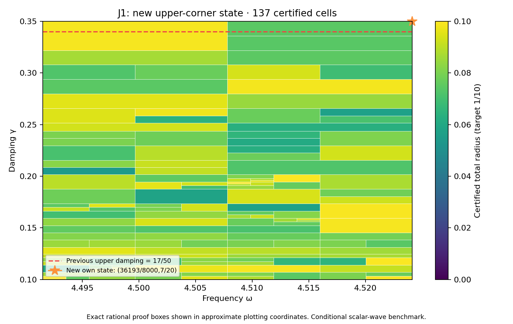

# J1 upper-corner state and complete rectangle through 7/20

**PASS — new own state/flux and complete frozen rectangle.** DERIVED / EXACT CONDITIONAL external scalar-wave benchmark; Scientific OPEN; constructor checked; independent review pending. Development — no registry entry; physical promotion0.

## Construction

The new exact rational center is (omega,gamma)=(36193/8000,7/20). P255/PR332's prospectively frozen finite-grid scout selected it because all35 particular transported-upper formulas exceed the target there. This was a rational probe,not a represented-input measurement,actual-error lower,continuous optimum or no-go against every possible certificate.

Frequency and damping literals changed in P254/PR331's constructor. Flux,curl and candidate replay sources are byte-identical. Geometry,source F=10(x+y),normalized measure,metric and meanfree P2 mesh remain unchanged:18,673 nodal coefficients,one exact mean constraint,12,288 tetrahedra. The new saved two-word state is decoded exactly and its exact weighted mean removed. New projected-source RT1 flux,patch equilibration,curl correction and cellwise-meanfree residual lift are constructed directly from that state within this constructor workflow.

Corrected output is approximately (-2.992521388141801-2.3077442395260728j). Own reported-J continuum radius is **0.002215184253249972**; the continuum-plus-floating point radius at the declared represented input is **0.002215184253000522**. Defect squared is 0.0003141650643125649. The phase-proxy radius is 0.001187873732215038,with a different center;it is not silently substituted for reported J. Source/state/flux payload hashes,parameter equality,full P2 mass,projected cross identity and own residual reconstruction are checked.

## Frozen full goal and guarantee

| Quantity | Exact scope |
|---|---|
| Frequency | [8983/2000,36193/8000] |
| Damping | [1/10,7/20] |
| Target total radius | 1/10 |
| Maximum depth / leaves | 30 / 4096 |
| Saved states | 36,including unchanged prior35 entries |

PARAMETER_FREEZE.json records this goal and budget before generation. The unchanged planner,evaluator,kernel and rounding sources produce a complete cover with **137 cells**,maximum depth **11**,and uniform total radius **0.09965136774270968<1/10**. There are 34 active owners. It includes the previous rectangle through17/50 and the full-width new upper strip. Exact area ratio is **25/24** (+1/24,approximately4.16667%). Accepted represented-input pairs total **297771125993614271497969547713**,including **6617136133191433969452461620** new pairs.

The inherited meanfree continuum bound uses C_P<=1/2 and lambda_*=4 as a spectral lower bound,not first-eigenvalue equality or the old discrete mesh gap. Each proof box Q uses
\[
r_Q=\kappa_Q\left(\sqrt{d_c^2}+\sqrt{\nu_c^2}+\tfrac12 D_{z,Q}\sqrt{m_c}\right)^2+E_Q.
\]
Here own flux defect d_c^2 and local lift nu_c^2 bound the residual;full Hermitian mass m_c controls transport;full bilinear mass controls the output estimator. Exact-Galerkin orthogonality is not assumed for saved floating coefficients. Continuum enclosures hold on exact rational proof boxes;primitive binary64 additions hold on the associated represented-input word partitions. Proof boxes share cuts,word partitions are disjoint and exhaustive.

## Center constants versus runtime inputs

Both center constants are nonbinary. Frequency `0x1.218b439581062p+2` has signed stored-minus-exact error `-19/70368744177664000` and damping `0x1.6666666666666p-2` has signed error `-1/45035996273704960`. Both lie below the exact upper guards and are the last accepted words. The represented point uses those two constants as inputs. Their exact quantization errors enter the floating bound;the global API actually rejects each adjacent upper word. The exact rational source-center probe remains distinct from represented runtime inputs.

## Verification,provenance and next step

The full audit checks exact source binding,unchanged prior35 bank entries,constants for all36 state records,tree/leaf/word/pair identities and uniform radius. It executes **19027 native traces**,**304432 operation comparisons**,**816 seam controls** and **9 extension boundary controls**. Tampered trees,certificates,radius,domain and hash;budget exhaustion;outside words;wrong types;nonfinite values;normal/subnormal ties-to-even are checked. The own represented point adds16 primitive node comparisons. Primitive RN operations,non-fused evaluation,underflow allowance and bounded magnitudes remain declared conditions;this is not an all-platform formal proof.

Saved candidate state/flux and scalar replay components run separately and reproduce their result files. REPLAY_RECEIPTS.json records actual exits/log hashes;the default composing wrapper is not separately executed. Prior35 own-state/flux receipts are reused by hash,not rerun. Preparation base `cba43cce947438074e6125d242e9a3f957705c85` includes retained action-scale recovery and identifiability work,kept as a separate track without importing its action-scale claims. Publication preparation then advanced to main `b405ddfc044b9e082dfc2fa06ced6cb599f74154`,preserving PR333’s14 added energy-clock paths,including its Docs PDF. Those claims remain separate from this benchmark. The supplied v0.39 attachment bytes are unchanged context;the CRL-2 amendment remains a proposal,not enacted by citation. The first pre-freeze repository-wide integrity attempt rejected the still-unmanifested active capture. Published main was then verified separately in a clean worktree:PASS,241 manifests,7,224 files,245 events. Final capture/merge integrity is checked after manifest freeze.

After full-cover success,the frozen129-by-8 scout above7/20 executes1032 probes. Selected rational point **(8983/2000,9/25)** has minimum particular-formula lower approximately **0.1368246503555941**;all-formula obstruction flag **True**. Every minimum model upper below target: **False**. This is finite-grid diagnostic only,not future continuous coverage or actual-error lower. Next action: **Construct own state/flux at exact(8983/2000,9/25),then prospectively freeze and audit the full rectangle through9/25.**

Full audit-band closure,quantitative mesh termination,native UD constitutive/metric/clock bridge,material/horn identification,empirical calibration and physical promotion remain open. Gap2_FINAL_Finite_Genesis.png was unavailable and unused.

**A. CURRENT MISSION TRAJECTORY —** Extend certified coverage with actual own state/flux witnesses.

**B. WHAT WAS DONE —** New upper-corner state/flux,full7/20 rectangle,actual estimator audit and saved replay components.

**C. FINDING —** PASS;uniform radius 0.09965136774270968;area ratio25/24 versus PR332.

**D. UD GAP IMPACT —** DERIVED / EXACT CONDITIONAL benchmark;Scientific OPEN,independent review pending,Development/no registry,physical promotion0.

**NEXT —** Construct own state/flux at exact(8983/2000,9/25),then prospectively freeze and audit the full rectangle through9/25.
