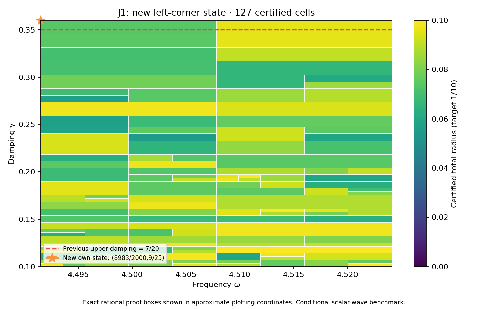

# J1 left-corner state and complete rectangle through 9/25

**PASS — new own state/flux and complete frozen rectangle.** DERIVED / EXACT CONDITIONAL external scalar-wave benchmark; Scientific OPEN; constructor checked; independent review pending. Development — no registry entry; physical promotion0.

## Construction

The new exact rational center is (omega,gamma)=(8983/2000,9/25). P256/PR335's prospectively frozen finite-grid scout selected it because all36 particular transported-upper formulas exceed the target there. This was a rational probe,not a represented-input measurement,actual-error lower,continuous optimum or no-go against every possible certificate.

Frequency and damping literals changed in P256/PR335's constructor. Flux,curl and candidate replay sources are byte-identical. Geometry,source F=10(x+y),normalized measure,metric and meanfree P2 mesh remain unchanged:18,673 nodal coefficients,one exact mean constraint,12,288 tetrahedra. The new saved two-word state is decoded exactly and its exact weighted mean removed. New projected-source RT1 flux,patch equilibration,curl correction and cellwise-meanfree residual lift are constructed directly from that state within this constructor workflow.

Corrected output is approximately (-2.989751065608467-2.5357470893734178j). Own reported-J continuum radius is **0.002299055851659794**; the continuum-plus-floating point radius at the declared represented input is **0.002299055851600464**. Defect squared is 0.0003378737700108114. The phase-proxy radius is 0.001231740074401033,with a different center;it is not silently substituted for reported J. Source/state/flux payload hashes,parameter equality,full P2 mass,projected cross identity and own residual reconstruction are checked.

## Frozen full goal and guarantee

| Quantity | Exact scope |
|---|---|
| Frequency | [8983/2000,36193/8000] |
| Damping | [1/10,9/25] |
| Target total radius | 1/10 |
| Maximum depth / leaves | 30 / 4096 |
| Saved states | 37,including unchanged prior36 entries |

PARAMETER_FREEZE.json records this goal and budget before generation. The unchanged planner,evaluator,kernel and rounding sources produce a complete cover with **127 cells**,maximum depth **10**,and uniform total radius **0.09965136774270968<1/10**. There are 35 active owners. It includes the previous rectangle through7/20 and the full-width new upper strip. Exact area ratio is **26/25** (+1/25,approximately4%). Accepted represented-input pairs total **304388262126805705467422009333**,including **6617136133191433969452461620** new pairs.

The inherited meanfree continuum bound uses C_P<=1/2 and lambda_*=4 as a spectral lower bound,not first-eigenvalue equality or the old discrete mesh gap. Each proof box Q uses
\[
r_Q=\kappa_Q\left(\sqrt{d_c^2}+\sqrt{\nu_c^2}+\tfrac12 D_{z,Q}\sqrt{m_c}\right)^2+E_Q.
\]
Here own flux defect d_c^2 and local lift nu_c^2 bound the residual;full Hermitian mass m_c controls transport;full bilinear mass controls the output estimator. Exact-Galerkin orthogonality is not assumed for saved floating coefficients. Continuum enclosures hold on exact rational proof boxes;primitive binary64 additions hold on the associated represented-input word partitions. Proof boxes share cuts,word partitions are disjoint and exhaustive.

## Center constants versus runtime inputs

Both center constants are nonbinary. Frequency `0x1.1f74bc6a7ef9ep+2` has signed stored-minus-exact error `19/70368744177664000` and damping `0x1.70a3d70a3d70ap-2` has signed error `-3/225179981368524800`. Frequency lies above the exact lower guard and is the first accepted word. Damping lies below the exact upper guard and is the last accepted word. The represented point uses those two constants as inputs. Their exact quantization errors enter the floating bound;the global API actually rejects the preceding frequency word and next damping word. The exact rational source-center probe remains distinct from represented runtime inputs.

## Verification,provenance and next step

The full audit checks exact source binding,unchanged prior36 bank entries,constants for all37 state records,tree/leaf/word/pair identities and uniform radius. It executes **17661 native traces**,**282576 operation comparisons**,**756 seam controls** and **9 extension boundary controls**. Tampered trees,certificates,radius,domain and hash;budget exhaustion;outside words;wrong types;nonfinite values;normal/subnormal ties-to-even are checked. The own represented point adds16 primitive node comparisons. Primitive RN operations,non-fused evaluation,underflow allowance and bounded magnitudes remain declared conditions;this is not an all-platform formal proof.

Saved candidate state/flux and scalar replay components run separately and reproduce their result files. REPLAY_RECEIPTS.json records actual exits/log hashes;the default composing wrapper is not separately executed. Prior36 own-state/flux receipts are reused by hash,not rerun. Preparation base `d69dacdade72fb594ddf847eb4f4d23083556743` includes retained action-scale and energy-clock/support recovery and identifiability work,kept as separate tracks without importing their claims. Native Project next gate was saved,reloaded and DOM verified:In review / Scientific OPEN / Constructor checked / Development;the same inspected screenshot bytes are attached with a receipt. Final repository integrity is checked after manifest freeze. The supplied v0.39 attachment bytes are unchanged context;the CRL-2 amendment remains a proposal,not enacted by citation.

After full-cover success,the frozen129-by-8 scout above9/25 executes1032 probes. Selected rational point **(4618871/1024000,37/100)** has minimum particular-formula lower approximately **0.07213220988593368**;all-formula obstruction flag **False**. Every minimum model upper below target: **True**. This is finite-grid diagnostic only,not future continuous coverage or actual-error lower. Next action: **Prospectively freeze and audit unchanged37-state bank on the full rectangle through37/100;do not assume coverage.**

Full audit-band closure,quantitative mesh termination,native UD constitutive/metric/clock bridge,material/horn identification,empirical calibration and physical promotion remain open. Gap2_FINAL_Finite_Genesis.png was unavailable and unused.

**A. CURRENT MISSION TRAJECTORY —** Extend certified coverage with actual own state/flux witnesses.

**B. WHAT WAS DONE —** New left-corner state/flux,full9/25 rectangle,actual estimator audit and saved replay components.

**C. FINDING —** PASS;uniform radius 0.09965136774270968;area ratio26/25 versus PR335.

**D. UD GAP IMPACT —** DERIVED / EXACT CONDITIONAL benchmark;Scientific OPEN,independent review pending,Development/no registry,physical promotion0.

**NEXT —** Prospectively freeze and audit unchanged37-state bank on the full rectangle through37/100;do not assume coverage.
