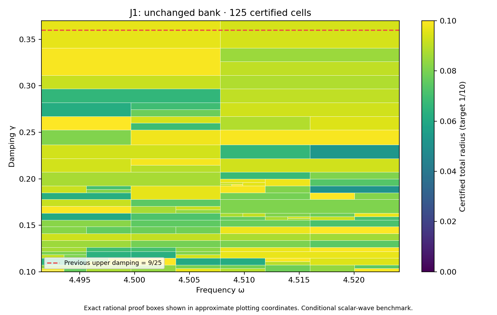

# J1 unchanged-bank rectangle through 37/100

**PASS — the complete proposed rectangle is certified using the existing 37-state bank.** DERIVED / EXACT CONDITIONAL external scalar-wave benchmark; Scientific OPEN; constructor checked; independent review pending. Development — no registry entry; physical promotion 0.

## Frozen scope and result

The prior PR337 finite-grid scout motivated this attempt, without certifying it. Before execution, AUDIT_FREEZE.json fixes the full goal, target and finite budget:

| Quantity | Exact scope |
|---|---|
| Frequency | [8983/2000,36193/8000] |
| Damping | [1/10,37/100] |
| Target total radius | 1/10 |
| Maximum depth / leaves | 30 / 4096 |
| Saved states | 37, unchanged |

The new complete cover has **125 cells**, maximum depth **12**, and uniform continuum-plus-floating radius **0.09998815972901196<1/10**. Its 35 active owners are selected from the unchanged 37 saved states. The domain includes the entire previous rectangle through9/25 plus a new full-width upper strip. Exact area ratio is **27/26**, an increase of 1/26 (approximately3.84615%). Exact accepted represented-input pair count is **311005398259997139436874470953**, with **6617136133191433969452461620** newly accepted pairs.

No new state or flux coefficients were generated, and no state/flux solver was rerun. BANK.json and the kernel, planner, evaluator and rounding sources are byte-identical to PR337. Prior state/flux results and replay receipts are reused by hash. The new work is the complete rectangular cover, actual estimator audit and saved scalar replay, not another own-state construction.

## Continuum and floating certificate

The inherited meanfree Neumann benchmark keeps C_P<=1/2 and continuum eigenvalue lower bound lambda_*=4; this is not equality with the first eigenvalue or the old discrete gap. For each state c and exact rational proof box Q, the envelope is
\[
r_Q=\kappa_Q\left(\sqrt{d_c^2}+\sqrt{\nu_c^2}+\tfrac12 D_{z,Q}\sqrt{m_c}\right)^2+E_Q.
\]
Own flux defects, local cell-meanfree residual lifts and full Hermitian masses enter transport; the full bilinear masses enter the corrected-output estimator. Exact decoded saved words have exact mean removal; no exact-Galerkin assumption is imposed on floating coefficients. Primitive binary64 round-to-nearest arithmetic is audited using the unchanged16-operation expression, exact rational square-root enclosures, outward error grid, quantized constants, underflow allowance and bounded magnitudes. Proof boxes share cuts, while accepted word partitions are disjoint and exhaust the guard. The continuum enclosure covers every proof box; the floating addition applies to represented inputs in its word partition.

**Upper boundary:** 37/100 is not representable. Its nearest binary64 value `0x1.7ae147ae147aep-2` is below the exact guard by signed offset `-1/225179981368524800` and is the last accepted word. The actual evaluator accepts it and rejects the next word above the exact guard. Boundary-word checks are separate from the quantizations of saved state-center constants.

## Executed verification

The constructor audit checks source hashes, all37 bank definitions, source parameters, full state masses, exact node/leaf/word/pair identities, uniform bounds and source-code identity. It exercises **17392** native traces, **278272** operation comparisons, **744** internal seam controls, and **9** previous/new-strip boundary controls. Tampered tree, certificate, radius, domain and hash records are rejected. Budget exhaustion, outside words, nonfinite/wrong-type inputs, acceptance of the rounded upper guard,rejection of its next word,and normal/subnormal ties-to-even controls are exercised. The saved scalar replay must reproduce COVER.json, PLACEMENT_RESULTS.json and AUDIT_RESULTS.json; its actual exit and log hash are in REPLAY_RECEIPTS.json. These are scoped constructor checks under the declared primitive arithmetic model, not non-constructor review or an all-platform formal proof.

## Next gate and provenance

The prospectively frozen129-by-8 scout over damping(37/100,19/50] executes all1032 probes. It selects exact **(2310349/512000,19/50)**, with minimum particular-formula lower approximately **0.1167229971812746**. All37 particular formulas exceed1/10 there: **True**. This lower enclosure concerns those declared upper-bound formulas, not the unknown actual approximation error. It does not rule out alternate certificates or identify a continuous optimum. The next action follows this scoped result:construct an own state only if the obstruction flag is true;otherwise audit the unchanged bank under a new prospective full-goal freeze. No future coverage or candidate precision is presumed.

Next action: **Construct own state/flux at exact(2310349/512000,19/50),then audit a prospectively frozen full rectangle through19/50.**

Preparation base is `62cb6e62d9ec4f170c5dbe5e859af9dea92282f4`, including concurrent PR336/338's experimental-data audit and signed reconstruction. Those separate tracks are preserved and supply no scalar-wave premise. Native Project next gate saved,reloaded and DOM verified:In review / Scientific OPEN / Constructor checked / Development. The inspected screenshot and receipt are attached. Final repository integrity follows manifest freeze. The supplied provenance ledger's identical bytes remain context; its coefficients do not derive this source or damping. The supplied CRL-2 amendment remains a proposal, not enacted by citation. No native UD constitutive/metric/clock bridge, physical material or horn identification, empirical calibration, full audit-band closure, or quantitative mesh-termination theorem is inferred. Gap2_FINAL_Finite_Genesis.png remains unavailable and unused.

**A. CURRENT MISSION TRAJECTORY —** Extend certified parameter coverage using the frozen bank when possible.

**B. WHAT WAS DONE —** Full37/100 rectangle, actual evaluator audit and saved scalar replay; no new state/flux generation.

**C. FINDING —** PASS; radius 0.09998815972901196,125 cells,area ratio27/26 relative to PR337.

**D. UD GAP IMPACT —** DERIVED / EXACT CONDITIONAL benchmark; Scientific OPEN, independent review pending, Development/no registry,physical promotion0.

**NEXT —** Construct own state/flux at exact(2310349/512000,19/50),then audit a prospectively frozen full rectangle through19/50.
