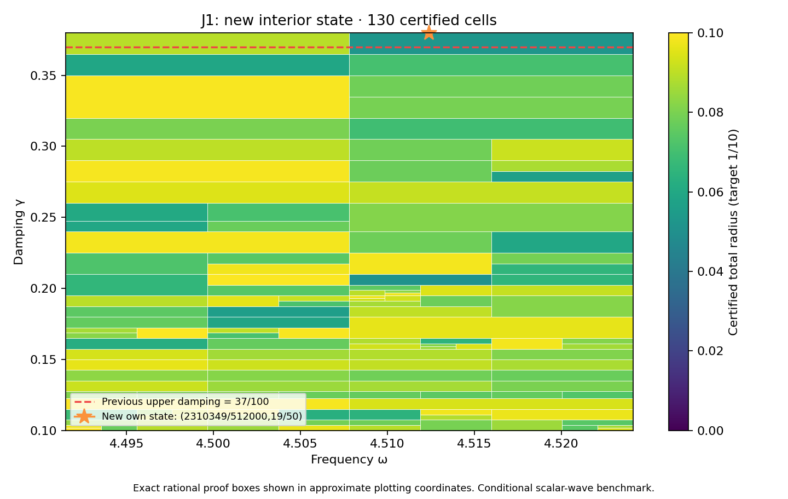

# J1 interior state and complete rectangle through 19/50

**PASS — new own state/flux and complete frozen rectangle.** DERIVED / EXACT CONDITIONAL external scalar-wave benchmark; Scientific OPEN; constructor checked; independent review pending. Development — no registry entry; physical promotion0.

## Construction

The new exact rational center is (omega,gamma)=(2310349/512000,19/50). P258/PR341's prospectively frozen finite-grid scout selected it because all37 particular transported-upper formulas exceed the target there. This was a rational probe,not a represented-input measurement,actual-error lower,continuous optimum or no-go against every possible certificate.

Frequency and damping literals changed in P257/PR337's constructor. Flux,curl and candidate replay sources are byte-identical. Geometry,source F=10(x+y),normalized measure,metric and meanfree P2 mesh remain unchanged:18,673 nodal coefficients,one exact mean constraint,12,288 tetrahedra. The new saved two-word state is decoded exactly and its exact weighted mean removed. New projected-source RT1 flux,patch equilibration,curl correction and cellwise-meanfree residual lift are constructed directly from that state within this constructor workflow.

Corrected output is approximately (-2.823828168715614-2.4207275050396317j). Own reported-J continuum radius is **0.001975932595093258**; the continuum-plus-floating point radius at the declared represented input is **0.001975932594980722**. Defect squared is 0.0003044639031597603. The phase-proxy radius is 0.001059345166550262,with a different center;it is not silently substituted for reported J. Source/state/flux payload hashes,parameter equality,full P2 mass,projected cross identity and own residual reconstruction are checked.

## Frozen full goal and guarantee

| Quantity | Exact scope |
|---|---|
| Frequency | [8983/2000,36193/8000] |
| Damping | [1/10,19/50] |
| Target total radius | 1/10 |
| Maximum depth / leaves | 30 / 4096 |
| Saved states | 38,including unchanged prior37 entries |

PARAMETER_FREEZE.json records this goal and budget before generation. The unchanged planner,evaluator,kernel and rounding sources produce a complete cover with **130 cells**,maximum depth **11**,and uniform total radius **0.09966578760063784<1/10**. There are 36 active owners. It includes the previous rectangle through37/100 and the full-width new upper strip. Exact area ratio is **28/27** (+1/27,approximately3.70370%). Accepted represented-input pairs total **317622534393188536673842471832**,including **6617136133191397236968000879** new pairs.

The inherited meanfree continuum bound uses C_P<=1/2 and lambda_*=4 as a spectral lower bound,not first-eigenvalue equality or the old discrete mesh gap. Each proof box Q uses
\[
r_Q=\kappa_Q\left(\sqrt{d_c^2}+\sqrt{\nu_c^2}+\tfrac12 D_{z,Q}\sqrt{m_c}\right)^2+E_Q.
\]
Here own flux defect d_c^2 and local lift nu_c^2 bound the residual;full Hermitian mass m_c controls transport;full bilinear mass controls the output estimator. Exact-Galerkin orthogonality is not assumed for saved floating coefficients. Continuum enclosures hold on exact rational proof boxes;primitive binary64 evaluation holds on the associated represented-input word partitions. Proof boxes share cuts,word partitions are disjoint and exhaustive.

## Center constants versus runtime inputs

Both center constants are nonbinary. Frequency `0x1.20cb2b020c49cp+2` has signed stored-minus-exact error `11/35184372088832000` and is an interior accepted word. Damping `0x1.851eb851eb852p-2` has signed error `1/225179981368524800` and is the first excluded word above the exact upper guard. The declared runtime point uses nearest frequency plus last accepted damping `0x1.851eb851eb851p-2`,with input-minus-source damping offset `-23/450359962737049600`. The damping constant/input difference is `1/18014398509481984`. Constant quantizations and source-to-runtime input drift are bounded separately;the actual global API rejects the rounded damping center and accepts the declared represented point. The exact rational source-center probe remains distinct from represented runtime inputs.

## Verification,provenance and next step

The full audit checks exact source binding,unchanged prior37 bank entries,constants for all38 state records,tree/leaf/word/pair identities and uniform radius. It executes **18068 native traces**,**289088 operation comparisons**,**774 seam controls** and **9 extension boundary controls**. Tampered trees,certificates,radius,domain and hash;budget exhaustion;outside words;wrong types;nonfinite values;normal/subnormal ties-to-even are checked. The own represented point adds16 primitive node comparisons. Primitive RN operations,non-fused evaluation,underflow allowance and bounded magnitudes remain declared conditions;this is not an all-platform formal proof.

Saved candidate state/flux and scalar replay components run separately and reproduce their result files. REPLAY_RECEIPTS.json records actual exits/log hashes;the default composing wrapper is not separately executed. Prior37 own-state/flux receipts are reused by hash,not rerun. Preparation base `06d75de17187a453a3590f3c92a7c56be7e707c5` includes prior experimental-data,signal-reconstruction and local-quadrature work,kept as separate tracks without importing their claims. Native Project next gate saved,reloaded and DOM verified:In review / Scientific OPEN / Constructor checked / Development. Same inspected screenshot bytes and receipt attached. Final repository integrity follows manifest freeze. The supplied v0.39 attachment bytes are unchanged context;the CRL-2 amendment remains a proposal,not enacted by citation.

After full-cover success,the frozen129-by-8 scout above19/50 executes1032 probes. Selected rational point **(8983/2000,39/100)** has minimum particular-formula lower approximately **0.06206763231547333**;all-formula obstruction flag **False**. Every minimum model upper below target: **True**. This is finite-grid diagnostic only,not future continuous coverage or actual-error lower. Next action: **Prospectively freeze and audit unchanged38-state bank on the full rectangle through39/100;do not assume coverage.**

Full audit-band closure,quantitative mesh termination,native UD constitutive/metric/clock bridge,material/horn identification,empirical calibration and physical promotion remain open. Gap2_FINAL_Finite_Genesis.png was unavailable and unused.

**A. CURRENT MISSION TRAJECTORY —** Extend certified coverage with actual own state/flux witnesses.

**B. WHAT WAS DONE —** New interior state/flux,full19/50 rectangle,actual estimator audit and saved replay components.

**C. FINDING —** PASS;uniform radius 0.09966578760063784;area ratio28/27 versus PR341.

**D. UD GAP IMPACT —** DERIVED / EXACT CONDITIONAL benchmark;Scientific OPEN,independent review pending,Development/no registry,physical promotion0.

**NEXT —** Prospectively freeze and audit unchanged38-state bank on the full rectangle through39/100;do not assume coverage.
