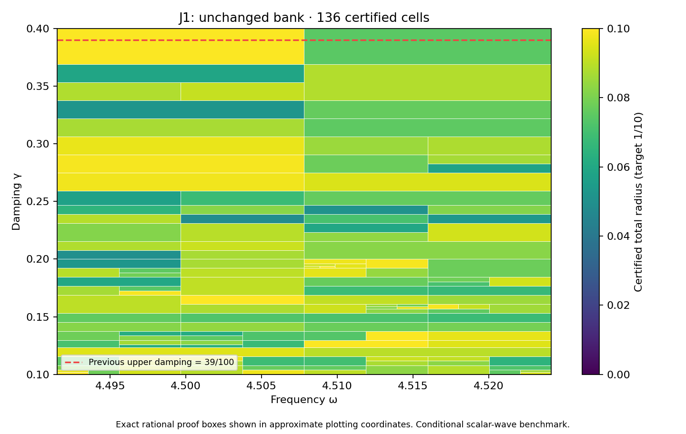

# J1 unchanged-bank rectangle through 2/5

**PASS — the complete proposed rectangle is certified using the existing 38-state bank.** DERIVED / EXACT CONDITIONAL external scalar-wave benchmark; Scientific OPEN; constructor checked; independent review pending. Development — no registry entry; physical promotion 0.

## Frozen scope and result

The prior PR351 finite-grid scout motivated this attempt, without certifying it. Before execution, AUDIT_FREEZE.json fixes the full goal, target and finite budget:

| Quantity | Exact scope |
|---|---|
| Frequency | [8983/2000,36193/8000] |
| Damping | [1/10,2/5] |
| Target total radius | 1/10 |
| Maximum depth / leaves | 30 / 4096 |
| Saved states | 38, unchanged |

The new complete cover has **136 cells**, maximum depth **12**, and uniform continuum-plus-floating radius **0.09975421396915329<1/10**. Its 36 active owners are selected from the unchanged 38 saved states. The domain includes the entire previous rectangle through39/100 plus a new full-width upper strip. Exact area ratio is **30/29**, an increase of 1/29 (approximately3.44828%). Exact accepted represented-input pair count is **330856806659571404612747395072**, with **6617136133191433969452461620** newly accepted pairs.

No new state or flux coefficients were generated, and no state/flux solver was rerun. BANK.json and the kernel, planner, evaluator and rounding sources are byte-identical to PR351. Prior state/flux results and replay receipts are reused by hash. The new work is the complete rectangular cover, actual estimator audit and saved scalar replay, not another own-state construction.

## Continuum and floating certificate

The inherited meanfree Neumann benchmark keeps C_P<=1/2 and continuum eigenvalue lower bound lambda_*=4; this is not equality with the first eigenvalue or the old discrete gap. For each state c and exact rational proof box Q, the envelope is
\[
r_Q=\kappa_Q\left(\sqrt{d_c^2}+\sqrt{\nu_c^2}+\tfrac12 D_{z,Q}\sqrt{m_c}\right)^2+E_Q.
\]
Own flux defects, local cell-meanfree residual lifts and full Hermitian masses enter transport; the full bilinear masses enter the corrected-output estimator. Exact decoded saved words have exact mean removal; no exact-Galerkin assumption is imposed on floating coefficients. Primitive binary64 round-to-nearest arithmetic is audited using the unchanged16-operation expression, exact rational square-root enclosures, outward error grid, quantized constants, underflow allowance and bounded magnitudes. Proof boxes share cuts, while accepted word partitions are disjoint and exhaust the guard. The continuum enclosure covers every proof box; the floating error allowance applies to represented inputs in its word partition.

**Upper boundary:** 2/5 is not representable. Its nearest binary64 value `0x1.999999999999ap-2` is above the exact guard by signed offset `1/45035996273704960` and is the first excluded word. The actual evaluator rejects it and accepts the last word below the guard, `0x1.9999999999999p-2`, whose signed offset is `-3/90071992547409920`. Boundary-word checks are separate from the quantizations of saved state-center constants.

## Executed verification

The native Project next gate is saved, reloaded and DOM verified; its proof receipt and screenshot are included.

## Checks

The constructor audit checks source hashes, all38 bank definitions, source parameters, full state masses, exact node/leaf/word/pair identities, uniform bounds and source-code identity. It exercises **18908** native traces, **302528** operation comparisons, **810** internal seam controls, and **9** previous/new-strip boundary controls. Tampered tree, certificate, radius, domain and hash records are rejected. Budget exhaustion, outside words, nonfinite/wrong-type inputs, rejection of the rounded upper guard,acceptance of the last word below it,and normal/subnormal ties-to-even controls are exercised. The saved scalar replay must reproduce COVER.json, PLACEMENT_RESULTS.json and AUDIT_RESULTS.json; its actual exit and log hash are in REPLAY_RECEIPTS.json. These are scoped constructor checks under the declared primitive arithmetic model, not non-constructor review or an all-platform formal proof.

## Next gate and provenance

The prospectively frozen129-by-8 scout over damping(2/5,41/100] executes all1032 probes. It selects exact **(8983/2000,41/100)**, with minimum particular-formula lower approximately **0.1265803758215883**. All38 particular formulas exceed1/10 there: **True**. This lower enclosure concerns those declared upper-bound formulas, not the unknown actual approximation error. It does not rule out alternate certificates or identify a continuous optimum. The next action follows this scoped result:construct an own state only if the obstruction flag is true;otherwise audit the unchanged bank under a new prospective full-goal freeze. No future coverage or candidate precision is presumed.

Next action: **Construct own state/flux at exact(8983/2000,41/100),then audit a prospectively frozen full rectangle through41/100.**

Preparation base is `8be4e90d68528325f081126d27c61ac61cad951e`, the verified PR351 merge. Historical and concurrent tracks supply no additional scalar-wave premise. The supplied provenance ledger's identical bytes remain context; its coefficients do not derive this source or damping. The supplied CRL-2 amendment remains a proposal, not enacted by citation. No native UD constitutive/metric/clock bridge, physical material or horn identification, empirical calibration, full audit-band closure, or quantitative mesh-termination theorem is inferred. Gap2_FINAL_Finite_Genesis.png remains unavailable and unused.

**A. CURRENT MISSION TRAJECTORY —** Extend certified parameter coverage using the frozen bank when possible.

**B. WHAT WAS DONE —** Full2/5 rectangle, actual evaluator audit and saved scalar replay; no new state/flux generation.

**C. FINDING —** PASS; radius 0.09975421396915329,136 cells,area ratio30/29 relative to PR351.

**D. UD GAP IMPACT —** DERIVED / EXACT CONDITIONAL benchmark; Scientific OPEN, independent review pending, Development/no registry,physical promotion0.

**NEXT —** Construct own state/flux at exact(8983/2000,41/100),then audit a prospectively frozen full rectangle through41/100.
