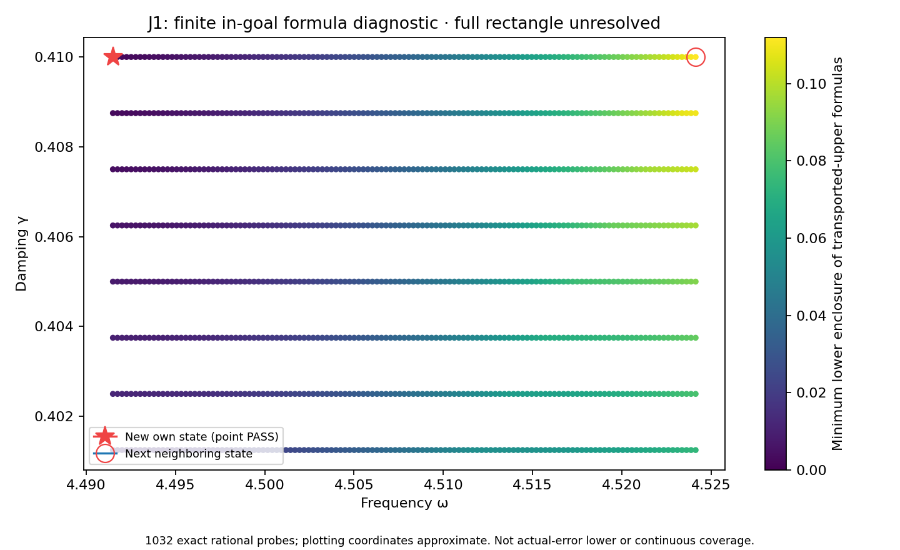

# J1 own state at (8983/2000,41/100): point PASS, full rectangle unresolved

**DERIVED / EXACT CONDITIONAL. New own state and flux certificate PASS. The proposed full rectangle through41/100 is unresolved under the frozen budget.** Current certified uniform upper damping remains **2/5**, from PR353. Scientific OPEN; constructor checked; independent review pending; Development/no registry; physical promotion0.

## New state and own certificate

PR353's frozen finite-grid diagnostic selected the exact rational source point (8983/2000,41/100). Only the damping literal changes from P257/PR337's constructor; its frequency literal and flux,curl,candidate-replay sources are unchanged. The geometry,F=10(x+y),normalized measure,gradient/flux metrics and meanfree P2 mesh remain unchanged:18673 nodal coefficients,one exact mean constraint,12288 tetrahedra. The saved two-word state is decoded exactly and its exact weighted mean removed. New projected-source RT1 flux,1024 local patches,coupled curl correction and cell-meanfree residual lift are built for this new state.

| Quantity | Result |
|---|---:|
| Corrected output J | approximately (-2.6592747753330808-2.5691206570828506j) |
| Algebraic corrected-output budget | 7.4245e-14 |
| Own reported-J continuum radius | 0.001805324935256874 |
| Declared represented-input total radius | 0.001805324935185016 |
| Flux defect squared | 0.0003009722739899512 |
| Phase-proxy radius, different center | 0.0009674219856661926 |

Exact state/source/flux hashes,parameter equality,full P2 masses,projected cross identity,divergence and normal traces,degree-four flux moments,direct defect identities and local volume-residual budgets are checked. The phase proxy uses a different output center and is not substituted for reported J. Prior38 bank records remain unchanged;BANK.json has39 entries.

The meanfree continuum bound retains C_P<=1/2 and lambda_*=4 as a spectral lower bound,not first-eigenvalue equality or a discrete gap. A trial state's transported residual uses full Hermitian mass;the output estimator uses full bilinear mass. Saved floating coefficients need no exact-Galerkin premise.

## Frozen full rectangle attempt

PARAMETER_FREEZE.json predates generation and fixes omega=[8983/2000,36193/8000],gamma=[1/10,41/100],target1/10,maximumdepth30,maximumleaves4096. SCALAR_GENERATION.log retains the actual failed run,exit1,with `unresolved cell at depth budget`. No COVER.json or complete AUDIT_RESULTS.json was emitted. The full actual-evaluator audit was not reached. The original goal,bank,contract,budget and algorithm were not changed to obtain a pass. No additional uniform parameter area is certified here.

DIAGNOSTIC_FREEZE.json then prospectively fixes a separate failure-reproduction and1032-point diagnostic within the attempted strip (2/5,41/100]. diagnostic_replay.py reproduces the same budget failure,records the first unresolved proof box at depth30 and checks its minimum box certificate above target. Its exact midpoint is (10182827787585323/2251799813685248,7382223460908401/18014398509481984),where the minimum particular-formula lower is approximately 0.0999877024580703. The full rational box,word bounds and all point formula lowers are in DIAGNOSTIC_RESULTS.json. These are lower enclosures of the declared upper-bound formulas,not actual-error lower bounds or no-go results against alternative certificates or meshes.

The in-goal scout selects **(36193/8000,41/100)**,with minimum particular-formula lower **0.112019619142215>1/10** across the39 saved-state formulas. The selected point is inside the attempted rectangle. The originally frozen future scout above41/100 was **not executed**,because the proposed full rectangle did not pass.

## Represented-input scope

Source frequency is nonbinary: `0x1.1f74bc6a7ef9ep+2`,signed stored-minus-exact error `19/70368744177664000`,first word above the exact lower guard. Source damping is also nonbinary: `0x1.a3d70a3d70a3dp-2`,signed error `-11/450359962737049600`,last word below the proposed upper guard. own_checks.py checks the exact word-domain inequalities and16 native primitive round-to-nearest operations at this declared represented point,including constant-error and ideal-estimator identities. This is a direct kernel point certificate. No new complete global evaluator partition or uniform actual-API audit is claimed.

## Replays,provenance and next gate

Saved candidate state/flux replay reproduces P2_RESULTS,CURL_CORRECTION_RESULTS and UPPER_RESULTS. Saved diagnostic replay reproduces POINT_AUDIT_RESULTS,IN_GOAL_PLACEMENT_RESULTS and DIAGNOSTIC_RESULTS while reproducing the expected full-cover failure. Their actual exit codes and logs are recorded in REPLAY_RECEIPTS.json. A diagnostic replay PASS means these claims and expected failure reproduced;it does not mean the full rectangle passed. The default full composing wrapper and scalar-only path cannot complete the proposed cover and are not reported as successful. Prior38 state/flux replay receipts are reused by hash,not rerun.

Preparation base `4c264504f1ec8ce8965b097356d7193103c9382a` is PR353's verified merge. Separate historical-recovery and benchmark tracks supply no scalar-wave premise. Supplied ledger bytes remain historical context;the CRL2 amendment remains a proposal,not enacted by citation. Native Project next gate is saved,reloaded and DOM verified,but its captured screenshot could not be attached:the file failed to synchronize within the documented five-second limit. Exact field text was verified after reload. Full audit-band closure,mesh termination,native UD constitutive/metric/clock bridge,material/horn identification and physical promotion remain open. Gap2_FINAL_Finite_Genesis.png is unavailable and unused.

**A. CURRENT MISSION TRAJECTORY —** Extend coverage using actual state/flux witnesses and retain failed frozen attempts.

**B. WHAT WAS DONE —** New own state/flux;point certificate;full rectangle attempted and failure reproduced;in-goal neighboring-state diagnostic and saved replays.

**C. FINDING —** Own radius 0.001805324935256874;full41/100 rectangle unresolved;uniform coverage stays through2/5.

**D. UD GAP IMPACT —** Conditional external benchmark only;Scientific OPEN,independent review pending,Development/no registry,physical promotion0.

**NEXT —** Construct neighboring own state/flux at exact(36193/8000,41/100),then prospectively freeze and audit the full rectangle through41/100 using both new states.
