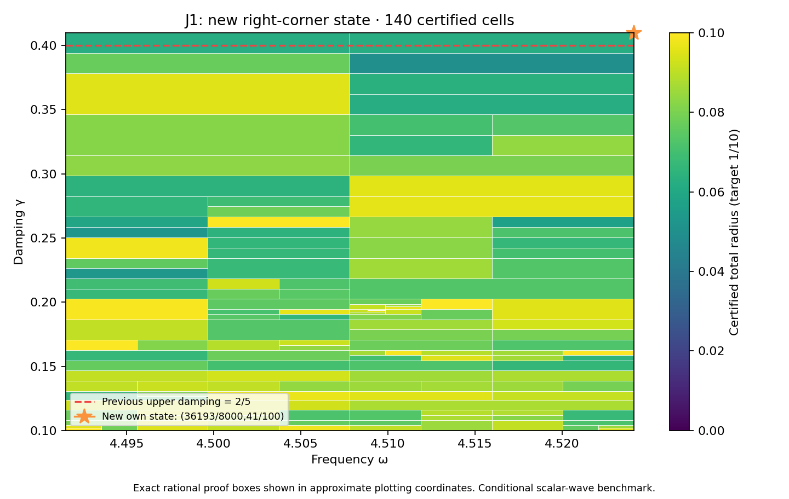

# J1 right-corner state and complete rectangle through 41/100

**PASS — new own state/flux and complete frozen rectangle.** DERIVED / EXACT CONDITIONAL external scalar-wave benchmark; Scientific OPEN; constructor checked; independent review pending. Development — no registry entry; physical promotion0.

## Construction

The neighboring exact rational center is (omega,gamma)=(36193/8000,41/100). P262/PR357's separately frozen in-goal finite-grid diagnostic selected it because all39 particular transported-upper formulas exceed the target there. This was a rational probe,not a represented-input measurement,actual-error lower,continuous optimum or no-go against every possible certificate.

Frequency and damping literals changed in P257/PR337's constructor. Flux,curl and candidate replay sources are byte-identical. Geometry,source F=10(x+y),normalized measure,metric and meanfree P2 mesh remain unchanged:18,673 nodal coefficients,one exact mean constraint,12,288 tetrahedra. The new saved two-word state is decoded exactly and its exact weighted mean removed. New projected-source RT1 flux,patch equilibration,curl correction and cellwise-meanfree residual lift are constructed directly from that state within this constructor workflow.

Corrected output is approximately (-2.627815869291985-2.374317125870159j). Own reported-J continuum radius is **0.00167121341866888**; the continuum-plus-floating point radius at the declared represented input is **0.001671213418438186**. Defect squared is 0.0002763694632526527. The phase-proxy radius is 0.0008963952464665048,with a different center;it is not silently substituted for reported J. Source/state/flux payload hashes,parameter equality,full P2 mass,projected cross identity and own residual reconstruction are checked.

## Retry evidence

The failed attempt and this retry have the same full domain, target1/10 and budget depth30/leaves4096. The added neighboring state changes the bank:

| Attempt | Saved states | Full41/100 result | Reached depth |
|---|---:|---|---:|
| P262 / PR357 | 39, including left_41 | Unresolved; no complete cover | 30 |
| P263, this capture | 40, adding right_41 | PASS;140 cells | 13 |

Both left_41 and right_41 are active owners in the successful cover. The prior failed capture remains unchanged. This resolves that declared finite-cover attempt; it does not establish an arbitrary-mesh termination theorem.

## Frozen full goal and guarantee

| Quantity | Exact scope |
|---|---|
| Frequency | [8983/2000,36193/8000] |
| Damping | [1/10,41/100] |
| Target total radius | 1/10 |
| Maximum depth / leaves | 30 / 4096 |
| Saved states | 40,including unchanged prior39 entries |

PARAMETER_FREEZE.json records this goal and budget before generation. The unchanged planner,evaluator,kernel and rounding sources produce a complete cover with **140 cells**,maximum depth **13**,and uniform total radius **0.09979014852690984<1/10**. There are 38 active owners. It includes the previous rectangle through2/5 and the full-width new upper strip. Exact area ratio is **31/30** (+1/30,approximately3.33333%). Accepted represented-input pairs total **337473942792762838582199856692**,including **6617136133191433969452461620** new pairs.

The inherited meanfree continuum bound uses C_P<=1/2 and lambda_*=4 as a spectral lower bound,not first-eigenvalue equality or the old discrete mesh gap. Each proof box Q uses
\[
r_Q=\kappa_Q\left(\sqrt{d_c^2}+\sqrt{\nu_c^2}+\tfrac12 D_{z,Q}\sqrt{m_c}\right)^2+E_Q.
\]
Here own flux defect d_c^2 and local lift nu_c^2 bound the residual;full Hermitian mass m_c controls transport;full bilinear mass controls the output estimator. Exact-Galerkin orthogonality is not assumed for saved floating coefficients. Continuum enclosures hold on exact rational proof boxes;primitive binary64 evaluation holds on the associated represented-input word partitions. Proof boxes share cuts,word partitions are disjoint and exhaustive.

## Center constants versus runtime inputs

Both center constants are nonbinary. Frequency `0x1.218b439581062p+2` has signed stored-minus-exact error `-19/70368744177664000` and damping `0x1.a3d70a3d70a3dp-2` has signed error `-11/450359962737049600`. Both constants lie below their exact upper guards and are the last accepted words. The represented point uses those two constants as inputs. Their exact quantization errors enter the floating bound;the global API actually rejects the next word above each upper guard. The exact rational source-center probe remains distinct from represented runtime inputs.

## Verification,provenance and next step

Native Project next gate saved, reloaded and DOM verified; proof receipt and screenshot attached. Constructor checks remain distinct from independent review.

The full audit checks exact source binding,unchanged prior39 bank entries,constants for all40 state records,tree/leaf/word/pair identities and uniform radius. It executes **19462 native traces**,**311392 operation comparisons**,**834 seam controls** and **9 extension boundary controls**. Tampered trees,certificates,radius,domain and hash;budget exhaustion;outside words;wrong types;nonfinite values;normal/subnormal ties-to-even are checked. The own represented point adds16 primitive node comparisons. Primitive RN operations,non-fused evaluation,underflow allowance and bounded magnitudes remain declared conditions;this is not an all-platform formal proof.

Saved candidate state/flux and scalar replay components run separately and reproduce their result files. REPLAY_RECEIPTS.json records actual exits/log hashes;the default composing wrapper is not separately executed. Prior39 own-state/flux receipts are reused by hash,not rerun. Preparation base `509dd923ce04c6f019c5939954806c6d3c0e6f12` is the verified PR357 merge. The source39-state bank includes P262 left_41,whose own certificate passed while its full goal hit depth30. That failed attempt is preserved. Current uniform baseline is P261/PR353's complete2/5 cover; source-bank and current-cover captures are deliberately distinct. The full goal and finite budget are identical to the retained failed attempt,and both left_41 and right_41 must be active owners in this new cover. Historical recovery and other benchmark tracks supply no new scalar-wave premise. The supplied v0.39 attachment bytes are unchanged context;the CRL-2 amendment remains a proposal,not enacted by citation.

After full-cover success,the frozen129-by-8 scout above41/100 executes1032 probes. Selected rational point **(2307217/512000,21/50)** has minimum particular-formula lower approximately **0.04232506608455674**;all-formula obstruction flag **False**. Every minimum model upper below target: **True**. This is finite-grid diagnostic only,not future continuous coverage or actual-error lower. Next action: **Prospectively freeze and audit unchanged40-state bank on the full rectangle through21/50;do not assume coverage.**

Full audit-band closure,quantitative mesh termination,native UD constitutive/metric/clock bridge,material/horn identification,empirical calibration and physical promotion remain open. Gap2_FINAL_Finite_Genesis.png was unavailable and unused.

**A. CURRENT MISSION TRAJECTORY —** Extend certified coverage with actual own state/flux witnesses.

**B. WHAT WAS DONE —** New right-corner state/flux,full41/100 rectangle,actual estimator audit and saved replay components.

**C. FINDING —** PASS;uniform radius 0.09979014852690984;area ratio31/30 versus PR353.

**D. UD GAP IMPACT —** DERIVED / EXACT CONDITIONAL benchmark;Scientific OPEN,independent review pending,Development/no registry,physical promotion0.

**NEXT —** Prospectively freeze and audit unchanged40-state bank on the full rectangle through21/50;do not assume coverage.
