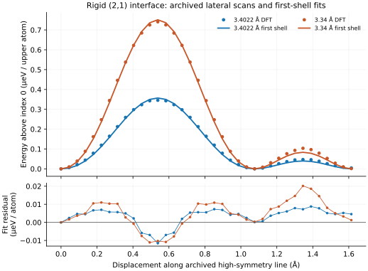

# Full lateral-profile replay and correction to the static pressure bridge

**23 October 2026 UTC. Development — no registry entry. Physical promotion 0.** This capture refines the static vdW-DF3 calculation in the preceding graphite paper v5. It does not provide graphite kinetic friction or a UD-specific material law.

## Source, path and units

The original authors' [Zenodo DOI 10.5281/zenodo.16318186](https://doi.org/10.5281/zenodo.16318186) includes `qe-21-vdw-df3-3.4022A-h30A.tar.gz` and `qe-21-vdw-df3-3.34A-h30A.tar.gz` (30 Å vacuum), each with **37 completed** 28-atom Quantum ESPRESSO calculations at successive lateral translations. SHA-256 pins are in `FULL_PROFILE_RESULTS.json` and checked by `replay_full_profiles.py`. The script reads input geometry, `JOB DONE` and final XML `etot` as Hartree data; imported shell scripts are never run. Cell energies are divided by 14 and reported as μeV **per upper atom**. The 31-point AB distance scan from the preceding capture is also SHA checked to calculate the finite-pressure comparison.

The input translations follow the paper's high-symmetry line of length 1.6144 Å. The actual archived lattice spacing differs slightly from the paper's rounded (a=2.4660) Å, so the replay constructs Fourier phases from the input endpoint displacements: (k_xDelta x_i=ipi/12), (k_yDelta y_i=ipi/36), (i=0,ldots,36). For a type-II AB minimum, the first-shell profile relative to index 0 is

\[
 S_i=2\cos(2\pi/3+i\pi/36)\cos(i\pi/12)
      +\cos(4\pi/3+i\pi/18)+3/2,
 \qquad E_i-E_0\simeq U_1 S_i.
\]

In particular $S_{12}=4.5$; the sampled path **passes through the AA maximum and a saddle**. It is *not* the minimum-energy sliding path used for the paper's static shear strength. Therefore taking the maximum finite-difference derivative along these 37 samples as τ would be incorrect. We instead use the published two-dimensional type-II first-harmonic minimum-energy-path coefficient, $\tau=6.182800612\sqrt7 U_1/a^3$, for the static comparison. This is a same-source model estimate, not a directly observed threshold force.

## Results and correction

| Rigid separation | All-point $U_1$ fit (μeV/upper atom) | RMS fit residual / observed peak | Observed AA-path peak (μeV/upper atom) | Static first-harmonic $\tau$ (Pa) |
| --- | ---: | ---: | ---: | ---: |
| 3.4022 Å | 0.0793397 | 1.649% | 0.345493 | 13,866 |
| 3.34 Å | 0.166933 | 1.214% | 0.740913 | 29,175 |

The equilibrium fit reproduces the paper's reported $U_1=0.0793$ μeV/atom (Table 4). Using only its sampled AA–AB peak would instead give $U_1=0.345493/4.5=0.0767763$, about **3.23% below the all-point fit**. This difference is consistent with finite fit residuals and electronic-energy scatter. The all-point $U_1$ increases by a factor 2.1040 between the two separations; its **finite secant** is $\Delta\ln U_1/\Delta d=-11.9590$ Å⁻¹. A scaled comparison of the two 37-point profiles has a residual RMS of 0.004788 μeV/atom and maximum non-scaling residual of 1.92% of the more compressed peak.

A five-point cubic derivative of the AB normal energy near 3.34 Å gives $e'_{\rm AB}(3.34)=-11.8883$ meV Å⁻¹ per upper atom. With ideal area $A_a=2.63322$ Ų and compression-positive $e'_{\rm AB}+PA_a=0$, the **model-implied pressure** is 723.34 MPa (local fit choices 723–735 MPa). Consequently, the two theoretical static strengths differ by a factor 2.104 across approximately 0.72–0.74 GPa. Their finite log-change divided by the nominal pressure difference is approximately $1.03\times10^{-3}$ MPa⁻¹; this is an **interval average**, not a derivative at either endpoint. Rigid geometry, fixed $a$, uniform pressure and unchanged first-harmonic type-II branch are assumed throughout. The high-pressure point is a hypothetical rigid model state, not an experimental load condition.

**Correction to v5 wording.** The earlier local value $+1.55297\times10^{-3}$ MPa⁻¹ follows the local AA–AB gap derivative through $U_1=2(E_{\rm AA}-E_{\rm AB})/9$ **as an exact-first-harmonic proxy**. The actual all-point fit has a 1–2% profile residual and a 3.23% amplitude difference from this peak-only estimate at equilibrium. Two archived full profiles do not give a local derivative of the all-point fitted $U_1(d)$ at 3.4022 Å. Thus the numerical value is not a verified local slope of static strength from the full fitted DFT PES, and none of these static comparisons explains load-independent kinetic friction. The model discrepancy between KC and vdW-DF3, the missing mode damping and the missing 2026 force traces remain open. A further full-profile scan at separations immediately bracketing 3.4022 Å (and independent material validation) would resolve the derivative issue.

## Replay

`python replay_full_profiles.py --source-dir DIRECTORY --output-dir OUTPUT` reproduces `FULL_PROFILE_RESULTS.json` and `FULL_PROFILE_SCAN.csv`. The four earlier registry and normal-energy archive checks remain in the preceding capture. The present source files are public original calculation data, not new DFT calculations or independent physical verification.
